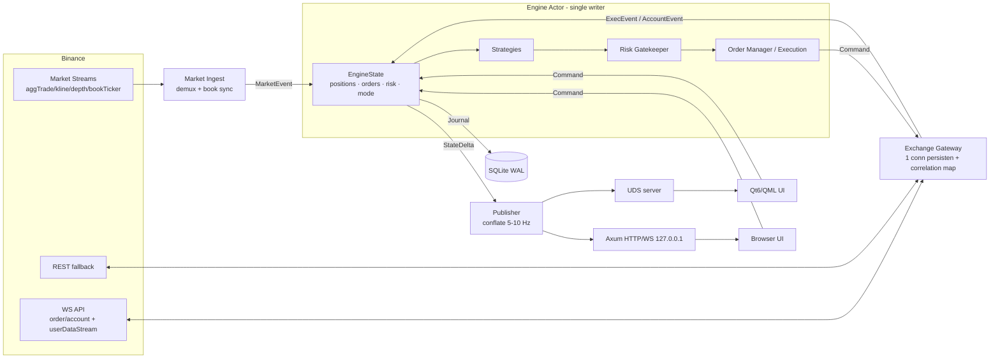

# Blueprint v3.1 — Bot Trading Crypto Binance 24/7 (Rust · Qt6/Plasma 6 · Web) · Spot ⇄ Futures

> **Versi**: 3.1 (menyempurnakan v2; menambah **peralihan venue Spot ⇄ USDⓈ-M Futures**, lihat 3.5, 4.5, 6.4.1, 7.8, 11.6) · **Tanggal**: 2026-11-22 · **Bahasa dokumen**: Indonesia (identifier & kode: Inggris)
> **Audiens utama**: agen coding AI (Claude Code / sejenisnya) + pemilik proyek.
> **Peringatan**: Dokumen ini adalah spesifikasi rekayasa, bukan jaminan profit. Tidak ada strategi di sini yang terbukti menguntungkan pada akun Anda sampai lolos gerbang validasi di Bagian 13.

---

## 0. Aturan Kerja untuk Agen Coding (BACA DULU)

**Prioritas keputusan (urut)**: Keselamatan dana > Kebenaran (correctness) > Kesederhanaan > Performa.

1. **MUST / SHOULD / MAY** mengikuti RFC 2119. Semua `MUST` wajib dipenuhi dan diuji.
2. Tag **`[VERIFY]`** = fakta eksternal (endpoint, kode error, limit, nama field) yang berubah cepat. Agen **MUST** memverifikasi ke dokumentasi resmi (https://developers.binance.com) sebelum menulis kode yang bergantung padanya, lalu mencatat hasilnya di `docs/verified-facts.md`. Jangan mengarang nama field/endpoint.
3. Tag **`[FIXED-v3]`** = perbaikan atas kesalahan/risiko di v2 (lihat Bagian 1).
4. **Jangan pernah** menjalankan order di akun live saat mengembangkan. Urutan lingkungan: unit test → replay/backtest → **Testnet** → **paper (data live, fill simulasi)** → **micro-live**. Default build **MUST** `BOT_MODE=paper`.
5. Aturan kode (ditegakkan CI):
   * `#![forbid(unsafe_code)]` di semua crate kecuali binding Qt (jika ada).
   * `clippy::pedantic` warn, `clippy::unwrap_used`/`expect_used`/`panic`/`indexing_slicing` **deny** di kode non-test.
   * Harga, kuantitas, saldo, PnL **MUST** memakai `rust_decimal::Decimal` (bukan `f64`). `f64` hanya boleh di dalam kalkulator indikator, dikonversi di batas modul.
   * Tidak ada `sleep`/busy-loop untuk menunggu fill: gunakan event + `tokio::select!` + timeout.
   * Rahasia (private key, API key) **MUST NOT** muncul di log, telemetry, error message, atau crash dump. Gunakan newtype `Secret<T>` dengan `Debug` ter-redact.
   * Setiap perubahan perilaku trading **MUST** disertai test (unit/property/replay) dan entri di `CHANGELOG.md`.
6. Perintah verifikasi yang harus lulus sebelum PR/commit besar:
   ```bash
   cargo fmt --all -- --check
   cargo clippy --workspace --all-targets -- -D warnings
   cargo test --workspace
   cargo deny check            # lisensi + advisory
   (cd web-ui && npm ci && npm run check && npm run build)
   cmake -S desktop-ui -B desktop-ui/build -G Ninja && cmake --build desktop-ui/build
   ```
7. Bila spesifikasi ambigu: pilih opsi **paling aman** (menolak trade, bukan memaksa trade), tulis asumsi di `docs/decisions/NNNN-*.md` (ADR singkat), lanjutkan.

---

## 1. Hasil Audit v2 → Perbaikan v3 (Ringkasan)

Hasil review blueprint v2 + riset dokumentasi Binance & literatur (Bagian 15). Item bertanda **KRITIS** dapat menyebabkan kehilangan dana atau bot tidak jalan.

| # | Temuan di v2 | Dampak | Perbaikan v3 |
|---|---|---|---|
| 1 | **KRITIS** — ListenKey keep-alive 30 menit untuk Spot. Mekanisme listenKey Spot **sudah dihapus 2026-02-20**; penggantinya adalah `session.logon` (Ed25519) + `userDataStream.subscribe` di koneksi WS API | Bot tidak menerima event fill/akun | Bagian 4.2: user data via WS API; listenKey hanya untuk Futures bila masih berlaku `[VERIFY]` |
| 2 | **KRITIS** — Order kondisional Futures (STOP_MARKET, TAKE_PROFIT_MARKET, TRAILING_STOP_MARKET, dst.) sudah pindah ke **Algo Service** (error `-4120` bila lewat `/fapi/v1/order`); event baru `ALGO_UPDATE` | SL/TP tidak terpasang | Bagian 4.5 (Futures) memakai `algoOrder` |
| 3 | **KRITIS** — `place_limit_maker_order` membuka koneksi WS baru **per order** dan membaca pesan pertama apa pun | Latensi tinggi, salah-korelasi respons, kena limit koneksi (300/5 menit/IP) | Satu koneksi persisten + peta korelasi `id → oneshot` (4.2) |
| 4 | Koneksi WS API hanya valid **24 jam** — tidak ditangani | Disconnect mendadak | Rotasi proaktif ±23 jam, make-before-break (4.2) |
| 5 | **KRITIS** — `f64` untuk harga/qty/saldo | Galat pembulatan → order ditolak filter / selisih saldo | `Decimal` + newtype + pembulatan filter (3.4) |
| 6 | `sled` sebagai persistence (tidak mencapai rilis stabil, tidak aktif dirawat) | Risiko korupsi/abandon | SQLite WAL (journal event + snapshot) (Bagian 8) |
| 7 | **KRITIS (keamanan)** — UDS di `/tmp`, endpoint `POST /api/panic-flatten` **tanpa autentikasi**, web gateway bind tanpa batas | Siapa pun di host/jaringan bisa menutup posisi / mengendalikan bot | Socket di `/run/binance-bot/`, mode 0660 grup; web bind `127.0.0.1`, token + cek Origin; perintah destruktif butuh konfirmasi (Bagian 10) |
| 8 | Default `UsdsFutures`, short, risiko 1% × 5 posisi searah | Aset kripto berkorelasi tinggi → risiko efektif ≈ 5% per satu gerakan pasar; ada risiko likuidasi | Risiko default 0.5% (Futures 0.35%); batas **portfolio heat** lintas-venue; **Spot dan Futures sama-sama didukung dan dapat berganti mode saat runtime** (3.5); Futures: leverage ≤3×, isolated, buffer likuidasi (7.8) |
| 9 | Strategi 5m tanpa pagar biaya (fee) | Biaya round-trip Spot (≈0.1% per sisi default `[VERIFY]`) bisa lebih besar dari edge | **Cost gate** (target ≥ 3× biaya round-trip), TF default 1h/4h (Bagian 6) |
| 10 | Kelly 0.25× dari win-rate historis **per simbol** | Sampel kecil → estimasi liar → sizing berbahaya | Fixed-fractional default; Kelly hanya sebagai *pengurang* dan butuh n ≥ 100 (7.3) |
| 11 | BTC Crash Guard tanpa kondisi rilis | Bot terkunci selamanya / atau flapping | Histeresis + cooldown (7.5) |
| 12 | Urutan cek lifecycle: SL dicek paling akhir; TP/SL dihitung dari tick lokal | Keterlambatan keluar | SL dicek **pertama**; proteksi selalu **di sisi exchange** (OCO/algo) + watcher software sebagai cadangan (4.4, 5.5) |
| 13 | Order book `@depth@100ms` tanpa prosedur sinkronisasi snapshot/diff | Book korup → OBI salah | Prosedur resmi sinkronisasi + resync otomatis (4.3) |
| 14 | Kode error keliru/tidak terverifikasi (`-4048` untuk reduce-only; `-5022` dipakai untuk Spot) | Handler error salah | Tabel error terverifikasi (Lampiran A); `-5022` hanya Futures GTX; Spot LIMIT_MAKER ditolak sebagai `-2010` `[VERIFY]` |
| 15 | Konfigurasi hanya `.env` flat, semua parameter bisa diubah | Salah ubah risiko saat runtime | `bot.toml` berlapis + validasi; runtime hanya boleh **memperketat** risiko (Bagian 9) |
| 16 | Tidak ada tahap backtest/paper/gerbang rilis | Langsung live tanpa bukti | Pipeline validasi & kriteria lulus numerik (Bagian 13) |
| 17 | Installer berorientasi apt/root, build sebagai root-escalation, blok kode terpecah, bagian 11.1 duplikat, `bot-keygen` tidak ada di tree, rujukan `strategi.md` tidak ada | Gagal dijalankan oleh agen | Installer ulang **CachyOS/Arch-first** (pacman), unit systemd ter-harden, referensi dibersihkan (Bagian 12) |
| 18 | Izin API: Spot+Margin+Futures sekaligus | Permukaan serangan besar | Least privilege: **API key & keypair terpisah per venue**, izin minimum; **withdrawal & transfer antar-wallet MUST dimatikan**; whitelist IP |
| 19 | `bot-keygen` menulis file lalu `chmod` (race izin) | Private key sempat terbaca | Buat file dengan mode `0600` sejak awal (Bagian 12.3) |
| 20 | Throttler UI berbasis tick buta | Frame lama menumpuk / tidak ada conflation | Conflation per-key, `MissedTickBehavior::Skip` (10.4) |
| 21 | Venue dikunci satu nilai di config (Spot **atau** Futures) | Tidak bisa berpindah tanpa restart; risiko state campur antar-venue (simbol sama `BTCUSDT` ada di keduanya) | `VenueManager`: peralihan runtime dengan state machine, isolasi kredensial/state per venue, kunci `(Venue, Symbol)`, risiko lintas-venue (3.5, 7.8) |

---

## 2. Keputusan Arsitektur (ADR Ringkas)

| ID | Keputusan | Alasan | Alternatif |
|---|---|---|---|
| A1 | **Dua venue, satu engine**: Spot dan USDⓈ-M Futures diimplementasikan sebagai `VenueAdapter` yang dikelola `VenueManager`; pengguna dapat **berganti mode Spot ⇄ Futures saat runtime** (3.5). Urutan *build* tetap Spot dulu (M2–M14), Futures menyusul (M15–M16), tetapi seluruh kode inti **MUST** venue-agnostic sejak M0 (kunci `(Venue, Symbol)`) | Permintaan pemilik; isolasi kegagalan per venue; Spot lebih sederhana untuk validasi awal | Dua binary terpisah (ditolak: duplikasi & UI ganda); venue dikunci di config (ditolak: tak bisa berpindah) |
| A1b | Tiap venue **lulus gerbang validasi sendiri** (Bagian 13.3) sebelum live; kelulusan Spot tidak diwarisi Futures, dan Futures-short dinilai terpisah dari Futures-long | Profil risiko berbeda (leverage, likuidasi, funding, short squeeze) | — |
| A2 | Daemon headless Rust (`binance-botd`) = satu-satunya pemilik state trading. UI (Qt & Web) = klien tipis | UI crash tidak boleh mempengaruhi trading | UI in-process (ditolak) |
| A3 | Core **single-writer engine actor** (satu task memiliki `EngineState`), I/O di task terpisah via channel bounded | Tanpa lock pada state; deterministik; mudah di-replay | `Arc<Mutex<State>>` (ditolak) |
| A4 | Auth **Ed25519** + `session.logon` pada WS API | Tanpa signing per-request; syarat user data stream baru | HMAC (deprecated oleh Binance) |
| A5 | WebSocket API = jalur order/akun; WebSocket Streams = data pasar; REST = rekonsiliasi & fallback | Sesuai permintaan | — |
| A6 | SDK resmi `binance-sdk` (crate Rust resmi, fitur `spot`, `derivatives_trading_usds_futures`) **dibungkus** trait `ExchangeGateway`; boleh diganti klien WS tipis sendiri bila semantik reconnect SDK tidak cukup | Isolasi dari perubahan API; testability (mock) | Panggil SDK langsung (ditolak). Pin versi **eksak** setelah `cargo add`; fitur penandatanganan private key mungkin butuh backend TLS OpenSSL `[VERIFY]` |
| A7 | Persistence: **SQLite (WAL)** via `rusqlite` (bundled) — event journal append-only + snapshot | Tahan crash, bisa diaudit, bisa di-replay | `sled` (ditolak), Postgres (berlebihan) |
| A8 | Desktop: **Qt6/QML + Kirigami (KF6)**, kode C++ tipis (`QLocalSocket` → model QML). Opsional: `cxx-qt` bila ingin glue Rust | Native Plasma 6, tray, notifikasi | Electron/Tauri (di luar permintaan) |
| A9 | Web: **SvelteKit (adapter-static) + Svelte 5 + Lightweight Charts**, dilayani Axum dari daemon | Satu artefak deploy | SPA terpisah |
| A10 | Target OS utama: **CachyOS (Arch)**; sekunder: Debian/Ubuntu/Fedora lewat script terpisah | Sesuai lingkungan pemilik | — |
| A11 | Waktu: sinkron NTP (chrony **atau** systemd-timesyncd); bot mengukur offset server dan **pause** bila > 800 ms | Error `-1021` | — |
| A12 | Telemetry & log: `tracing` JSON ke journald; metrics Prometheus opsional (`/metrics` lokal) | Observability 24/7 | — |

---

## 3. Arsitektur Sistem

### 3.1. Proses & Artefak

| Artefak | Jenis | Peran |
|---|---|---|
| `binance-botd` | daemon (systemd) | Engine trading, gateway Binance, IPC (UDS + HTTP/WS lokal) |
| `binance-botctl` | CLI | `keygen`, `config validate`, `status`, `pause/resume`, `panic-flatten`, `replay`, `backtest` |
| `binance-bot-ui` | aplikasi Qt6/QML | Cockpit desktop Plasma 6 |
| `web-ui/build` | static assets | Dashboard web (dilayani oleh `botd`) |

### 3.2. Topologi Task (Tokio)



### 3.3. Kebijakan Channel & Backpressure

| Aliran | Tipe channel | Bila penuh |
|---|---|---|
| Kline **closed**, trade yang dipakai CVD | `mpsc` bounded (4096) | **Jangan drop**; bila penuh >1 s → alarm + `PAUSED` |
| Order book diff | per-simbol `watch`/conflation (simpan keadaan terbaru) | Drop perantara, simpan terbaru |
| Event user data (fill/akun/algo) | `mpsc` bounded (4096) | **Jangan drop**; bila penuh → `HALTED` + alarm (kehilangan fill = state korup) |
| Command UI → engine | `mpsc` bounded (64) | Tolak dengan error `busy` |
| Telemetry → UI | `watch` + timer 5–10 Hz | Conflation, kirim yang terbaru |

### 3.4. Tipe Domain Inti (`bot-types`) `[FIXED-v3]`

```rust
use rust_decimal::Decimal;
use serde::{Deserialize, Serialize};
use time::OffsetDateTime;
use uuid::Uuid;

#[derive(Debug, Clone, PartialEq, Eq, Hash, PartialOrd, Ord, Serialize, Deserialize)]
pub struct Symbol(pub String);                       // "BTCUSDT"
#[derive(Debug, Clone, Copy, PartialEq, Eq, PartialOrd, Ord, Serialize, Deserialize)]
pub struct Price(pub Decimal);
#[derive(Debug, Clone, Copy, PartialEq, Eq, PartialOrd, Ord, Serialize, Deserialize)]
pub struct Qty(pub Decimal);

#[derive(Debug, Clone, Copy, PartialEq, Eq, Serialize, Deserialize)]
pub enum Venue { Spot, UsdsFutures }                 // keduanya didukung; aktif via VenueManager (3.5)
#[derive(Debug, Clone, Copy, PartialEq, Eq, Serialize, Deserialize)]
pub enum Side { Buy, Sell }
#[derive(Debug, Clone, Copy, PartialEq, Eq, Serialize, Deserialize)]
pub enum Direction { Long, Short }                   // Spot: hanya Long; Futures: Long & Short

/// Filter simbol dari exchangeInfo (di-cache, refresh berkala & saat error filter).
#[derive(Debug, Clone, Serialize, Deserialize)]
pub struct InstrumentRules {
    pub symbol: Symbol,
    pub tick_size: Decimal,
    pub step_size: Decimal,
    pub min_qty: Decimal,
    pub max_qty: Decimal,
    pub min_notional: Decimal,          // filter NOTIONAL / MIN_NOTIONAL [VERIFY nama filter]
    pub status_trading: bool,           // status == TRADING
    pub base_precision: u32,
    pub quote_precision: u32,
}

#[derive(Debug, Clone, Serialize, Deserialize)]
pub struct Kline {
    pub open_time_ms: i64, pub close_time_ms: i64,
    pub open: f64, pub high: f64, pub low: f64, pub close: f64,   // f64 hanya utk indikator
    pub volume: f64, pub quote_volume: f64, pub trades: u64,
    pub taker_buy_base: f64, pub is_closed: bool,
}

#[derive(Debug, Clone, Copy, PartialEq, Eq, Serialize, Deserialize)]
pub enum OrderStatus { PendingNew, New, PartiallyFilled, Filled, Canceled, Rejected, Expired, UnknownNeedsQuery }

#[derive(Debug, Clone, Serialize, Deserialize)]
pub struct Order {
    pub venue: Venue,                    // WAJIB: simbol sama ada di kedua venue → kunci unik = (venue, client_id)
    pub client_id: String,               // ^[A-Za-z0-9_-]{1,36}$ ; lihat 5.2 untuk format
    pub exchange_id: Option<i64>,
    pub symbol: Symbol, pub side: Side, pub kind: OrderKind,
    pub price: Option<Price>, pub qty: Qty, pub filled_qty: Qty,
    pub avg_fill_price: Option<Price>,
    pub status: OrderStatus,
    pub position_id: Option<Uuid>, pub purpose: OrderPurpose,
    pub created_at: OffsetDateTime, pub updated_at: OffsetDateTime,
}
#[derive(Debug, Clone, Copy, PartialEq, Eq, Serialize, Deserialize)]
pub enum OrderKind { LimitMaker, Limit, Market, StopLossLimit, TakeProfitLimit, OcoLeg }
#[derive(Debug, Clone, Copy, PartialEq, Eq, Serialize, Deserialize)]
pub enum OrderPurpose { Entry, ProtectStop, TakeProfit1, TakeProfit2, EmergencyExit, ManualFlatten }

/// Posisi. `r_distance` = |entry - stop_awal| dalam satuan harga (1R).
#[derive(Debug, Clone, Serialize, Deserialize)]
pub struct Position {
    pub id: Uuid, pub symbol: Symbol, pub venue: Venue, pub direction: Direction,
    pub strategy: StrategyId,
    pub entry_price: Price, pub qty_initial: Qty, pub qty_open: Qty,
    pub r_distance: Decimal,
    pub leverage: Option<u32>,           // hanya Futures
    pub liq_price: Option<Price>,        // hanya Futures (diperbarui dari event akun/positionRisk)
    pub stop_price: Price, pub tp1_price: Price, pub tp2_price: Option<Price>,
    pub best_price: Price,               // high-water mark (Long) / low-water (Short)
    pub tp1_done: bool, pub breakeven_done: bool,
    pub fees_paid_quote: Decimal, pub realized_pnl_quote: Decimal,
    pub state: PositionState,
    pub opened_at: OffsetDateTime,
}
#[derive(Debug, Clone, Copy, PartialEq, Eq, Serialize, Deserialize)]
pub enum PositionState { EntryPending, EntryPartial, OpenProtected, OpenUnprotected, ExitPending, Closed, Orphaned }

#[derive(Debug, Clone, Copy, PartialEq, Eq, Hash, Serialize, Deserialize)]
pub enum StrategyId { TrendPullback, Breakout, GainersMomentum, VwapReversion }

#[derive(Debug, Clone, Copy, PartialEq, Eq, Serialize, Deserialize)]
pub enum EngineMode { Starting, Syncing, Ready, Paused, ReduceOnly, Halted, Killed }
```

### 3.5. Mode Venue: Spot ⇄ Futures & Peralihan (`bot-venue`) `[NEW-v3.1]`

**Dimensi ortogonal**: `venue` (Spot/Futures) × `mode` (paper/testnet/live). Contoh: *Futures + testnet*, *Spot + live*. Matriks lengkap harus bisa dipilih tanpa rekompilasi (feature flag `futures` hanya untuk mengecilkan binary, default **aktif**).

```rust
#[derive(Debug, Clone, Copy, PartialEq, Eq, Hash, Serialize, Deserialize)]
pub struct InstrumentKey { pub venue: Venue, pub symbol: Symbol }   // JANGAN pernah memakai Symbol saja sebagai kunci

#[derive(Debug, Clone, Copy, PartialEq, Eq, Serialize, Deserialize)]
pub enum VenueState { Disabled, Activating, Active, Draining }

#[derive(Debug, Clone, Copy, PartialEq, Eq, Serialize, Deserialize)]
pub enum ProtectionScheme { DualOco, AlgoReduceOnly }               // Spot vs Futures (4.4 / 4.5)

#[derive(Debug, Clone, Copy)]
pub struct VenueCaps { pub can_short: bool, pub max_leverage: u32, pub has_funding: bool, pub protection: ProtectionScheme }

#[async_trait::async_trait]
pub trait VenueAdapter: Send + Sync {            // satu implementasi: SpotAdapter, FuturesAdapter (+ PaperAdapter membungkus keduanya)
    fn venue(&self) -> Venue;
    fn caps(&self) -> VenueCaps;
    async fn activate(&self) -> Result<ActivationReport, GatewayError>;   // connect, logon, subscribe, exchangeInfo, setup (Futures: margin/leverage/position mode)
    async fn deactivate(&self) -> Result<(), GatewayError>;               // tutup sesi bersih (TIDAK membatalkan proteksi)
    // + seluruh metode ExchangeGateway (place/cancel/cancel_replace/protect/open_orders/account_snapshot/exchange_info)
}
// Strategy menyatakan kapabilitas: fn supports(&self, caps: &VenueCaps, dir: Direction) -> bool
```

**Mode `venue_mode`**: `spot` | `futures` (peralihan antar keduanya saat runtime). `dual` (keduanya aktif bersamaan) **bukan** bagian MVP — disiapkan oleh desain (kunci `(Venue,Symbol)`, anggaran lintas-venue) tetapi baru dibuka di M17.

**State machine per venue**
```text
Disabled ──switch/start──▶ Activating ──(sesi+sync+rekonsiliasi OK)──▶ Active
Active ──switch away──▶ Draining ──(posisi flat atau policy selesai)──▶ Disabled
Activating ──gagal──▶ Disabled (rollback, alarm)
```
`Draining` = **tanpa entry baru**; lifecycle posisi, proteksi, rekonsiliasi, dan user-data stream tetap berjalan sampai posisi venue itu habis.

**Prosedur `switch_venue(target, on_open_positions, confirm_nonce)`** (**MUST** atomik terhadap state engine):
1. **Prasyarat** (semua wajib; bila gagal → tolak + alasan jelas):
   * `EngineMode ∈ {Ready, Paused}`. Ditolak saat `Halted`/`Killed` (peralihan **tidak boleh** dipakai untuk menghindari halt: circuit breaker bersifat **global**).
   * Target `enabled`, kredensial valid, dan (bila `mode=live`) `live_confirmation_file` venue target ada.
   * Cooldown ≥ `switch_cooldown_s` (60) sejak peralihan terakhir; ≤ `max_switches_per_day` (3).
   * Tidak sedang dalam `Syncing`/rekonsiliasi.
2. Venue lama → entry dihentikan (`Paused` untuk venue itu); **batalkan order entry yang belum terisi**; proteksi (OCO/algo) **dipertahankan**.
3. Terapkan `on_open_positions` (default `keep_managing`):
   * `keep_managing`: venue lama → `Draining`; engine terus mengelola posisi sampai flat.
   * `require_flat`: tolak peralihan bila masih ada posisi terbuka di venue lama.
   * `flatten`: tutup semua posisi venue lama (market/IOC reduce-only) lalu `Disabled`; **wajib** nonce konfirmasi (hold-to-confirm).
4. Venue target → `Activating` → `activate()` → rekonsiliasi per-venue (8.3) → `Active`. Entry baru hanya setelah `Active`.
5. **Rollback**: bila langkah 4 gagal → target `Disabled`; venue lama dikembalikan `Active` (jika belum `Disabled`); engine `Paused`; alarm; tidak ada keadaan setengah-jadi.
6. Journal `VenueSwitched{from,to,policy,actor}`; broadcast `event` ke UI; catat di `docs`/audit.

**Terisolasi per venue**: kredensial & keypair, sesi WS (API + stream), cache `exchangeInfo`/rules, rate limit (Spot `/api` dan Futures `/fapi` memiliki bobot terpisah), reconciler, skema proteksi, universe, cooldown per `(venue,symbol)`, daftar strategi yang aktif, parameter risiko override, model biaya.

**Bersama (global lintas-venue)**: circuit breaker harian/mingguan/drawdown dihitung dari **equity gabungan (USD)**; `portfolio_heat` gabungan; BTC Crash/Spike Guard (data pasar BTC dipakai bersama); jurnal & audit; kill-switch (`Killed` menghentikan **semua** venue). Aturan `cross_venue_same_symbol = "block_opposite"` (default): dilarang membuka arah berlawanan pada simbol dasar yang sama di venue lain (mencegah self-hedge tak sengaja & pemborosan fee).

**Dana**: bot **MUST NOT** memindahkan dana antar-wallet (izin *Universal Transfer* off). Pengguna mendanai Spot dan Futures sendiri. Equity untuk sizing venue = `min(equity_venue, capital_allocation_usd)` bila `capital_allocation_usd > 0`.

**Kompatibilitas ID**: `clientOrderId` memuat huruf venue (5.2); tabel DB memuat kolom `venue` (Bagian 8); event IPC memuat `venue`; UI selalu menampilkan venue pada setiap baris posisi/order.

---

## 4. Konektivitas Binance (`bot-exchange`)

### 4.1. Endpoint & Autentikasi

| Fungsi | Spot | USDⓈ-M Futures |
|---|---|---|
| WS API (order/akun) | `wss://ws-api.binance.com:443/ws-api/v3` (alternatif port 9443) | `wss://ws-fapi.binance.com/ws-fapi/v1` `[VERIFY]` |
| Market streams | `wss://stream.binance.com:9443` (`/ws`, `/stream?streams=`) | `wss://fstream.binance.com` `[VERIFY]` |
| REST | `https://api.binance.com` | `https://fapi.binance.com` |
| Testnet WS API | `wss://ws-api.testnet.binance.vision/ws-api/v3` | `wss://testnet.binancefuture.com/ws-fapi/v1` `[VERIFY]` |
| Testnet REST | `https://testnet.binance.vision` | `https://testnet.binancefuture.com` |

* Auth: **Ed25519** (PKCS#8 PEM). Pada WS API kirim `session.logon` sekali per koneksi; request berikutnya tidak perlu `apiKey`/`signature` per-request. Kirim ulang `session.logon` setiap reconnect.
* Setiap request WS API wajib `id` unik (UUID v7) — dipakai peta korelasi.
* Batas dasar `[VERIFY]` — **jangan di-hardcode**, baca `rateLimits` dari `exchangeInfo` saat start dan dari field `rateLimits` di setiap respons:
  * Koneksi baru: 300 per 5 menit per IP.
  * `REQUEST_WEIGHT` per menit per IP (dibagi semua koneksi), `ORDERS` per 10 detik dan per hari per akun.
  * 429 = back-off; 418 = IP ban (2 menit s/d 3 hari, bertingkat). Respons error membawa `retryAfter`.
  * Respons **5xx tidak berarti order gagal** → status order = `UnknownNeedsQuery`, tanya ulang via `clientOrderId` (5.3).

### 4.2. Manajemen Sesi WS API `[FIXED-v3]`

```text
STATE: Disconnected → Connecting → LoggingOn → Subscribing → Ready → Draining → Disconnected
```

Persyaratan:
1. **MUST** satu koneksi persisten; `Gateway::request()` menyimpan `HashMap<RequestId, oneshot::Sender<Response>>`; task pembaca mengirim respons ke pengirim yang sesuai; request timeout default 10 s (batas server 10 s) → `UnknownNeedsQuery` untuk order.
2. Setelah `Ready`: panggil `userDataStream.subscribe` (butuh sesi ter-logon Ed25519). Event (`executionReport`, `outboundAccountPosition`, `balanceUpdate`, `listStatus`, dsb. `[VERIFY]`) mengalir pada koneksi yang sama.
3. **Rotasi 24 jam**: pada umur koneksi ≈ 23 j (jitter ±10 mnt), buka koneksi B → logon → subscribe → lakukan `Ready`; arahkan request baru ke B; tunggu request in-flight di A selesai (maks 5 s); tutup A. Dedup event user-data berdasarkan `(orderId, tradeId)` selama overlap.
4. Tangani frame `ping` server (balas `pong` segera; payload kosong). Watchdog: bila tidak ada frame apa pun selama `stale_ms` (default 1500 ms untuk market stream; 60 s untuk WS API) → anggap basi, reconnect.
5. Tangani event `serverShutdown`: segera buka koneksi baru (make-before-break).
6. Reconnect backoff: eksponensial 250 ms → 30 s dengan full jitter; hormati `retryAfter`; setelah reconnect, **MUST** menjalankan **rekonsiliasi** (8.3) sebelum mengizinkan entry baru.
7. Selama `Syncing`/reconnect: `EngineMode::Paused` (tidak ada entry; exit/proteksi yang sudah ada di exchange tetap berlaku).

Futures: listenKey (`POST /fapi/v1/listenKey`, keepalive tiap ≤30 menit, event `listenKeyExpired`) masih dipakai **bila** dokumentasi Futures saat implementasi belum menggantinya `[VERIFY]`.

### 4.3. Data Pasar & Sinkronisasi Order Book `[FIXED-v3]`

Stream per simbol universe (maks ~20 simbol aktif; hormati batas 1024 stream/koneksi dan 5 pesan/detik kontrol):

| Stream | Pemakaian | Catatan |
|---|---|---|
| `<s>@kline_1h`, `<s>@kline_4h` (+`@kline_15m` untuk scanner) | Sinyal | Hanya `x=true` (closed) memicu sinyal; bar berjalan untuk exit/ATR trailing |
| `<s>@aggTrade` | CVD, VWAP intrabar | Opsional di MVP |
| `<s>@bookTicker` | Spread & harga eksekusi | Murah; dipakai untuk gate spread |
| `<s>@depth@100ms` (atau `@depth20@100ms`) | OBI | Hanya simbol yang sedang diperiksa / posisi terbuka; perlu sinkronisasi |
| `!miniTicker@arr` | Scanner gainers | `!ticker@arr` sudah dideprekasi → gunakan `!miniTicker@arr` atau `<s>@miniTicker` `[VERIFY]` |

**Prosedur sinkronisasi order book lokal (Spot)** `[VERIFY terhadap dokumen "How to manage a local order book correctly"]`:
1. Buka `@depth` stream; **buffer** event.
2. Ambil snapshot (`depth` WS API/REST, limit 1000; hemat weight — hanya untuk simbol aktif).
3. Buang event dengan `u <= lastUpdateId`.
4. Event pertama yang dipakai harus memenuhi `U <= lastUpdateId+1 <= u`; bila tidak → ambil snapshot ulang.
5. Terapkan event berurutan; tiap event baru harus punya `U == u_sebelumnya + 1`. **Gap → tandai book `Invalid`, jangan hitung OBI, resync.**
6. Kuantitas `0` = hapus level.
(Futures memakai field `pu` — `pu == u_sebelumnya`.)

Kalkulasi mikro-struktur (opsional sebagai *filter lembut*, bukan pemicu):
* `OBI_n = (ΣbidQty_topN − ΣaskQty_topN) / (ΣbidQty_topN + ΣaskQty_topN)`, N=10, di-smoothing EMA 30 detik. OBI mudah dimanipulasi (spoofing) → tidak boleh jadi satu-satunya alasan entry.
* `spread_bps = (ask − bid)/mid × 10⁴`.

### 4.4. Jenis Order & Proteksi

**Spot** `[VERIFY semua nama method/parameter]`:

| Kebutuhan | Method WS API | Catatan |
|---|---|---|
| Entry pasif | `order.place` `type=LIMIT_MAKER` | Ditolak bila langsung match (kode `-2010`) → hitung ulang di tick berikut |
| Entry mendesak / exit darurat | `order.place` `type=MARKET` atau `LIMIT`+`IOC` | Selalu pakai `quoteOrderQty`/`quantity` yang sudah dibulatkan filter |
| Batalkan | `order.cancel` (by `origClientOrderId`) | |
| Ganti harga tanpa celah | `order.cancelReplace` | Dipakai untuk "chasing" entry |
| Proteksi (TP+SL bersamaan) | `orderList.place.oco` (atau `orderList.place` generik) | Satu list mengunci qty; SL = `STOP_LOSS_LIMIT` (+ offset limit), TP = `LIMIT_MAKER`. OCO mendukung `…TrailingDelta` untuk trailing sisi-server `[VERIFY]` |
| Entry + proteksi atomik | `orderList.place.otoco` | Opsi lanjutan; bila dipakai, tangani `listStatus` event |

**Tata letak proteksi "Dual-OCO"** (mendukung TP1 parsial + runner di Spot, karena qty yang sama tidak bisa dikunci dua order terpisah):
* Setelah entry terisi (qty Q): buat **OCO-A** (qty = Q×`tp1_ratio`, TP = TP1, SL = stop) dan **OCO-B** (qty = Q − A, TP = TP2 jauh / tidak ada, SL = stop).
* Saat TP1 (OCO-A) terisi → batalkan & buat ulang OCO-B dengan SL = break-even (+buffer fee).
* Trailing runner: ratchet **hanya bila** stop baru ≥ stop lama + `0.25×ATR` (kurangi churn & rate limit) → `cancel list` lalu `place` OCO baru. Ada celah tak-terlindungi (puluhan ms): mitigasi = watcher software `HardStopWatcher` (menjual MARKET bila harga ≤ stop saat OCO belum aktif) dan/atau `belowTrailingDelta` server-side.
* Setiap perubahan proteksi **MUST** tercatat di journal sebelum dikirim.

**Futures**: rincian lengkap (setup akun, order, proteksi, funding, likuidasi) ada di **4.5**.

### 4.5. Spesifikasi Venue Futures (USDⓈ-M Perpetual) `[NEW-v3.1]` — semua `[VERIFY]` ke dokumen resmi

**Universe Futures**: `contractType == PERPETUAL`, quote USDT, `status == TRADING`, usia listing ≥ 30 hari, `quoteVolume24h ≥ 100 juta USD` (konfig), spread ≤ 4 bps. Kontrak delivery & simbol baru dikecualikan.

**Setup akun saat `Activating`** (hanya bila **flat** dan tanpa order terbuka pada simbol terkait; urutan idempoten, hasil dicatat):
| Item | Nilai wajib | Catatan |
|---|---|---|
| Position mode | **One-way** (bukan hedge) | Baca mode saat ini; bila berbeda & ada posisi → **batalkan aktivasi** (jangan paksa) |
| Margin type | **ISOLATED** per simbol | Mengubah margin type ditolak bila ada posisi/order terbuka → lakukan hanya saat flat |
| Leverage | `min(max_leverage, bracket_max)` (default 3) | Set per simbol sebelum entry pertama; **jangan** dinaikkan runtime (tighten-only) |
| Multi-Assets Mode | **Off** | Bila On → tolak aktivasi + alarm |
| Izin API | Reading + Futures; **tanpa** withdrawal/transfer | Key khusus Futures |

**Data pasar**: `@markPrice@1s` (mark, funding rate, waktu funding berikutnya), `@kline_*`, `@bookTicker`, `@depth@100ms` (sinkronisasi via `pu`, lihat 4.3). Harga untuk **stop/likuidasi = mark price**; harga untuk fill = last/book.

**User data** (listenKey bila masih berlaku `[VERIFY]`): `ORDER_TRADE_UPDATE`, `ACCOUNT_UPDATE` (saldo + posisi), **`ALGO_UPDATE`** (order kondisional), `MARGIN_CALL`, `ACCOUNT_CONFIG_UPDATE`, `listenKeyExpired`.

**Order**
* Entry: `LIMIT` `timeInForce=GTX` (post-only; penolakan = kode `-5022`) untuk jalur pasif; `MARKET` hanya untuk darurat. `positionSide=BOTH`, `newClientOrderId` (5.2).
* **Proteksi = order kondisional via Algo Service** (`algoType=CONDITIONAL`): 
  * SL: `STOP_MARKET`, `closePosition=true`, `workingType=MARK_PRICE`, `priceProtect=true`.
  * TP1: `TAKE_PROFIT_MARKET` dengan `quantity = Q×tp1_ratio` + `reduceOnly=true` (tidak boleh digabung `closePosition`).
  * TP2/trailing runner: `TAKE_PROFIT_MARKET` reduce-only **atau** `TRAILING_STOP_MARKET` (`callbackRate`, `activationPrice`) bila trailing sisi-server dipilih; selain itu trailing software (5.5).
  * Berbeda dari Spot, Futures **tidak mengunci saldo** per order → tidak perlu *Dual-OCO*. Penggeseran stop (BE/trailing) memakai **make-before-break**: pasang SL baru → tunggu `ALGO_UPDATE` `NEW` → batalkan SL lama (tanpa celah tak-terlindungi) `[VERIFY aturan duplikasi closePosition]`.
* Jumlah semua `reduceOnly` ≤ posisi terbuka; setelah TP1 terisi, sinkronkan ulang qty TP2.
* Dead-man: `countdownCancelAll` hanya untuk **order entry** yang menggantung (bukan proteksi) `[VERIFY]`.

**Biaya & funding**: fee default maker ≈0.02% / taker ≈0.05% `[VERIFY via commissionRate]`. **Cost gate Futures** (6.5) ditambah `expected_funding_cost = funding_rate_sisi_membayar × (max_bars_in_trade × tf_jam / 8)`; entry **diblok** bila funding merugikan > `funding_adverse_block_pct` (0.03%/8 jam) atau ≤ 10 menit sebelum settlement funding yang merugikan.

**Likuidasi & margin** (aturan keras — detail di 7.8): perkiraan harga likuidasi isolated dihitung saat entry dan diperbarui dari `ACCOUNT_UPDATE`/`positionRisk`; entry ditolak bila `|entry − liq| < liq_buffer_mult × |entry − stop|` (default 3×). Pantau juga `MARGIN_CALL`, kuantil ADL, dan divergensi mark↔last > 0.5% (pause entry simbol).

**Rate limit Futures** terpisah dari Spot: baca dari `exchangeInfo` Futures & header/field respons; tracker weight per-venue.

---

## 5. Eksekusi & Order Management (`bot-exec`)

### 5.1. Prinsip
1. **Journal-first**: setiap niat (intent) → catat event `OrderIntended` ke SQLite **sebelum** kirim ke exchange.
2. **Idempoten**: `clientOrderId` deterministik; retry memakai id yang sama.
3. **Source of truth**: exchange (via user data stream + rekonsiliasi), bukan memori lokal.
4. Event-driven: tidak ada polling-sleep. Timeout via `tokio::time::timeout` / `sleep_until` di dalam `select!`.

### 5.2. Format `clientOrderId`
`{bot}{run}{venue}-{seq}-{purpose}` dengan `venue ∈ {S,F}` mis. `b01r7S-000123-ENT` / `b01r7F-000124-SL` (≤36 karakter, regex `^[A-Za-z0-9_-]{1,36}$`). `run` = id jalan daemon (naik tiap start), `seq` = counter persisten di SQLite. Parsing id mengembalikan `position_id` via tabel `orders`.

### 5.3. Mesin Status Order

```text
PendingNew --ack--> New --partial--> PartiallyFilled --fill--> Filled
PendingNew --timeout/5xx--> UnknownNeedsQuery --query ketemu--> (status dari exchange)
                                           \--query tidak ada setelah 3 percobaan--> Rejected(Lost)
New|PartiallyFilled --cancel ack--> Canceled      New --expire--> Expired
* --reject--> Rejected
```
Aturan: event fill **MUST** diproses idempoten (kunci `tradeId`); `filled_qty` hanya naik; fee dicatat dari event (`commission`, `commissionAsset`) — bila fee dibayar dengan BNB/aset lain, konversi ke quote untuk PnL.

### 5.4. Algoritma Entry Pasif dengan Chasing Terbatas `[FIXED-v3]`

```text
ENTRY(intent):  # intent berisi symbol, qty (sudah lolos Risk), limit_price_max, ttl_ms, max_replaces
  price = best_bid (Long)                       # dari bookTicker lokal (fresh < 500 ms)
  place LIMIT_MAKER(price, qty, cid)
  loop select!:
     fill event        -> akumulasi; bila Filled -> on_entry_filled(); break
     bookTicker update -> bila best_bid naik & |price - best_bid| ≥ 1 tick & replaces < max_replaces
                          & best_bid ≤ limit_price_max -> cancelReplace ke best_bid
     reject(-2010)     -> tunggu update book berikutnya (bukan sleep) lalu ulangi
     timeout ttl_ms    -> cancel; bila partial -> pakai qty terisi saja
  KEBIJAKAN: jangan mengejar melewati limit_price_max (slippage cap). Trade terlewat = OK.
```
* Exit stop-loss **tidak pernah** pasif: selalu market/IOC (atau OCO stop yang sudah di exchange).
* Exit TP boleh pasif (LIMIT_MAKER) — sudah bagian OCO.
* Partial fill entry < `min_viable_fill` (mis. < 30% qty) → batalkan sisa & tutup sisa posisi bila notional < `min_notional` tidak bisa dijual → catat sebagai *dust*.

### 5.5. Siklus Hidup Posisi (dievaluasi setiap tick harga & tiap kline close)

Urutan evaluasi `[FIXED-v3]` (keselamatan dulu):
1. **Cek proteksi**: apakah OCO/algo masih ada di exchange? Bila tidak (mis. dibatalkan manual) → `OpenUnprotected` → pasang ulang proteksi segera; bila gagal 2× → `EmergencyExit` market.
2. **Hard stop watcher**: bila harga menembus `stop_price` dan proteksi exchange belum terisi dalam `hard_stop_grace_ms` (default 1500) → market exit.
3. Update `best_price` (high-water mark) → journal hanya bila berubah ≥ 0.1 ATR.
4. `profit_R = (price − entry)/r_distance` (Long).
5. **Break-even**: bila `profit_R ≥ be_trigger_R` (default 1.0) → SL = entry + `fee_buffer` (= 2×taker_fee_bps×entry + 1 tick).
6. **Trailing monoton** bila `profit_R ≥ trail_activate_R` (default 1.5): `stop = best_price − k×ATR` (k default 3.0; chandelier), ratchet satu arah.
7. **Pengetatan kelelahan momentum**: bila `RSI(14) ≥ 78` (Long) dan `profit_R ≥ 2` → `k = k × 0.7`.
8. **TP1** (default 1.5R, tutup 50%) dan **TP2** (default 3R) — dieksekusi oleh order di exchange; software hanya menyinkronkan state dari event.
9. **Time stop**: posisi tanpa progres (`|profit_R| < 0.3`) setelah `max_bars_in_trade` (default 48 bar 1h) → exit.
10. Semua exit → laporan PnL (gross, fee, net, R-multiple) ke journal & UI.

---

## 6. Strategi Trading (`bot-strategy`)

### 6.1. Kesimpulan Riset (mengubah desain)

| Temuan | Implikasi desain |
|---|---|
| Momentum/trend di kripto punya dukungan empiris (mis. faktor trend CTREND, JFQA 2025; Liu–Tsyvinski–Wu; Borri), **tetapi** hasil tidak konsisten antar sampel; satu studi menemukan **satu outlier = 37% total return** momentum, dan efek terutama di aset kapitalisasi besar | Universe = aset **likuid** besar; ekspektasi realistis; jangan bergantung pada beberapa trade lucky; kurangi ekor kiri |
| *Momentum crash* terjadi di kripto; **volatility-managed** momentum mengurangi crash | **Vol targeting** pada sizing (6.5) |
| Parameter trend-following kripto **tidak stabil**: Sharpe optimal in-sample pada 1 tahun tidak memprediksi tahun berikutnya; permukaan parameter berlonjak | Sedikit parameter, rentang lebar, **walk-forward**, uji kestabilan lingkungan parameter, bukan mencari satu "angka ajaib" |
| Klaim backtest bagus sering runtuh di walk-forward ketat; koreksi look-ahead/settlement menurunkan Sharpe signifikan | Replay tanpa look-ahead (hanya bar closed), biaya & slippage realistis, paper trading wajib |
| Biaya transaksi Spot (≈0.1%/sisi default VIP0 `[VERIFY via account.commission]`) memakan edge timeframe pendek | **Cost gate** & TF default 1h/4h |

### 6.2. Universe & Penyaringan

* Spot, quote `USDT` (opsi `USDC`/`FDUSD`), `status == TRADING`.
* Core universe: `quoteVolume24h ≥ 50 juta USD` (konfig), spread median ≤ 5 bps, usia listing ≥ 90 hari. Scanner gainers: `≥ 10 juta USD`, spread ≤ 15 bps, usia ≥ 14 hari.
* Eksklusi: token leverage (UP/DOWN/BULL/BEAR), stablecoin vs stablecoin, simbol bertanda monitoring/seed `[VERIFY sumber penanda di exchangeInfo/pengumuman]`, simbol `CANCEL_ONLY`/break.
* Refresh universe tiap 15 menit; simbol keluar universe tidak boleh dibuka baru tetapi posisi yang ada tetap dikelola.

### 6.3. Indikator (spesifikasi tegas — agar tidak ambigu)

| Indikator | Definisi |
|---|---|
| EMA(n) | α=2/(n+1); seed = SMA n bar pertama; **warm-up ≥ 3n bar** (EMA200 butuh ≥ 600 bar) |
| RSI(14) | **Wilder smoothing** (α=1/14), bukan SMA |
| ATR(14) | Wilder smoothing atas True Range |
| ADX(14), +DI, −DI | Wilder (DM+, DM−, TR smoothing 14; ADX = Wilder-smoothed DX) |
| Donchian(n) | highest high / lowest low **n bar sebelumnya** (tidak termasuk bar sinyal) |
| VWAP sesi | Reset 00:00 UTC; Σ(typical×vol)/Σvol |
| Volume SMA(20) | SMA volume 20 bar closed |

Semua indikator **MUST** inkremental (`update(bar)` O(1)), dites terhadap nilai referensi (fixture dari TA-Lib/pandas-ta untuk dataset tetap, toleransi 1e-6). Tidak boleh ada look-ahead: sinyal hanya dihitung pada bar **closed**; bar HTF yang dipakai juga harus closed.

### 6.4. Profil Strategi

**Kerangka**: `trait Strategy { fn on_bar_close(&mut self, ctx:&Ctx) -> Option<EntryIntent>; }` — strategi **tidak** mengukur ukuran posisi dan tidak kirim order; hanya mengusulkan `EntryIntent{symbol, direction, entry_ref, stop, tp1, tp2, atr, strategy, rationale}`. Risk Gatekeeper yang memutuskan.

**S1 — Trend-Pullback** (profil utama, TF sinyal 1h, HTF 4h)
* Rezim HTF (4h, bar closed): `close > EMA50` dan `EMA50` naik (slope > 0 selama 3 bar).
* Tren 1h: `EMA21 > EMA55` dan `close > EMA200`.
* Pullback: dalam 3 bar terakhir `low ≤ EMA21 + 0.1×ATR` dan bar sinyal **close kembali > EMA21** (penolakan), `close ≤ EMA9 + 0.5×ATR` (tidak overextended).
* Momentum: `RSI ∈ [40, 62]` dan `RSI > RSI[1]`; `ADX ≥ 20` dan `+DI > −DI`.
* Volume: `vol ≥ 0.8×SMA20`.
* Anti-overextension: `|close − EMA21| ≤ 1.5×ATR`.
* Filter lembut (opsional, bisa dimatikan): `OBI_smooth ≥ +0.05`.
* Stop awal: `min(low 5 bar terakhir, entry − 1.5×ATR) − 0.1×ATR`. TP1 = 1.5R, TP2 = 3R.

**S2 — Breakout** (TF 1h, HTF 4h)
* `close > Donchian(20).upper`, `vol ≥ 1.5×SMA20`, `ADX ≥ 18` dan naik, `RSI ∈ [52, 75]`, HTF searah, `close − EMA21 ≤ 2.5×ATR`.
* Stop: `Donchian mid` atau `entry − 2×ATR` (yang lebih dekat tetapi ≥ 1×ATR). Trailing: lower Donchian(10) atau chandelier.

**S3 — Gainers Momentum Scanner** (hipotesis eksperimental; **shadow dulu**)
* Tiap 5 menit hitung skor = z(return 24h, di-cap) + z(return 4h) + z(rasio volume 1h/rata-rata 24h) di antara simbol lolos filter likuiditas.
* Kandidat = top K=5. Entry hanya bila: return 24h **antara +5% dan +25%** (di atas itu = risiko blow-off/pump-and-dump → tolak), harga > VWAP dan > EMA21 (15m), pullback ke VWAP/EMA21 dengan `RSI(14,15m) ∈ [45, 65]`, spread ≤ 15 bps, BTC regime OK.
* Ukuran = **0.5×** risiko normal; maks 2 posisi scanner; stop 1.2–1.5×ATR(15m); **time stop 24 jam**; cooldown per simbol 6 jam setelah rugi.

**S4 — VWAP Reversion** — `enabled=false` default; hanya jalan **shadow**. Mean reversion melawan tren kuat berisiko tinggi; aktifkan hanya bila shadow ≥ 200 trade menunjukkan expectancy positif setelah biaya. Syarat: `ADX < max(adx_min+12, 38)`, deviasi VWAP ≥ 1.1×ATR, RSI ekstrem + slope berbalik.

### 6.4.1. Sisi Short & Kapabilitas Venue `[NEW-v3.1]`

* Tiap strategi mengimplementasikan `supports(caps, dir)`. **Spot ⇒ hanya Long.** **Futures ⇒ Long dan Short**, masing-masing dapat di-enable terpisah (`[strategy.*].allow_short`) dan **dinilai gerbang sendiri** (13.3).
* Rumus Short = **cermin** Long: `profit_R = (entry − price)/r_distance`; `best_price` = low-water mark; stop ratchet **turun** saja; BE = `entry − fee_buffer`; trailing = `best_price + k×ATR`; TP di bawah entry.
* **S1 Short**: HTF 4h `close < EMA50` & EMA50 turun; 1h `EMA21 < EMA55` & `close < EMA200`; pullback `high ≥ EMA21 − 0.1×ATR` dalam 3 bar dan close kembali **< EMA21**; `RSI ∈ [38, 60]` & turun; `ADX ≥ 20`, `−DI > +DI`; anti-overextension `|close − EMA21| ≤ 1.5×ATR`; stop `max(high 5 bar, entry + 1.5×ATR) + 0.1×ATR`.
* **S2 Short**: `close < Donchian(20).lower`, volume ≥ 1.5×SMA20, `RSI ∈ [25, 48]`, HTF turun.
* **Regime BTC untuk Short**: BTC 4h `close < EMA50` **dan** **BTC Spike Guard** tidak aktif (BTC naik ≥ 1.5% dalam 15 menit atau ≥ 3% dalam 60 menit → blok entry short baru; histeresis sama seperti 7.5). Risiko *short squeeze*: ukuran Short × `short_size_multiplier` (default 0.75), stop **tidak boleh** lebih jauh dari `max_stop_pct`.
* **S3 (gainers)** tetap **Long-only** (pump-and-dump); **S4** shadow di kedua arah.
* Pada Futures, pagar kualitas 6.5 ditambah: funding gate, margin/likuidasi (7.8), divergensi mark↔last.

### 6.5. Pagar Kualitas Sinyal (berlaku semua profil)

1. **Cost gate**: `(tp1 − entry)/entry ≥ cost_multiple × round_trip_cost`, `cost_multiple=3`, `round_trip_cost = fee_entry + fee_exit + 2×expected_slippage` (bps).
2. Spread ≤ `max_spread_bps` (core 5, scanner 15); data segar (bookTicker < 500 ms).
3. Tidak ada gap bar pada 300 bar terakhir; warm-up terpenuhi.
4. **BTC regime**: entry long altcoin hanya bila `BTC 4h close > EMA50` **dan** Crash Guard tidak aktif.
5. **Vol targeting** pada ukuran: `size_mult = clamp(target_vol / realized_vol_30d, 0.5, 1.25)`; bila ATR%-percentile (90 hari) > 85 → `size_mult ≤ 0.6`.
6. Satu posisi per simbol; cooldown 4 bar setelah exit pada simbol yang sama.
7. Tidak ada entry baru pada menit −5…+2 sekitar jadwal event makro besar *(opsional; kalender statis di konfigurasi)*.

---

## 7. Manajemen Risiko (`bot-risk`)

### 7.1. Model Berlapis (Defense in Depth)

| Lapis | Mekanisme | Berlaku walau bot mati? |
|---|---|---|
| L0 Akun/Exchange | API key tanpa izin withdraw, whitelist IP, izin minimum; proteksi OCO/algo **di sisi exchange** | **Ya** |
| L1 Pre-trade | Gatekeeper menolak/mengecilkan order (7.2) | Tidak |
| L2 Portofolio | Batas heat, eksposur, korelasi | Tidak |
| L3 Circuit breaker | Mode `ReduceOnly/Halted/Killed` (7.4) | Tidak |
| L4 Operasional | Rekonsiliasi, deteksi data basi, drift jam, rate-limit guard, dead-man | Sebagian |
| L5 Manusia | Tombol Panic (hold-to-confirm), notifikasi, review mingguan | — |

### 7.2. Pre-trade Checks (urutan — berhenti di penolakan pertama; semua alasan dicatat)

1. `EngineMode == Ready` (bukan Paused/ReduceOnly/Halted/Killed).
2. Simbol `TRADING`, tidak di-quarantine, lolos universe & cooldown.
3. BTC Crash Guard tidak aktif; jam jendela larangan (bila ada).
4. Data segar (market < 1500 ms, user stream sehat, jam drift < 800 ms).
5. Batas jumlah posisi, **portfolio heat**, eksposur total, eksposur per-simbol, batas per-strategi, batas **posisi searah/berkorelasi**.
6. Jarak stop valid: `0.3% ≤ |entry−stop|/entry ≤ 8%` (konfig).
7. Sizing (7.3) → pembulatan filter (`LOT_SIZE`, `PRICE_FILTER`, `NOTIONAL`/`MIN_NOTIONAL`, `PERCENT_PRICE_BY_SIDE` `[VERIFY]`) → bila di bawah minimum: **tolak**, jangan dinaikkan.
8. Saldo quote tersedia (≥ notional + buffer fee 0.2%).
9. Rate-limit guard: `REQUEST_WEIGHT` < 60% dan `ORDERS` 10 s < 50% batas.

**Default awal (konservatif — jangan dinaikkan sebelum lulus gerbang Bagian 13):**

| Parameter | Default | Rentang yang boleh | Catatan |
|---|---|---|---|
| `risk_per_trade_pct` | **0.5** | 0.1–1.0 | v2: 1.0 |
| `max_open_positions` | 4 | 1–8 | |
| `portfolio_heat_max_pct` (Σ risiko terbuka dalam R×risk) | **2.0** | 0.5–4 | Menggantikan hitungan posisi mentah |
| `max_notional_per_position_pct` | 20 | 5–35 | % equity |
| `max_total_exposure_pct` | 60 | 20–80 | % equity (Spot) |
| `max_same_direction_correlated` | 3 | 1–5 | Per arah, **lintas venue**: batas jumlah posisi searah/berkorelasi (Spot long-only ⇒ altcoin long; Futures ⇒ long & short dihitung terpisah) |
| `daily_loss_halt_pct` | **−2.0** | −0.5…−4 | Equity vs 00:00 UTC, realized+unrealized |
| `weekly_loss_halt_pct` | −5.0 | | Senin 00:00 UTC |
| `drawdown_kill_pct` (dari equity puncak) | **−10.0** | −5…−20 | Reset **manual** |
| `loss_streak_cooldown` | 3 rugi → 2 jam; 5 rugi → sampai 00:00 UTC | | |
| `max_entry_slippage_bps` | 10 | 2–25 | |
| `max_orders_per_day` | 200 | | Guard terhadap bug loop |

### 7.3. Position Sizing `[FIXED-v3]`

```text
risk_cap      = equity × risk_per_trade_pct/100 × size_mult(6.5) × scanner_mult
qty_raw       = risk_cap / |entry − stop|                       # Spot long
qty_notional  = min(qty_raw × entry,  equity × max_notional_pct/100,  free_quote × 0.98)
qty           = floor_to_step(qty_notional / entry, step_size)
heat_after    = heat_now + (qty × |entry − stop|) / equity
REJECT jika heat_after > portfolio_heat_max atau qty < min_qty atau qty×entry < min_notional
```
Contoh: equity 1.000 USDT, risk 0.5% = 5 USDT, entry 100, stop 98 → qty_raw = 2.5 → notional 250 USDT (25% > batas 20%) → dipotong ke 200 USDT → qty 2.0 (risiko nyata 4 USDT = 0.4%).

* Mode `fixed_risk_pct` (default) dan `fixed_notional` (untuk testnet). 
* **Kelly**: *hanya* sebagai pengurang. Aktif bila ≥100 trade live/paper untuk strategi tersebut; `f = W − (1−W)/R` dihitung dari **batas bawah** interval kepercayaan (mis. bootstrap persentil 25); `risk = min(risk_per_trade, 0.25×f×100)`; bila `f ≤ 0` → strategi di-**disable otomatis** (alarm), bukan sekadar skip.
* Stop yang dipakai sizing = stop **sebenarnya** (termasuk buffer); jangan hitung dari jarak ATR murni bila stop swing lebih jauh.

### 7.4. Mode Engine & Circuit Breaker

```text
Starting → Syncing → Ready ⇄ Paused
Ready → ReduceOnly   (data basi >30 s, reconnect gagal >30 s, drift jam, ketidakcocokan rekonsiliasi kecil)
Ready/ReduceOnly → Halted   (daily/weekly loss tercapai, buffer user-data penuh, anomali state, 3× error order beruntun)
Any → Killed         (drawdown_kill, perintah Panic, kehilangan proteksi tak dapat dipulihkan)
```
| Mode | Entry baru | Kelola posisi/proteksi | Keluar mode |
|---|---|---|---|
| Ready | ya | ya | — |
| Paused | tidak | ya | otomatis saat sinkron/reconnect beres (≥ 3 detik stabil) |
| ReduceOnly | tidak | ya (hanya mengurangi) | otomatis bila kondisi pulih ≥ 60 detik |
| Halted | tidak | ya; proteksi tetap di exchange | otomatis 00:00 UTC (loss harian) **atau** manual (lainnya) |
| Killed | tidak | **flatten** semua (opsional: biarkan proteksi exchange bila `kill_flatten=false`) | **manual saja** (`botctl reset-kill --confirm`) |

Profit lock: v2 menghentikan entry pada +3%/hari — ini memotong ekor kanan strategi trend. v3: `profit_lock_mode = "reduce"` (default): setelah +2% hari ini, `risk_per_trade × 0.5`; opsi `"stop"` tersedia untuk meniru v2.

### 7.5. BTC Crash Guard (dengan Histeresis) `[FIXED-v3]`

* **Trigger**: `BTCUSDT` turun ≥ 1.5% dalam 15 menit **atau** ≥ 3% dalam 60 menit (dari kline 1m/ticker).
* **Aksi**: blok entry baru; geser stop posisi yang untung ke `max(stop, entry)`; kirim alarm.
* **Rilis**: ≥ 30 menit sejak trigger **dan** `ATR(1m,14)/harga` kembali < 1.5× median 24 jam **dan** harga BTC pulih ≥ 50% dari penurunan *atau* 60 menit tanpa low baru. Cooldown minimal 15 menit antar-trigger (cegah flapping).

### 7.6. Kontrol Operasional

* **Rekonsiliasi berkala** tiap 60 s (REST/WS API): saldo, open orders, posisi vs journal. Selisih kecil (dust < min_notional) → catat; selisih material → `ReduceOnly` + alarm; order/proteksi yatim → batalkan/adopsi sesuai kebijakan `orphan_policy` (`adopt_with_stop` | `flatten`).
* **Dead-man**: heartbeat daemon ke file `/run/binance-bot/heartbeat`; watchdog systemd `WatchdogSec=30` + `sd_notify`. Proteksi exchange tetap menjaga posisi walau daemon mati.
* **Dust & fee asset**: pantau saldo BNB bila fee dibayar BNB (peringatan < ambang).
* **Aset quote**: pantau depeg stablecoin quote (USDT) — bila `USDTUSDC` menyimpang > 0.5% → `ReduceOnly`.
* **Pencatatan & kepatuhan**: ekspor trade log CSV (tanggal, simbol, qty, harga, fee) untuk kebutuhan pelaporan pajak/kepatuhan lokal; pemilik bertanggung jawab atas aturan setempat.

### 7.7. Kebersihan Kunci API
1. Buat key **Ed25519** **terpisah per venue** (keypair & API key Spot ≠ Futures); unggah hanya public key. **Withdrawal MUST off; Universal Transfer MUST off.** Spot: Reading + Spot Trading. Futures: Reading + Futures. Jangan menyalakan izin yang venue itu tidak butuhkan.
2. Whitelist IP publik mesin bot.
3. Private key: `0600`, milik user layanan; tidak di dalam repo; masuk `.gitignore` & pre-commit secret scan.
4. Rotasi key tiap 90 hari (runbook).

### 7.8. Risiko Khusus Futures & Anggaran Lintas-Venue `[NEW-v3.1]`

**Default `[risk.futures]`** (override atas `[risk]`; semua **tighten-only** saat runtime):

| Parameter | Default | Rentang | Catatan |
|---|---|---|---|
| `risk_per_trade_pct` | **0.35** | 0.1–0.75 | Lebih kecil dari Spot (leverage, gap, funding) |
| `short_size_multiplier` | 0.75 | 0.25–1.0 | Risiko *squeeze* |
| `max_leverage` (exchange) | **3** | 1–5 | Hard cap; micro-live mulai 1–2× |
| `max_effective_leverage` (Σ notional / equity venue) | 2.0 | 0.5–3 | Dicek di gatekeeper |
| `margin_mode` | isolated | isolated | `cross` **ditolak** |
| `liq_buffer_mult` | 3.0 | 2–6 | `|entry−liq| ≥ mult × |entry−stop|` |
| `liq_emergency_mult` | 1.5 | 1–2 | Posisi terbuka dengan jarak likuidasi < 1.5× jarak stop → kurangi/tutup |
| `funding_adverse_block_pct` | 0.03 | 0.01–0.1 | Per periode 8 jam |
| `max_funding_cost_r` | 0.15 | | Perkiraan biaya funding maks (dalam R) per trade |
| `mark_last_divergence_pct` | 0.5 | 0.2–1 | Pause entry simbol |
| `max_notional_per_position_pct` | 20 | | Dari equity venue |
| `max_open_positions` | 3 | 1–6 | |

**Sizing Futures**
```text
risk_cap  = equity_venue × risk% × size_mult × (short ? short_size_multiplier : 1)
qty_raw   = risk_cap / |entry − stop|
notional  = min(qty_raw × entry, equity_venue × max_notional_pct, equity_venue × max_effective_leverage − notional_terbuka)
margin    = notional / leverage_exchange   → harus ≤ 0.8 × free_margin
TOLAK bila: |entry − liq_est| < liq_buffer_mult × |entry − stop|  atau notional < min_notional  atau funding gate gagal
```

**Circuit breaker tambahan Futures**
* `MARGIN_CALL` atau jarak likuidasi < `liq_emergency_mult` → `ReduceOnly` pada venue + kurangi posisi paling berisiko (market reduce-only) + alarm.
* Kuantil ADL tinggi `[VERIFY]` → alarm & larang menambah ukuran.
* Funding ekstrem (> 0.1%/8 jam melawan kita) pada posisi terbuka → pertimbangkan exit (`funding_exit_enabled`, default off, hanya alarm).
* Gangguan/maintenance Futures → venue `Paused`; proteksi algo tetap di exchange.

**Anggaran lintas-venue (global)**
* Equity gabungan (USD) = `equity_spot + equity_futures(margin balance)`; `daily/weekly/drawdown` limit (7.2) dihitung dari ini → satu venue yang rugi besar menghentikan **keduanya**.
* `portfolio_heat_max_pct` berlaku pada **jumlah** risiko terbuka kedua venue (heat = Σ qty×|entry−stop| / equity gabungan).
* `capital_allocation_usd` per venue membatasi modal yang boleh dipakai; sisa tidak disentuh.
* Peralihan venue **tidak** mereset counter risiko (hari/minggu/drawdown/streak).

---

## 8. Persistensi & Pemulihan (`bot-store`)

### 8.1. Prinsip
SQLite, mode WAL, `synchronous=FULL` untuk tabel `journal`; satu writer (engine). Event-sourcing ringan: **journal append-only** + **snapshot** state tiap 60 detik & saat perubahan penting. Pemulihan = snapshot terakhir + replay journal sesudahnya + rekonsiliasi eksternal.

### 8.2. Skema (migrasi bernomor, `migrations/0001_init.sql`)

```sql
PRAGMA journal_mode=WAL; PRAGMA foreign_keys=ON;

CREATE TABLE journal (
  seq        INTEGER PRIMARY KEY AUTOINCREMENT,
  ts_ms      INTEGER NOT NULL,
  kind       TEXT NOT NULL,               -- OrderIntended, OrderAck, Fill, StopMoved, ModeChanged, ...
  venue TEXT, position_id TEXT, client_id TEXT,
  payload    TEXT NOT NULL                -- JSON (Decimal sebagai string)
);
CREATE INDEX journal_pos ON journal(position_id);

CREATE TABLE orders (
  venue TEXT NOT NULL DEFAULT 'spot', client_id TEXT NOT NULL, exchange_id INTEGER, symbol TEXT NOT NULL, side TEXT NOT NULL,
  kind TEXT NOT NULL, purpose TEXT NOT NULL, price TEXT, qty TEXT NOT NULL, filled_qty TEXT NOT NULL,
  avg_price TEXT, status TEXT NOT NULL, position_id TEXT, created_ms INTEGER, updated_ms INTEGER,
  PRIMARY KEY (venue, client_id)
);
CREATE TABLE fills (
  venue TEXT NOT NULL DEFAULT 'spot', trade_id INTEGER NOT NULL, symbol TEXT NOT NULL, client_id TEXT NOT NULL, price TEXT NOT NULL,
  qty TEXT NOT NULL, fee TEXT NOT NULL, fee_asset TEXT NOT NULL, is_maker INTEGER, ts_ms INTEGER,
  PRIMARY KEY (venue, symbol, trade_id)
);
CREATE TABLE positions (
  id TEXT PRIMARY KEY, venue TEXT NOT NULL DEFAULT 'spot', leverage INTEGER, liq_price TEXT, symbol TEXT NOT NULL, strategy TEXT NOT NULL, direction TEXT NOT NULL,
  state TEXT NOT NULL, entry_price TEXT, qty_initial TEXT, qty_open TEXT, r_distance TEXT,
  stop_price TEXT, tp1_price TEXT, tp2_price TEXT, best_price TEXT, tp1_done INTEGER, be_done INTEGER,
  fees_quote TEXT, realized_pnl_quote TEXT, opened_ms INTEGER, closed_ms INTEGER, close_reason TEXT
);
CREATE TABLE risk_state (k TEXT PRIMARY KEY, v TEXT NOT NULL);   -- day_start_equity, peak_equity, streaks, mode, ...
CREATE TABLE venue_state (venue TEXT PRIMARY KEY, state TEXT NOT NULL, since_ms INTEGER, last_switch_ms INTEGER, switches_today INTEGER);
CREATE TABLE snapshots (id INTEGER PRIMARY KEY AUTOINCREMENT, ts_ms INTEGER, last_seq INTEGER, state TEXT NOT NULL);
CREATE TABLE signals_shadow (                                      -- sinyal & hasil hipotetis (strategi shadow)
  id INTEGER PRIMARY KEY AUTOINCREMENT, ts_ms INTEGER, strategy TEXT, symbol TEXT, payload TEXT, outcome TEXT
);
```
Retensi: `journal` selamanya (kompresi/arsip bulanan opsional); backup harian `sqlite3 .backup` ke `/var/lib/binance-bot/backup/` (retensi 14 hari).

### 8.3. Prosedur Start/Recovery (**MUST**, sebelum `Ready`) — dijalankan **per venue** yang `Activating`/`Draining`
1. Muat snapshot terakhir + replay journal → `EngineState` lokal.
2. Sinkron jam (`time`), muat `exchangeInfo` (filter, rate limit).
3. Ambil dari exchange: saldo, open orders (+ order list OCO), (Futures: posisi + algo orders).
4. Cocokkan: 
   * order lokal aktif yang tidak ada di exchange → query by `clientOrderId` → perbarui status (mungkin terisi saat bot mati → proses fill yang terlewat dengan mengambil riwayat trade `myTrades` sejak `last_seq`).
   * order/proteksi di exchange yang tidak ada di lokal → **orphan** → `orphan_policy`.
   * saldo base > 0 tanpa posisi (di atas dust) → posisi yatim → `orphan_policy`.
5. Pastikan **setiap posisi terbuka punya proteksi** di exchange; bila tidak → pasang (atau flatten bila gagal).
6. Subscribe user data & market streams; setelah stabil ≥ 3 s → `Ready`.
Uji wajib: `kill -9` saat `OpenProtected`, saat `EntryPending`, dan saat `ExitPending` (lihat 13.4).

---

## 9. Konfigurasi (`bot-config`)

* **Lapisan** (prioritas naik): default di kode → `/etc/binance-bot/bot.toml` → `/etc/binance-bot/conf.d/*.toml` → env `BOT__SECTION__KEY` (hanya untuk override ops). Crate: `figment` atau `config`. Validasi lengkap saat start (`botctl config validate`); nilai di luar rentang = **gagal start** (bukan di-clamp diam-diam).
* **Rahasia** tidak di TOML: hanya *path* ke key file (`private_key_path`) dan `api_key_file`.
* **Runtime tighten-only**: perintah `set_param` dari UI hanya boleh **memperketat** parameter risiko (menurunkan risk%, menaikkan ambang proteksi, menonaktifkan strategi). Melonggarkan butuh edit file + restart (atau `botctl reload --allow-loosen` dengan konfirmasi manual di terminal).

```toml
# /etc/binance-bot/bot.toml  (contoh lengkap; nilai = default v3)
[general]
mode = "paper"                 # paper | testnet | live   (live butuh flag eksplisit lihat [safety])
# venue aktif diatur di [venues].default_active dan dapat diganti saat runtime (lihat 3.5)
quote_assets = ["USDT"]
timezone_reporting = "Asia/Jakarta"   # hanya tampilan; logika risiko = UTC

[safety]
# live per-venue hanya jalan bila [venues.<v>].live_confirmation_file ada & berisi token yang cocok
kill_flatten = true

[binance]
# kredensial per-venue: lihat [venues.spot] dan [venues.futures]
recv_window_ms = 5000
rest_fallback = true
max_clock_drift_ms = 800
stale_market_ms = 1500

[universe]
min_quote_volume_24h_usd = 50_000_000
scanner_min_quote_volume_24h_usd = 10_000_000
min_listing_age_days = 90
scanner_min_listing_age_days = 14
max_spread_bps = 5.0
scanner_max_spread_bps = 15.0
refresh_minutes = 15

[strategy.trend_pullback]
enabled = true
signal_tf = "1h"
htf = "4h"
rsi_min = 40
rsi_max = 62
adx_min = 20
tp1_r = 1.5
tp2_r = 3.0
tp1_close_ratio = 0.5
cost_multiple = 3.0

[strategy.breakout]
enabled = true
donchian = 20
min_volume_mult = 1.5

[strategy.gainers_momentum]
enabled = true
shadow_only = true             # sinyal dicatat, tidak dieksekusi
min_gain_24h_pct = 5
max_gain_24h_pct = 25
size_multiplier = 0.5
max_concurrent = 2
time_stop_hours = 24

[strategy.vwap_reversion]
enabled = true
shadow_only = true

[exit]
be_trigger_r = 1.0
be_fee_buffer_bps = 20
trail_activate_r = 1.5
trail_atr_mult = 3.0
trail_min_step_atr = 0.25
exhaustion_rsi = 78
exhaustion_trail_factor = 0.7
max_bars_in_trade = 48
hard_stop_grace_ms = 1500

[risk]
sizing_mode = "fixed_risk_pct"       # fixed_risk_pct | fixed_notional
risk_per_trade_pct = 0.5
max_open_positions = 4
portfolio_heat_max_pct = 2.0
max_notional_per_position_pct = 20
max_total_exposure_pct = 60
daily_loss_halt_pct = -2.0
weekly_loss_halt_pct = -5.0
drawdown_kill_pct = -10.0
profit_lock_mode = "reduce"          # reduce | stop | off
max_entry_slippage_bps = 10
max_orders_per_day = 200
orphan_policy = "adopt_with_stop"    # adopt_with_stop | flatten
btc_crash_15m_pct = 1.5
btc_crash_60m_pct = 3.0

[venues]
default_active = "spot"                     # spot | futures — venue aktif saat start
allow_switch = true
switch_cooldown_s = 60
max_switches_per_day = 3
on_open_positions_default = "keep_managing" # keep_managing | require_flat | flatten
cross_venue_same_symbol = "block_opposite"  # block_opposite | allow

[venues.spot]
enabled = true
api_key_file = "/etc/binance-bot/keys/api_key_spot.txt"
private_key_path = "/etc/binance-bot/keys/binance_spot_ed25519.pem"
capital_allocation_usd = 0                  # 0 = seluruh saldo quote Spot
live_confirmation_file = ""

[venues.futures]
enabled = false                             # aktifkan setelah G2 (testnet) Futures lulus
api_key_file = "/etc/binance-bot/keys/api_key_futures.txt"
private_key_path = "/etc/binance-bot/keys/binance_futures_ed25519.pem"
capital_allocation_usd = 0
live_confirmation_file = ""
allow_short = true
position_mode = "one_way"
margin_mode = "isolated"
max_leverage = 3
min_quote_volume_24h_usd = 100_000_000
min_listing_age_days = 30

[risk.futures]                              # override atas [risk] (lihat 7.8)
risk_per_trade_pct = 0.35
short_size_multiplier = 0.75
max_effective_leverage = 2.0
liq_buffer_mult = 3.0
liq_emergency_mult = 1.5
funding_adverse_block_pct = 0.03
max_funding_cost_r = 0.15
mark_last_divergence_pct = 0.5
max_open_positions = 3
btc_spike_15m_pct = 1.5
btc_spike_60m_pct = 3.0

[ipc]
uds_path = "/run/binance-bot/bot.sock"   # dibuat oleh systemd RuntimeDirectory, mode 0660
web_bind = "127.0.0.1:3001"
web_token_file = "/etc/binance-bot/keys/web_token"   # token bearer (kontrol penuh)
web_readonly_token_file = ""                         # opsional: token tampilan saja
telemetry_hz = 8

[storage]
db_path = "/var/lib/binance-bot/state.sqlite"
backup_dir = "/var/lib/binance-bot/backup"
```

---

## 10. Protokol IPC & Gateway (`bot-ipc`)

### 10.1. Transport & Keamanan
| Klien | Transport | Auth |
|---|---|---|
| Desktop Qt6 | Unix Domain Socket `/run/binance-bot/bot.sock` (mode `0660`, grup `binancebot`; user desktop ditambahkan ke grup) | Peer credentials (`SO_PEERCRED`) → izinkan UID/grup yang terdaftar |
| Web | HTTP + WebSocket di `127.0.0.1:3001` (akses jarak jauh **hanya** via reverse proxy TLS / SSH tunnel / Tailscale) | `Authorization: Bearer <token>` (WS: token di subprotocol/first message, **bukan** query string), **cek header `Origin`**, CSRF-safe (tidak ada cookie auth), rate-limit |
* **MUST**: tidak ada endpoint tanpa auth; CORS default tutup; `Content-Security-Policy` ketat pada aset web.
* Token read-only hanya boleh perintah `GET`/stream; token penuh dibutuhkan untuk perintah mutasi.
* Perintah destruktif (`panic_flatten`, `reset_kill`) mewajibkan `confirm_nonce`: server mengeluarkan nonce 10 detik lewat `request_confirm`, klien mengirimnya balik (UI: tahan tombol 1,5 detik).
* Audit: setiap perintah (siapa, kapan, hasil) → `journal.kind="Command"`.

### 10.2. Envelope Pesan (JSON per-baris untuk UDS; satu pesan per frame untuk WS)

```json
{ "v": 1, "type": "<jenis>", "seq": 1042, "ts_ms": 1790000000000, "payload": { } }
```
* Desimal selalu **string** (`"68120.50"`). Waktu = epoch ms UTC.
* `seq` naik monoton per koneksi; klien yang mendeteksi gap minta `snapshot` ulang.

**Server → klien**
| `type` | Isi | Frekuensi |
|---|---|---|
| `hello` | versi protokol, mode build, kapabilitas, `engine_instance_id` | sekali |
| `snapshot` | state penuh (di bawah) | saat connect & atas permintaan |
| `delta` | perubahan sejak `seq` sebelumnya (positions/orders/risk/health) | ≤ `telemetry_hz` |
| `market` | ringkasan harga/book watchlist (conflated) | ≤ 5 Hz |
| `event` | kejadian penting: fill, stop moved, mode changed, guard triggered, error | segera |
| `heartbeat` | `engine_state`, latensi, weight | 1 Hz |
| `command_result` | hasil `cmd_id` | respons |

**Klien → server** (`type: "command"`, `payload.cmd`): `pause`, `resume`, `switch_venue{target,on_open_positions,confirm_nonce}`, `set_param{key,value}` (tighten-only), `disable_strategy{id}`, `close_position{position_id}`, `request_confirm{action}`, `panic_flatten{confirm_nonce}`, `reset_kill{confirm_nonce}`, `ack_alert{id}`. Setiap perintah punya `cmd_id` (UUID) → idempoten.

**Contoh `snapshot.payload`**
```json
{
  "venues": { "active": "spot", "spot": "Active", "futures": "Disabled", "last_switch_ms": 0, "switches_today": 0 },
  "engine": { "mode": "Ready", "build_mode": "paper", "uptime_s": 86400, "ws_latency_ms": 14,
              "clock_drift_ms": 3, "rate": { "weight_used": 142, "weight_limit": 6000, "orders_10s": 2 } },
  "risk": { "equity": "1012.40", "day_pnl_pct": "0.82", "week_pnl_pct": "1.9", "drawdown_pct": "-1.1",
            "heat_pct": "0.9", "heat_max_pct": "2.0", "open_positions": 2, "max_positions": 4,
            "btc_guard": "SECURE", "limits": { "daily_halt_pct": "-2.0", "kill_pct": "-10.0" } },
  "positions": [ {
      "id": "0192f0a8-...", "venue": "spot", "symbol": "ETHUSDT", "strategy": "TrendPullback", "state": "OpenProtected",
      "entry": "3120.40", "mark": "3188.10", "qty": "0.320", "stop": "3098.00", "tp1": "3200.00",
      "tp2": "3280.00", "profit_r": "1.9", "unrealized_quote": "21.66", "age_s": 15420,
      "tp1_done": false, "be_done": true } ],
  "orders": [ ],
  "signals_shadow": [ ],
  "alerts": [ { "id": "a1", "level": "warn", "msg": "Spread BTCUSDT 6.1 bps > gate" } ]
}
```

### 10.3. Endpoint HTTP (Web)
`GET /api/v1/health` · `GET /api/v1/state` (snapshot) · `GET /api/v1/trades?from=&to=` · `GET /api/v1/klines?symbol=&tf=&limit=` (untuk chart) · `POST /api/v1/commands/{pause|resume|switch-venue|request-confirm|panic-flatten|close-position|set-param}` · `GET /metrics` (lokal) · `WS /ws/v1/stream`.
Respons error seragam: `{ "error": { "code": "…", "message": "…" } }`.

### 10.4. Throttler / Conflation `[FIXED-v3]`

```rust
use std::{collections::HashMap, time::Duration};
use tokio::{sync::mpsc, time::{interval, MissedTickBehavior}};

/// Menerima update berkunci (mis. "pos:ETHUSDT") dan hanya meneruskan nilai TERBARU per kunci pada tiap tick.
pub async fn conflate<K: std::hash::Hash + Eq, V>(
    mut rx: mpsc::Receiver<(K, V)>, hz: u32, out: mpsc::Sender<Vec<(K, V)>>,
) {
    let mut ticker = interval(Duration::from_millis(1000 / u64::from(hz.max(1))));
    ticker.set_missed_tick_behavior(MissedTickBehavior::Skip);
    let mut latest: HashMap<K, V> = HashMap::new();
    loop {
        tokio::select! {
            maybe = rx.recv() => match maybe { Some((k, v)) => { latest.insert(k, v); } None => break },
            _ = ticker.tick() => {
                if !latest.is_empty() && out.send(latest.drain().collect()).await.is_err() { break; }
            }
        }
    }
}
```
Klien lambat (buffer kirim > N frame): putus & minta konek ulang + snapshot — **jangan** memblok engine.

---

## 11. Desain Antarmuka (UI/UX)

### 11.1. Prinsip
1. **Keselamatan terlihat**: banner mode permanen — `PAPER` (biru), `TESTNET` (kuning), `LIVE` (merah/oranye bergaris). Mode engine (`Ready/Paused/ReduceOnly/Halted/Killed`) selalu tampak di header.
2. **Status > hiasan**: informasi yang menjawab "apakah aman? berapa risiko terbuka? apa yang bot lakukan sekarang?" dalam 2 detik.
3. Warna tidak boleh menjadi satu-satunya pembawa makna (tambahkan ikon ▲▼, teks) — aksesibilitas buta-warna.
4. Aksi destruktif: tahan 1,5 detik + nonce server; tidak ada pintasan keyboard tunggal untuk panic.
5. UI **tidak** berisi logika trading; semua angka berasal dari server (hindari selisih hitung).
6. Responsif: desktop 1280×800+, web mobile-friendly (view-only nyaman di ponsel).

### 11.2. Peta Layar (sama untuk Desktop & Web)
1. **Cockpit** (beranda) 2. **Positions & Orders** 3. **Signals** (live + shadow, alasan lolos/tolak gate) 4. **Market** (chart multi-TF + depth ladder) 5. **Risk** (heat, limit, circuit breaker, riwayat guard) 6. **Performance** (equity curve, R-distribusi, per-strategi, biaya) 7. **Journal/Logs** (event, filter) 8. **Settings** (lihat parameter; edit hanya tighten-only; unduh config) 9. **System** (koneksi WS, latensi, weight, jam, versi).

### 11.3. Wireframe Cockpit (Desktop; Web analog)

```text
┌──────────────────────────────────────────────────────────────────────────────────────┐
│ [LIVE|PAPER] ● READY   Eq 1,012.40  Day +0.82%  DD -1.1%   WS 14ms  W 142/6000  🔔2  [■ PANIC (hold)] │
├───────────────────────────────┬──────────────────────────────────────────────────────┤
│ RISK                          │ POSITIONS                                            │
│ Heat  ▓▓▓░░░░░ 0.9/2.0%       │ ETHUSDT ▲ L  +1.9R  +21.66  SL 3098 (BE) TP1 3200   │
│ Day   ░░░▓▓░░░ -2.0 … +0.82   │ SOLUSDT ▲ L  -0.3R   -4.10  SL 141.2      TP1 158   │
│ DD    ▓░░░░░░░ -1.1/-10       │  [Close] [Move SL ▾]                                 │
│ Pos   2/4   BTC guard: SECURE ├──────────────────────────────────────────────────────┤
├───────────────────────────────┤ CHART  [1h ▾]  ETHUSDT   (EMA21/55, entry/SL/TP lines)│
│ SIGNALS (last)                │                                                      │
│ 14:00 TrendPullback BNB ✔ tolak: spread 6.1bps                                       │
│ 13:00 Breakout ADA  ✔ → order                                                       │
├───────────────────────────────┴──────────────────────────────────────────────────────┤
│ EVENTS  14:02 fill ETH 0.32 @3120.4 · 14:02 OCO-A/B placed · 13:00 BTC guard released│
└──────────────────────────────────────────────────────────────────────────────────────┘
```

### 11.4. Desktop Qt6/QML (Plasma 6) — Struktur

```text
desktop-ui/
├── CMakeLists.txt           (find_package(Qt6 REQUIRED COMPONENTS Core Gui Qml Quick QuickControls2 Network)
│                             find_package(KF6 REQUIRED COMPONENTS Kirigami I18n Notifications StatusNotifierItem)
│                             ECM + qt_add_qml_module; target: binance-bot-ui)
├── src/
│   ├── main.cpp             (QGuiApplication, QQmlApplicationEngine, registrasi tipe)
│   ├── IpcClient.{h,cpp}    (QLocalSocket, parser JSON-lines, auto-reconnect, seq-gap → minta snapshot)
│   ├── StateStore.{h,cpp}   (menyimpan snapshot+delta; sinyal property QML)
│   ├── PositionsModel.{h,cpp}, OrdersModel.{h,cpp}, SignalsModel.{h,cpp}   (QAbstractListModel)
│   ├── CommandService.{h,cpp}   (kirim command + nonce flow; Q_INVOKABLE)
│   └── Notifier.{h,cpp}     (KNotification + KStatusNotifierItem: ikon tray berwarna per mode)
└── qml/
    ├── Main.qml             (Kirigami.ApplicationWindow + GlobalDrawer navigasi 9 layar)
    ├── components/          (ModeBanner, RiskGauge, PositionCard, HoldToConfirmButton, DepthLadder, EventList)
    └── pages/               (CockpitPage, PositionsPage, SignalsPage, MarketPage, RiskPage, PerformancePage, LogsPage, SettingsPage, SystemPage)
```
* QML hanya mengikat (`bind`) ke `StateStore`/model; tidak ada angka hardcode seperti di v2.
* Chart: Qt Graphs / `QtQuick.Shapes` / Canvas kustom untuk candlestick sederhana; data klines via perintah `GET klines` lewat IPC (UDS) atau HTTP lokal.
* Tema mengikuti Breeze (Kirigami `Theme`), mendukung terang/gelap.
* Autostart: file `.desktop` + opsi "Mulai saat login". Daemon **tidak** bergantung pada UI.
* Tray: ikon berubah per mode; menu cepat: Pause/Resume, Buka Cockpit. Panic **tidak** ada di menu tray (hanya di UI utama dengan hold-to-confirm).

### 11.5. Web (SvelteKit + Svelte 5)

```text
web-ui/
├── package.json  svelte.config.js (adapter-static)  vite.config.ts  tsconfig.json
└── src/
    ├── lib/
    │   ├── api/client.ts        (fetch + token; error handling)
    │   ├── api/stream.svelte.ts (WS: reconnect, seq-gap → snapshot; state via $state runes)
    │   ├── components/          (ModeBanner, RiskGauge, PositionTable, HoldToConfirm, SignalsFeed, EventLog, DepthLadder)
    │   └── charts/Candles.svelte  (Lightweight Charts; overlay EMA, garis entry/SL/TP)
    └── routes/ (+layout.svelte, +page.svelte [Cockpit], positions/, signals/, market/, risk/, performance/, logs/, settings/, system/)
```
* Token disimpan di memori/`sessionStorage` (bukan `localStorage`), dikirim lewat header/first-message WS.
* Default **read-only** kecuali token penuh dimasukkan; kontrol mutasi disembunyikan di mode read-only.
* Tailwind (utility) + tema gelap default; tabel berformat desimal dari string (jangan `parseFloat` untuk nilai yang ditampilkan bila presisi penting — gunakan `Intl.NumberFormat` atas nilai yang sudah dibulatkan server).

### 11.6. Venue Switcher (Spot ⇄ Futures) `[NEW-v3.1]`

* **Komponen header** `VenueSwitcher`: kontrol segmen `[ SPOT | FUTURES ]` + lencana status tiap venue (`Active` ✓ / `Draining` ⏳ / `Disabled` –). Lencana Futures menampilkan `ISOLATED · maks 3×`. Tersembunyi pada token read-only.
* **Dialog peralihan** (`VenueSwitchDialog`): venue sekarang → target; jumlah posisi terbuka & PnL venue sekarang; pilihan kebijakan (radio): **Kelola sampai selesai** (default) · **Wajib flat dulu** · **Tutup semua sekarang** (hold-to-confirm 1,5 s + nonce). Menampilkan ringkasan perbedaan (Futures: leverage, likuidasi, funding, Short) dan **alasan penolakan** bila tombol nonaktif (Halted/Killed/cooldown/limit harian/kredensial/konfirmasi live).
* **Identitas visual venue**: lencana venue selalu tampil di setiap baris posisi/order/sinyal; banner mode memuat venue (mis. `LIVE · FUTURES · 3× ISOLATED`) dan ikon berbeda (tidak hanya warna).
* **Cockpit**: filter `Semua | Spot | Futures`; kolom tambahan khusus Futures (Lev, Harga Likuidasi, jarak-liq %, Funding); panel Risk menampilkan heat gabungan + rincian per-venue + margin ratio.
* **Status Draining**: bar informasi "Spot sedang *draining*: 2 posisi dikelola, tidak ada entry baru".
* **Desktop**: `VenueSwitcher.qml`, `VenueSwitchDialog.qml`, properti `StateStore.venues`, `CommandService.switchVenue(target, policy)`; ikon tray memuat huruf venue (S/F). **Web**: `VenueSwitcher.svelte` memakai `stream.venues` + `commands.switchVenue()`.

---

## 12. Deployment & Operasi (CachyOS/Arch-first) `[FIXED-v3]`

### 12.1. Tata Letak Sistem

| Item | Lokasi | Pemilik / Mode |
|---|---|---|
| Binary | `/usr/local/bin/{binance-botd,binance-botctl,binance-bot-ui}` | root 0755 |
| Aset web | `/usr/share/binance-bot/web` | root 0755 |
| Konfigurasi | `/etc/binance-bot/bot.toml` | `binancebot:binancebot` 0640 |
| Kunci | `/etc/binance-bot/keys/` | `binancebot` 0700; file 0600 |
| Data | `/var/lib/binance-bot/` (SQLite, backup) | `binancebot` 0750 |
| Socket | `/run/binance-bot/bot.sock` | `binancebot:binancebot` 0660 |
| Log | journald (`journalctl -u binance-botd`) | — |

Pengguna desktop ditambahkan ke grup `binancebot` agar UI Qt dapat membuka socket.

### 12.2. Skrip (dua tahap: build sebagai user biasa, instal sebagai root)

`scripts/deps-arch.sh` (CachyOS/Arch):
```bash
#!/usr/bin/env bash
set -euo pipefail
sudo pacman -S --needed --noconfirm \
  base-devel git cmake ninja extra-cmake-modules pkgconf openssl \
  rust nodejs npm chrony \
  qt6-base qt6-declarative qt6-svg qt6-graphs \
  kirigami ki18n knotifications kstatusnotifieritem breeze
sudo systemctl enable --now chronyd     # nama unit di Arch: chronyd (bukan chrony)
rustc --version   # harus >= 1.86 (syarat SDK Binance) [VERIFY]
```
> Nama paket KF6 bisa berubah antar rilis; bila `pacman` gagal, agen **MUST** mencari nama yang benar (`pacman -Ss kirigami`) lalu memperbarui skrip — bukan melewati langkah.

`scripts/build.sh` (jalankan sebagai user, **bukan root**):
```bash
#!/usr/bin/env bash
set -euo pipefail
cd "$(dirname "$0")/.."
cargo build --release --locked --workspace
( cd web-ui && npm ci && npm run build )
cmake -S desktop-ui -B desktop-ui/build -G Ninja -DCMAKE_BUILD_TYPE=Release
cmake --build desktop-ui/build
```

`scripts/install-system.sh` (root):
```bash
#!/usr/bin/env bash
set -euo pipefail
[ "$EUID" -eq 0 ] || { echo "Jalankan dengan sudo"; exit 1; }
ROOT="$(cd "$(dirname "$0")/.." && pwd)"
SVC=binancebot
CONF=/etc/binance-bot

id -u "$SVC" &>/dev/null || useradd --system --home-dir /var/lib/binance-bot \
    --create-home --shell /usr/bin/nologin "$SVC"
[ -n "${SUDO_USER:-}" ] && usermod -aG "$SVC" "$SUDO_USER"

install -d -m 0750 -o "$SVC" -g "$SVC" /var/lib/binance-bot /var/lib/binance-bot/backup
install -d -m 0750 -o "$SVC" -g "$SVC" "$CONF"
install -d -m 0700 -o "$SVC" -g "$SVC" "$CONF/keys"
install -d -m 0755 /usr/share/binance-bot/web

install -m 0755 "$ROOT/target/release/binance-botd"   /usr/local/bin/
install -m 0755 "$ROOT/target/release/binance-botctl" /usr/local/bin/
[ -x "$ROOT/desktop-ui/build/binance-bot-ui" ] && install -m 0755 "$ROOT/desktop-ui/build/binance-bot-ui" /usr/local/bin/
cp -r "$ROOT/web-ui/build/." /usr/share/binance-bot/web/

[ -f "$CONF/bot.toml" ] || install -m 0640 -o "$SVC" -g "$SVC" "$ROOT/packaging/bot.toml.example" "$CONF/bot.toml"
for V in spot futures; do   # keypair TERPISAH per venue
  [ -f "$CONF/keys/binance_${V}_ed25519.pem" ] || sudo -u "$SVC" /usr/local/bin/binance-botctl keygen --out "$CONF/keys" --name "binance_${V}_ed25519"
done
[ -f "$CONF/keys/web_token" ] || { head -c 32 /dev/urandom | base64 | tr -d '\n' > "$CONF/keys/web_token"; chown "$SVC:$SVC" "$CONF/keys/web_token"; chmod 0600 "$CONF/keys/web_token"; }

install -m 0644 "$ROOT/packaging/binance-botd.service" /etc/systemd/system/
install -m 0644 "$ROOT/packaging/binance-trading-bot.desktop" /usr/share/applications/
systemctl daemon-reload

cat <<MSG
Instalasi selesai (mode default = paper; layanan BELUM diaktifkan).
1) Daftarkan public key ke Binance API Management (Ed25519), satu API key per venue: cat $CONF/keys/binance_spot_ed25519.pub.pem  (dan ..._futures_... bila memakai Futures)
2) Simpan API key ke $CONF/keys/api_key_spot.txt dan api_key_futures.txt (0600, pemilik $SVC), whitelist IP, WITHDRAWAL & TRANSFER = OFF. Futures: set enabled=true di [venues.futures] hanya setelah testnet lulus.
3) Validasi: sudo -u $SVC binance-botctl config validate
4) Mulai: sudo systemctl enable --now binance-botd
5) Pantau: journalctl -u binance-botd -f -o cat
Logout/login ulang agar keanggotaan grup '$SVC' aktif untuk UI desktop.
MSG
```

### 12.3. Keygen Ed25519 (`binance-botctl keygen`) — perbaikan izin file

```rust
use std::{fs::OpenOptions, io::Write, os::unix::fs::OpenOptionsExt, path::Path};
fn write_secret(path: &Path, data: &[u8], mode: u32) -> std::io::Result<()> {
    // create_new → gagal bila sudah ada (tidak menimpa kunci lama); mode diterapkan SAAT dibuat (tanpa race)
    let mut f = OpenOptions::new().write(true).create_new(true).mode(mode).open(path)?;
    f.write_all(data)
}
// private: write_secret(priv_path, priv_pem.as_bytes(), 0o600); public: mode 0o644
// ed25519-dalek 2.x: SigningKey::generate(&mut rand_core::OsRng) + to_pkcs8_pem / to_public_key_pem (SPKI). Zeroize memori kunci.
```
Alternatif manual: `openssl genpkey -algorithm ED25519 -out k.pem && chmod 600 k.pem && openssl pkey -in k.pem -pubout -out k.pub.pem`.

### 12.4. `packaging/binance-botd.service`

```ini
[Unit]
Description=Binance Rust Trading Engine (binance-botd)
After=network-online.target time-sync.target
Wants=network-online.target time-sync.target

[Service]
Type=notify
User=binancebot
Group=binancebot
ExecStart=/usr/local/bin/binance-botd --config /etc/binance-bot/bot.toml
Restart=on-failure
RestartSec=5s
WatchdogSec=30
TimeoutStopSec=30
RuntimeDirectory=binance-bot
RuntimeDirectoryMode=0770
StateDirectory=binance-bot
LimitNOFILE=65536
UMask=0007
# Hardening
NoNewPrivileges=yes
ProtectSystem=strict
ProtectHome=yes
PrivateTmp=yes
PrivateDevices=yes
ProtectKernelTunables=yes
ProtectKernelModules=yes
ProtectControlGroups=yes
RestrictAddressFamilies=AF_UNIX AF_INET AF_INET6
RestrictNamespaces=yes
LockPersonality=yes
MemoryDenyWriteExecute=yes
SystemCallFilter=@system-service
ReadWritePaths=/var/lib/binance-bot

[Install]
WantedBy=multi-user.target
```
**Perilaku SIGTERM** `[FIXED-v3]`: pada shutdown, daemon membatalkan **order entry yang belum terisi** saja; **proteksi (OCO/stop/algo) TIDAK boleh dibatalkan** — posisi tetap terlindungi saat bot mati. (v2 membatalkan semua order pending: berbahaya.)

### 12.5. Operasional

| Kebutuhan | Perintah |
|---|---|
| Start/Stop/Restart | `sudo systemctl {start\|stop\|restart} binance-botd` |
| Status | `systemctl status binance-botd` / `binance-botctl status` |
| Log langsung | `journalctl -u binance-botd -f -o cat` |
| Jeda entry | `binance-botctl pause` / `resume` |
| Panic (darurat) | UI: tombol PANIC (tahan) · CLI: `binance-botctl panic-flatten --confirm` |
| Validasi konfig | `sudo -u binancebot binance-botctl config validate` |
| Sinkron waktu | `chronyc tracking` (CachyOS: layanan `chronyd`) |

Runbook ringkas: `-1021` → cek `chronyc tracking`, restart `chronyd`; `-2015` → cocokkan public key/IP whitelist/izin; WS sering putus → cek MTU/ISP, naikkan jitter reconnect; `Halted` karena loss harian → tidak ada aksi (reset otomatis 00:00 UTC), tinjau jurnal; `Killed` → investigasi, **baru** `reset-kill`.

---

## 13. Validasi, Pengujian, dan Gerbang Rilis

### 13.1. Pipeline Bertahap (tidak boleh dilompati)

```text
Unit/Property → Replay/Backtest (walk-forward) → Testnet (fault injection) → Paper (data live, fill simulasi)
  → Micro-live (risiko 0.1%) → Scale bertahap
```

### 13.2. Backtester / Replay
* Memakai **engine yang sama** dengan produksi (clock & broker disimulasikan) agar logika tidak bercabang. Input: data historis kline (mis. dump publik `data.binance.vision` `[VERIFY]`) + opsional aggTrade/bookTicker untuk fill realistis.
* Model biaya: fee maker/taker sesuai tier akun, slippage (model default: 1 tick + 0.5×spread; stres uji 2×), tidak ada fill pada bar yang sama dengan sinyal (eksekusi bar berikutnya), LIMIT_MAKER terisi hanya bila harga *menembus* level (bukan menyentuh).
* **Tanpa look-ahead**: indikator HTF hanya dari bar closed; uji otomatis "perturb future bars tidak mengubah sinyal masa lalu".
* Optimasi parameter: **walk-forward** (train 12 bln / test 3 bln, geser 3 bln) + simpan hasil per jendela; laporkan sebaran, bukan satu angka terbaik. Hitung jumlah percobaan parameter dan koreksi *multiple testing* (mis. Deflated Sharpe) di laporan.

### 13.3. Gerbang Kelulusan (ambang awal yang disarankan; ubah via ADR dengan alasan)

| Gerbang | Kriteria |
|---|---|
| G1 Backtest | ≥ 3 tahun termasuk fase bear; ≥ 300 trade agregat; **net** biaya+slippage 2×: Profit Factor ≥ 1.3, expectancy ≥ +0.15R, MaxDD ≤ 15%; tetangga parameter (±20%) ≥ 70% masih PF > 1.1; hapus 3 trade terbaik → PF masih > 1.0 |
| G2 Testnet | ≥ 2 minggu; semua uji di 13.4 lulus; 0 insiden state/rekonsiliasi tak terjelaskan |
| G3 Paper | ≥ 6 minggu **dan** ≥ 100 trade (+shadow); metrik dalam toleransi terhadap backtest; slippage model tidak lebih optimis dari realisasi data book |
| G4 Micro-live | risiko 0.1%/trade, ≥ 4 minggu & ≥ 50 trade; slippage realisasi ≤ 1.5× model; fee aktual = model; 0 orphan/unprotected |
| G5 Scale | naikkan risiko bertahap 0.1 → 0.25 → 0.5% tiap ≥ 4 minggu bila G4 terpenuhi; turunkan bila DD > 5% |

**Aturan per-venue**: G1–G5 berlaku **terpisah untuk Spot, Futures-Long, dan Futures-Short**; kelulusan satu venue/arah **tidak** diwarisi yang lain. Micro-live Futures mulai dari leverage exchange 1–2× dan risiko 0.1%. Fitur peralihan venue lulus uji 13.4 (baris *Venue switching*) di testnet sebelum dipakai di live.

### 13.4. Fault Injection / Chaos (otomatis di CI bila memungkinkan, manual di testnet)

| Skenario | Perilaku yang HARUS terjadi |
|---|---|
| Putus WS market (`iptables -A OUTPUT -p tcp --dport 9443 -j DROP`; Spot stream juga bisa 443) | Deteksi basi ≤ 1500 ms → `Paused`; reconnect + resync book; tidak ada entry saat basi |
| Putus WS API saat order in-flight | Status `UnknownNeedsQuery` → query by `clientOrderId`; tidak ada order ganda |
| Rotasi 24 jam / `serverShutdown` | Tanpa kehilangan event; dedup fill |
| `kill -9` saat `EntryPending`, `OpenProtected`, `ExitPending` | Recovery 8.3 → state benar; proteksi tetap ada |
| Fill ganda / event tidak berurutan | Idempoten (kunci `tradeId`) |
| 429 lalu 418 (mock) | Back-off sesuai `retryAfter`; tidak spam |
| Drift jam > 800 ms | `Paused` + alarm; `-1021` tidak memicu loop retry |
| Gap pada depth stream | Book `Invalid` → resync → OBI tidak dipakai selama invalid |
| Proteksi OCO dibatalkan manual | Terdeteksi → pasang ulang ≤ 2 s atau flatten |
| Saldo/order berubah manual di app Binance | Rekonsiliasi mendeteksi → orphan policy |
| Disk penuh / SQLite error | `Halted` (tidak trading tanpa journal) |
| Flash crash BTC (replay data) | Crash Guard aktif, histeresis benar |
| *Venue switching*: switch Spot→Futures saat `EntryPending` | Order entry venue lama dibatalkan; proteksi tetap; tidak ada order ganda |
| *Venue switching*: switch dengan posisi terbuka (`keep_managing`) | Venue lama `Draining` & tetap dikelola; venue baru `Active` hanya setelah rekonsiliasi sukses |
| *Venue switching*: aktivasi target gagal (key salah / WS down / margin multi-asset) | Rollback ke venue lama, alarm, tanpa keadaan setengah |
| *Venue switching*: flapping (4× dalam 1 jam) / saat `Halted` | Ditolak oleh cooldown, limit harian, dan aturan halt global |
| Simbol sama (`BTCUSDT`) aktif di dua venue | Tidak tabrakan (kunci `(Venue,Symbol)`, `clientOrderId` berbeda, DB berkolom venue) |
| Futures: mark ↔ last divergen > 0.5% | Entry simbol dipause |
| Futures: `MARGIN_CALL` / jarak likuidasi < 1.5× stop | `ReduceOnly` venue + kurangi posisi |
| Futures: funding ekstrem melawan posisi | Entry diblok; cost gate memperhitungkan; alarm |
| Futures: algo SL dibatalkan manual | Terdeteksi via `ALGO_UPDATE`/rekonsiliasi → dipasang ulang ≤ 2 s |
| Futures: ganti SL (make-before-break) | Tidak pernah ada interval tanpa SL aktif |

### 13.5. Matriks Tes per Crate
`bot-exchange`: mock WS server (korelasi id, rotasi, reconnect), tes kontrak terhadap testnet. `bot-marketdata`: book sync dengan fixture rekaman (termasuk gap). `bot-strategy`: indikator vs nilai referensi; sinyal deterministik pada dataset tetap (golden files); property: tidak look-ahead. `bot-risk`: property-based (`proptest`) — risiko aktual ≤ cap, heat tidak pernah melebihi batas, stop monoton. `bot-exec`: simulasi urutan event acak untuk status order konsisten. `bot-store`: replay == state sebelum crash. `bot-ipc`: auth negatif (tanpa token, Origin salah, nonce kedaluwarsa), conflation. UI: smoke test render + uji kontrak JSON (schema versi `v:1`).

---

## 14. Struktur Repo & Roadmap Implementasi untuk Agen

### 14.1. Struktur Repo (Cargo workspace)

```text
binance-trading-bot/
├── Cargo.toml  Cargo.lock  rust-toolchain.toml (stable, ≥1.86)  deny.toml  clippy.toml  rustfmt.toml
├── AGENTS.md                       (salin Bagian 0 + perintah verifikasi)
├── CHANGELOG.md  docs/{decisions/,verified-facts.md,runbook.md}
├── crates/
│   ├── bot-types/        (domain: Decimal newtypes, enum, event, InstrumentRules)
│   ├── bot-config/       (TOML layering, validasi, tighten-only)
│   ├── bot-exchange/     (trait ExchangeGateway; binance/common: ws_api.rs ws_stream.rs rest.rs auth_ed25519.rs session.rs ratelimit.rs; binance/spot/; binance/futures/ [margin_setup, algo_orders, funding]; mock/)
│   ├── bot-marketdata/   (kline buffer, order book sync, universe, OBI)
│   ├── bot-indicators/   (EMA RSI ATR ADX Donchian VWAP — inkremental, tanpa I/O)
│   ├── bot-strategy/     (trait Strategy; trend_pullback.rs breakout.rs gainers.rs vwap_reversion.rs; shadow.rs)
│   ├── bot-risk/         (gatekeeper, sizing, heat, circuit_breaker, btc_guard)
│   ├── bot-exec/         (order FSM, router, protection (dual-OCO), position lifecycle, reconciler, paper_broker)
│   ├── bot-store/        (SQLite, migrations/, journal, snapshot, backup)
│   ├── bot-ipc/          (uds.rs, http_ws.rs, auth.rs, protocol.rs [+ JSON schema], conflate.rs)
│   ├── bot-venue/        (VenueManager, VenueAdapter, state machine & switching, anggaran lintas-venue)
│   ├── bot-engine/       (engine actor, mode FSM, wiring)
│   ├── bot-backtest/     (replay clock, sim broker, reports, walk-forward)
│   ├── botd/             (bin: binance-botd, sd_notify, signal handling)
│   └── botctl/           (bin: binance-botctl: keygen, status, panic, config, replay)
├── desktop-ui/           (Qt6/QML, lihat 11.4)
├── web-ui/               (SvelteKit, lihat 11.5)
├── packaging/            (binance-botd.service, bot.toml.example, .desktop, [opsional] PKGBUILD)
├── scripts/              (deps-arch.sh, build.sh, install-system.sh)
├── protocol/             (ipc-v1.schema.json — sumber kebenaran untuk Rust, QML, TS)
└── tests/                (integration, chaos, fixtures/)
```

Dependensi inti (pin versi eksak via `Cargo.lock`; ambil rilis stabil terbaru saat `cargo add`, **jangan** menyalin nomor versi dari dokumen ini): `tokio`, `tokio-tungstenite` (rustls), `futures-util`, `serde`/`serde_json`, `rust_decimal` (+`serde-str`), `time`, `uuid` (v7), `rusqlite` (bundled), `thiserror`, `anyhow` (hanya bin), `tracing` + `tracing-subscriber` (json, env-filter), `axum` (ws) + `tower-http`, `figment`, `clap`, `ed25519-dalek` + `pkcs8` + `zeroize`, `sd-notify`, `binance-sdk` (fitur `spot` dan `derivatives_trading_usds_futures`), dev: `proptest`, `insta`, `wiremock`/mock WS.

### 14.2. Milestone (urut; satu milestone = satu PR besar dengan test)

| ID | Deliverable | Acceptance (dapat diuji) |
|---|---|---|
| M0 | Scaffold workspace, CI (fmt/clippy/test/deny), `AGENTS.md`, ADR-0001, logging JSON, `Secret<T>` | CI hijau; `cargo test` lulus; secret tidak muncul di `Debug` |
| M1 | `bot-types`, `bot-config` (+validasi, tighten-only) | Test rentang nilai; config contoh 9 valid; nilai buruk → gagal start |
| M2 | `bot-exchange`: REST (`time`, `exchangeInfo`), auth Ed25519, WS API session (logon, korelasi id, ping/pong, rotasi 23 j, reconnect, subscribe user data) + **mock server** | Tes mock lulus; testnet: logon + `order.place`/`cancel` sukses; event fill diterima |
| M3 | `bot-marketdata`: stream kline/bookTicker/depth, **book sync**, universe filter | Fixture rekaman gap → resync; uji kontrak testnet |
| M4 | `bot-indicators` | Cocok dengan nilai referensi (toleransi 1e-6); O(1) per update |
| M5 | `bot-store`: skema, journal, snapshot, recovery | `kill -9` test: state pulih identik |
| M6 | `bot-risk`: gatekeeper, sizing, heat, circuit breakers, BTC guard | Property test lulus; tabel mode 7.4 terpenuhi |
| M7 | `bot-exec` + `bot-engine` + **paper broker**: FSM order, entry pasif, dual-OCO (simulasi), lifecycle, reconciler | Skenario end-to-end di paper: entry→TP1→BE→trail→exit; semua posisi selalu terproteksi |
| M8 | `bot-strategy`: S1, S2 + shadow S3/S4 + logging alasan gate | Golden test sinyal; no-look-ahead test |
| M9 | `bot-backtest` + laporan walk-forward | Hasil reproducible; laporan memuat biaya, DD, R-distribusi, sensitivitas parameter |
| M10 | `bot-ipc` + `botctl` | Auth negatif lulus; snapshot/delta/conflation; nonce panic |
| M11 | `web-ui` | Cockpit hidup di testnet; read-only vs full token; hold-to-confirm |
| M12 | `desktop-ui` (Qt6/Plasma 6) | Build CMake bersih di CachyOS; tray + notifikasi; reconnect IPC otomatis |
| M13 | Packaging + installer + systemd + chaos suite (13.4) | Semua skenario 13.4 lulus di testnet; `systemd-analyze security binance-botd` skor baik |
| M14 | **Operasional (bukan kode)**: G2→G5 untuk **Spot** | Dokumentasi hasil per gerbang di `docs/gates/spot/` |
| M15 | **FuturesAdapter**: setup akun (one-way/isolated/leverage/multi-assets), WS API + REST, user data (`ORDER_TRADE_UPDATE`/`ACCOUNT_UPDATE`/`ALGO_UPDATE`/`MARGIN_CALL`), proteksi algo make-before-break, funding & likuidasi, paper broker Futures | Tes mock + testnet Futures: entry→SL/TP algo→BE→trail→exit (Long & Short); funding gate & liq-buffer menolak kasus uji |
| M16 | **VenueManager & peralihan Spot ⇄ Futures** (3.5) + risiko lintas-venue (7.8) + sisi Short (6.4.1) + `switch_venue` di IPC + Venue Switcher UI (11.6) | Semua baris *Venue switching* di 13.4 lulus; counter risiko tidak ter-reset saat switch; rollback aktivasi teruji |
| M17 | **Operasional**: G1–G5 untuk **Futures-Long** lalu **Futures-Short**; opsional: mode `dual`, S3 live | Hasil di `docs/gates/futures/`; `dual` hanya via ADR terpisah setelah G4 kedua venue |

**Catatan urutan**: M0–M14 membangun & memvalidasi Spot, tetapi seluruh kode inti **MUST** venue-agnostic (kunci `(Venue,Symbol)`, kolom `venue`, `VenueAdapter`, event membawa `venue`) agar M15–M16 hanya menambah adapter & manajer — bukan refaktor besar. M15 dapat dikerjakan paralel dengan M14 (validasi Spot berjalan lama).

### 14.3. Prompt Awal yang Disarankan untuk Agen
> "Baca `binance-rust-bot-blueprint-v3.md` seluruhnya. Mulai dari M0 dan rancang semua tipe/DB/IPC **venue-agnostik sejak awal** (Spot & Futures, lihat 3.5). Patuhi Bagian 0. Untuk setiap item bertanda `[VERIFY]`, baca dokumentasi resmi Binance dan catat hasil di `docs/verified-facts.md` sebelum menulis kode terkait. Jangan melompati milestone. Setelah selesai satu milestone, jalankan perintah verifikasi Bagian 0 dan ringkas hasilnya."

---

## 15. Referensi (hasil riset 2026-11-22)

**Dokumentasi/Changelog Binance & ekosistem**
* Rust connector resmi (crate `binance-sdk`, fitur per-produk, Rust ≥ 1.86): https://developers.binance.com/en/docs/sdks-tools/connectors/rust
* Spot WS API — User Data Stream (`session.logon`, `userDataStream.subscribe`, `…subscribe.signature`): https://developers.binance.com/en/docs/catalog/core-trading-spot-trading/api/ws-api/user-data-stream
* Spot WS API — rate limits, batas koneksi, masa berlaku koneksi 24 jam, 418/429: https://developers.binance.com/legacy-docs/binance-spot-api-docs/websocket-api/rate-limits
* Penghapusan listenKey Spot 2026-02-20 (dicatat di rilis SDK pihak ketiga): https://github.com/sieblyio/binance/releases/tag/v3.3.1
* Futures — Algo Order (CONDITIONAL: STOP_MARKET, TAKE_PROFIT_MARKET, STOP, TAKE_PROFIT, TRAILING_STOP_MARKET): https://developers.binance.com/docs/derivatives/usds-margined-futures/trade/rest-api/Query-Algo-Order
* Dampak migrasi algo (`-4120`, efektif Des 2025): https://github.com/nautechsystems/nautilus_trader/issues/3287

**Riset strategi & validasi** (baca sebagai bukti campuran, bukan jaminan)
* Faktor trend kripto CTREND — JFQA 2025: https://www.cambridge.org/core/services/aop-cambridge-core/content/view/S0022109024000747 ; koreksi/revisitasi (Sharpe turun setelah koreksi timing/settlement): https://arxiv.org/pdf/2611.01951
* Momentum kripto: ekor risiko & volatility-managed (satu outlier = 37% return majemuk): https://link.springer.com/article/10.1007/s11408-025-00474-9
* AdaptiveTrend (trailing berbasis volatilitas, klaim Sharpe 2.41 — **klaim sendiri, satu sumber, skeptis**): https://arxiv.org/pdf/2602.11708.pdf
* "A Decade of Evidence of Trend Following in Cryptocurrencies" (parameter optimum tidak stabil antar-tahun): https://arxiv.org/pdf/2009.12155v1.pdf
* Walk-forward & double out-of-sample untuk strategi EMA kripto: https://arxiv.org/html/2602.10785v1 · Kerangka walk-forward ketat (hasil jauh lebih sederhana dari klaim umum): https://arxiv.org/pdf/2512.12924

---

## Lampiran A — Kode Error & Penanganan `[VERIFY semua]`

| Kode | Arti ringkas | Penanganan |
|---|---|---|
| HTTP/WS 429 | Melebihi rate limit | Berhenti kirim, tunggu `retryAfter`, turunkan laju |
| HTTP/WS 418 | IP di-ban | `Paused`; tunggu `retryAfter`; alarm |
| 5xx | Error sisi Binance; **order bisa jadi sudah masuk** | `UnknownNeedsQuery` → query by `clientOrderId` |
| `-1003` | Terlalu banyak request/weight | Sama dengan 429 |
| `-1021` | Timestamp di luar `recvWindow` | Cek drift jam; `Paused`; jangan retry buta |
| `-1013` | Filter gagal (LOT_SIZE/NOTIONAL/PRICE_FILTER…) | Refresh `exchangeInfo`; tolak trade; bug bila berulang |
| `-2010` | Order baru ditolak (saldo kurang; `LIMIT_MAKER` akan langsung match) | Untuk LIMIT_MAKER: hitung ulang di update book berikut |
| `-2011` / `-2013` | Cancel ditolak / order tidak ada | Query status; kemungkinan sudah terisi/dibatalkan |
| `-2015` | API key/IP/izin tidak valid | `Halted`; periksa key, whitelist IP, izin |
| `-4120` (Futures) | Tipe order kondisional harus lewat Algo API | Gunakan `algoOrder` |
| `-5022` (Futures) | Order GTX tidak dapat dieksekusi sebagai maker | Hitung ulang harga di tick berikut |

> Kode `-4048` yang dipakai v2 sebagai "reduce-only" **dihapus**: tidak terverifikasi (diduga berbeda artinya). Pemetaan semantik kode lain harus diambil dari dokumen resmi saat implementasi.

## Lampiran B — Daftar `[VERIFY]` Wajib Sebelum Coding

1. Nama method & parameter WS API Spot: `session.logon`, `userDataStream.subscribe`, `order.place`, `order.cancel`, `order.cancelReplace`, `orderList.place.oco`/`orderList.place`/`orderList.place.otoco`, parameter trailing (`belowTrailingDelta`) dan format respons/event (`executionReport`, `listStatus`, `balanceUpdate`).
2. Nama filter minimum notional (`NOTIONAL` vs `MIN_NOTIONAL`) dan `PERCENT_PRICE_BY_SIDE`.
3. Batas rate limit aktual (`exchangeInfo.rateLimits`), batas stream per koneksi, perilaku ping/pong tiap endpoint.
4. Prosedur resmi sinkronisasi order book (Spot & Futures).
5. Stream ticker pengganti `!ticker@arr` (mis. `!miniTicker@arr`).
6. Futures: ketersediaan `algoOrder.*` di WS API, status listenKey, `countdownCancelAll`.
7. Struktur fee akun (`account.commission`), diskon BNB, tier.
8. Penanda simbol monitoring/seed dan status simbol (`TRADING`, `BREAK`, `CANCEL_ONLY`).
9. Fitur TLS/penandatanganan `binance-sdk` (OpenSSL vs rustls untuk Ed25519).
10. Sumber data historis publik (`data.binance.vision`) dan formatnya.
11. Futures: endpoint/method untuk position mode, margin type, leverage, Multi-Assets Mode; batas leverage per *bracket*; formula likuidasi isolated & tabel maintenance margin.
12. Futures: filter/min notional, `contractType`, `onboardDate`, status simbol.
13. Futures: format `ORDER_TRADE_UPDATE`, `ACCOUNT_UPDATE`, `ALGO_UPDATE`, `MARGIN_CALL`; field funding rate/next funding di `@markPrice`.
14. Futures: batas rate limit `/fapi` (weight & order) dan cara membacanya (terpisah dari Spot).
15. Futures: aturan pemasangan SL `closePosition` kedua sebelum SL lama dibatalkan (make-before-break) dan batas jumlah algo order terbuka.
16. Futures: `commissionRate`, `countdownCancelAll`, kuantil ADL pada `positionRisk`.

## Lampiran C — Definisi Selesai (DoD) Per PR
- Semua perintah verifikasi Bagian 0 hijau.
- Test baru untuk perilaku baru; tidak ada `unwrap()` di kode non-test.
- Tidak ada rahasia di diff/log; `[VERIFY]` yang disentuh telah dicatat di `docs/verified-facts.md`.
- `CHANGELOG.md` dan (bila keputusan arsitektural) ADR diperbarui.
- Default tetap `mode=paper`; tidak ada jalur kode yang bisa memulai live tanpa `live_confirmation_file`.
