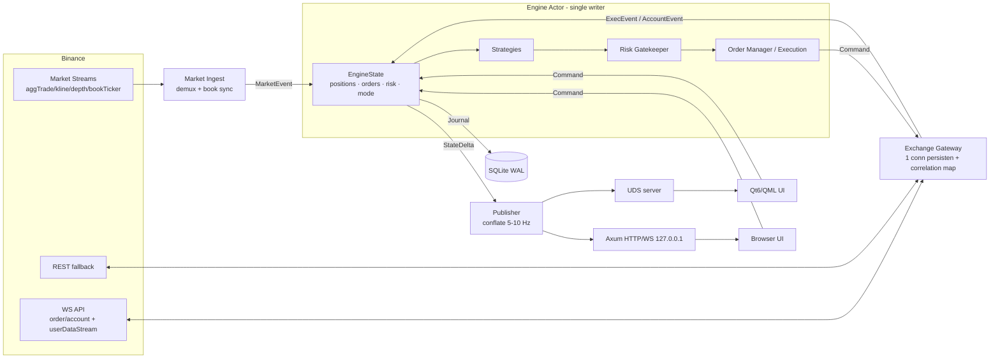

## 3. Arsitektur Sistem

### 3.1. Proses & Artefak

| Artefak | Jenis | Peran |
|---|---|---|
| `binance-botd` | daemon (systemd) | Engine trading, gateway Binance, IPC (UDS + HTTP/WS lokal) |
| `binance-botctl` | CLI | `keygen`, `config validate`, `status`, `pause/resume`, `panic-flatten`, `replay`, `backtest` |
| `binance-bot-ui` | aplikasi Qt6/QML | Cockpit desktop Plasma 6 |
| `web-ui/build` | static assets | Dashboard web (dilayani oleh `botd`) |

### 3.2. Topologi Task (Tokio)



### 3.3. Kebijakan Channel & Backpressure

| Aliran | Tipe channel | Bila penuh |
|---|---|---|
| Kline **closed**, trade yang dipakai CVD | `mpsc` bounded (4096) | **Jangan drop**; bila penuh >1 s → alarm + `PAUSED` |
| Order book diff | per-simbol `watch`/conflation (simpan keadaan terbaru) | Drop perantara, simpan terbaru |
| Event user data (fill/akun/algo) | `mpsc` bounded (4096) | **Jangan drop**; bila penuh → `HALTED` + alarm (kehilangan fill = state korup) |
| Command UI → engine | `mpsc` bounded (64) | Tolak dengan error `busy` |
| Telemetry → UI | `watch` + timer 5–10 Hz | Conflation, kirim yang terbaru |

### 3.4. Tipe Domain Inti (`bot-types`) `[FIXED-v3]`

```rust
use rust_decimal::Decimal;
use serde::{Deserialize, Serialize};
use time::OffsetDateTime;
use uuid::Uuid;

#[derive(Debug, Clone, PartialEq, Eq, Hash, PartialOrd, Ord, Serialize, Deserialize)]
pub struct Symbol(pub String);                       // "BTCUSDT"
#[derive(Debug, Clone, Copy, PartialEq, Eq, PartialOrd, Ord, Serialize, Deserialize)]
pub struct Price(pub Decimal);
#[derive(Debug, Clone, Copy, PartialEq, Eq, PartialOrd, Ord, Serialize, Deserialize)]
pub struct Qty(pub Decimal);

#[derive(Debug, Clone, Copy, PartialEq, Eq, Serialize, Deserialize)]
pub enum Venue { Spot, UsdsFutures }                 // keduanya didukung; aktif via VenueManager (3.5)
#[derive(Debug, Clone, Copy, PartialEq, Eq, Serialize, Deserialize)]
pub enum Side { Buy, Sell }
#[derive(Debug, Clone, Copy, PartialEq, Eq, Serialize, Deserialize)]
pub enum Direction { Long, Short }                   // Spot: hanya Long; Futures: Long & Short

/// Filter simbol dari exchangeInfo (di-cache, refresh berkala & saat error filter).
#[derive(Debug, Clone, Serialize, Deserialize)]
pub struct InstrumentRules {
    pub symbol: Symbol,
    pub tick_size: Decimal,
    pub step_size: Decimal,
    pub min_qty: Decimal,
    pub max_qty: Decimal,
    pub min_notional: Decimal,          // filter NOTIONAL / MIN_NOTIONAL [VERIFY nama filter]
    pub status_trading: bool,           // status == TRADING
    pub base_precision: u32,
    pub quote_precision: u32,
}

#[derive(Debug, Clone, Serialize, Deserialize)]
pub struct Kline {
    pub open_time_ms: i64, pub close_time_ms: i64,
    pub open: f64, pub high: f64, pub low: f64, pub close: f64,   // f64 hanya utk indikator
    pub volume: f64, pub quote_volume: f64, pub trades: u64,
    pub taker_buy_base: f64, pub is_closed: bool,
}

#[derive(Debug, Clone, Copy, PartialEq, Eq, Serialize, Deserialize)]
pub enum OrderStatus { PendingNew, New, PartiallyFilled, Filled, Canceled, Rejected, Expired, UnknownNeedsQuery }

#[derive(Debug, Clone, Serialize, Deserialize)]
pub struct Order {
    pub venue: Venue,                    // WAJIB: simbol sama ada di kedua venue → kunci unik = (venue, client_id)
    pub client_id: String,               // ^[A-Za-z0-9_-]{1,36}$ ; lihat 5.2 untuk format
    pub exchange_id: Option<i64>,
    pub symbol: Symbol, pub side: Side, pub kind: OrderKind,
    pub price: Option<Price>, pub qty: Qty, pub filled_qty: Qty,
    pub avg_fill_price: Option<Price>,
    pub status: OrderStatus,
    pub position_id: Option<Uuid>, pub purpose: OrderPurpose,
    pub created_at: OffsetDateTime, pub updated_at: OffsetDateTime,
}
#[derive(Debug, Clone, Copy, PartialEq, Eq, Serialize, Deserialize)]
pub enum OrderKind { LimitMaker, Limit, Market, StopLossLimit, TakeProfitLimit, OcoLeg }
#[derive(Debug, Clone, Copy, PartialEq, Eq, Serialize, Deserialize)]
pub enum OrderPurpose { Entry, ProtectStop, TakeProfit1, TakeProfit2, EmergencyExit, ManualFlatten }

/// Posisi. `r_distance` = |entry - stop_awal| dalam satuan harga (1R).
#[derive(Debug, Clone, Serialize, Deserialize)]
pub struct Position {
    pub id: Uuid, pub symbol: Symbol, pub venue: Venue, pub direction: Direction,
    pub strategy: StrategyId,
    pub entry_price: Price, pub qty_initial: Qty, pub qty_open: Qty,
    pub r_distance: Decimal,
    pub leverage: Option<u32>,           // hanya Futures
    pub liq_price: Option<Price>,        // hanya Futures (diperbarui dari event akun/positionRisk)
    pub stop_price: Price, pub tp1_price: Price, pub tp2_price: Option<Price>,
    pub best_price: Price,               // high-water mark (Long) / low-water (Short)
    pub tp1_done: bool, pub breakeven_done: bool,
    pub fees_paid_quote: Decimal, pub realized_pnl_quote: Decimal,
    pub state: PositionState,
    pub opened_at: OffsetDateTime,
}
#[derive(Debug, Clone, Copy, PartialEq, Eq, Serialize, Deserialize)]
pub enum PositionState { EntryPending, EntryPartial, OpenProtected, OpenUnprotected, ExitPending, Closed, Orphaned }

#[derive(Debug, Clone, Copy, PartialEq, Eq, Hash, Serialize, Deserialize)]
pub enum StrategyId { TrendPullback, Breakout, GainersMomentum, VwapReversion }

#[derive(Debug, Clone, Copy, PartialEq, Eq, Serialize, Deserialize)]
pub enum EngineMode { Starting, Syncing, Ready, Paused, ReduceOnly, Halted, Killed }
```

### 3.5. Mode Venue: Spot ⇄ Futures & Peralihan (`bot-venue`) `[NEW-v3.1]`

**Dimensi ortogonal**: `venue` (Spot/Futures) × `mode` (paper/testnet/live). Contoh: *Futures + testnet*, *Spot + live*. Matriks lengkap harus bisa dipilih tanpa rekompilasi (feature flag `futures` hanya untuk mengecilkan binary, default **aktif**).

```rust
#[derive(Debug, Clone, Copy, PartialEq, Eq, Hash, Serialize, Deserialize)]
pub struct InstrumentKey { pub venue: Venue, pub symbol: Symbol }   // JANGAN pernah memakai Symbol saja sebagai kunci

#[derive(Debug, Clone, Copy, PartialEq, Eq, Serialize, Deserialize)]
pub enum VenueState { Disabled, Activating, Active, Draining }

#[derive(Debug, Clone, Copy, PartialEq, Eq, Serialize, Deserialize)]
pub enum ProtectionScheme { DualOco, AlgoReduceOnly }               // Spot vs Futures (4.4 / 4.5)

#[derive(Debug, Clone, Copy)]
pub struct VenueCaps { pub can_short: bool, pub max_leverage: u32, pub has_funding: bool, pub protection: ProtectionScheme }

#[async_trait::async_trait]
pub trait VenueAdapter: Send + Sync {            // satu implementasi: SpotAdapter, FuturesAdapter (+ PaperAdapter membungkus keduanya)
    fn venue(&self) -> Venue;
    fn caps(&self) -> VenueCaps;
    async fn activate(&self) -> Result<ActivationReport, GatewayError>;   // connect, logon, subscribe, exchangeInfo, setup (Futures: margin/leverage/position mode)
    async fn deactivate(&self) -> Result<(), GatewayError>;               // tutup sesi bersih (TIDAK membatalkan proteksi)
    // + seluruh metode ExchangeGateway (place/cancel/cancel_replace/protect/open_orders/account_snapshot/exchange_info)
}
// Strategy menyatakan kapabilitas: fn supports(&self, caps: &VenueCaps, dir: Direction) -> bool
```

**Mode `venue_mode`**: `spot` | `futures` (peralihan antar keduanya saat runtime). `dual` (keduanya aktif bersamaan) **bukan** bagian MVP — disiapkan oleh desain (kunci `(Venue,Symbol)`, anggaran lintas-venue) tetapi baru dibuka di M17.

**State machine per venue**
```text
Disabled ──switch/start──▶ Activating ──(sesi+sync+rekonsiliasi OK)──▶ Active
Active ──switch away──▶ Draining ──(posisi flat atau policy selesai)──▶ Disabled
Activating ──gagal──▶ Disabled (rollback, alarm)
```
`Draining` = **tanpa entry baru**; lifecycle posisi, proteksi, rekonsiliasi, dan user-data stream tetap berjalan sampai posisi venue itu habis.

**Prosedur `switch_venue(target, on_open_positions, confirm_nonce)`** (**MUST** atomik terhadap state engine):
1. **Prasyarat** (semua wajib; bila gagal → tolak + alasan jelas):
   * `EngineMode ∈ {Ready, Paused}`. Ditolak saat `Halted`/`Killed` (peralihan **tidak boleh** dipakai untuk menghindari halt: circuit breaker bersifat **global**).
   * Target `enabled`, kredensial valid, dan (bila `mode=live`) `live_confirmation_file` venue target ada.
   * Cooldown ≥ `switch_cooldown_s` (60) sejak peralihan terakhir; ≤ `max_switches_per_day` (3).
   * Tidak sedang dalam `Syncing`/rekonsiliasi.
2. Venue lama → entry dihentikan (`Paused` untuk venue itu); **batalkan order entry yang belum terisi**; proteksi (OCO/algo) **dipertahankan**.
3. Terapkan `on_open_positions` (default `keep_managing`):
   * `keep_managing`: venue lama → `Draining`; engine terus mengelola posisi sampai flat.
   * `require_flat`: tolak peralihan bila masih ada posisi terbuka di venue lama.
   * `flatten`: tutup semua posisi venue lama (market/IOC reduce-only) lalu `Disabled`; **wajib** nonce konfirmasi (hold-to-confirm).
4. Venue target → `Activating` → `activate()` → rekonsiliasi per-venue (8.3) → `Active`. Entry baru hanya setelah `Active`.
5. **Rollback**: bila langkah 4 gagal → target `Disabled`; venue lama dikembalikan `Active` (jika belum `Disabled`); engine `Paused`; alarm; tidak ada keadaan setengah-jadi.
6. Journal `VenueSwitched{from,to,policy,actor}`; broadcast `event` ke UI; catat di `docs`/audit.

**Terisolasi per venue**: kredensial & keypair, sesi WS (API + stream), cache `exchangeInfo`/rules, rate limit (Spot `/api` dan Futures `/fapi` memiliki bobot terpisah), reconciler, skema proteksi, universe, cooldown per `(venue,symbol)`, daftar strategi yang aktif, parameter risiko override, model biaya.

**Bersama (global lintas-venue)**: circuit breaker harian/mingguan/drawdown dihitung dari **equity gabungan (USD)**; `portfolio_heat` gabungan; BTC Crash/Spike Guard (data pasar BTC dipakai bersama); jurnal & audit; kill-switch (`Killed` menghentikan **semua** venue). Aturan `cross_venue_same_symbol = "block_opposite"` (default): dilarang membuka arah berlawanan pada simbol dasar yang sama di venue lain (mencegah self-hedge tak sengaja & pemborosan fee).

**Dana**: bot **MUST NOT** memindahkan dana antar-wallet (izin *Universal Transfer* off). Pengguna mendanai Spot dan Futures sendiri. Equity untuk sizing venue = `min(equity_venue, capital_allocation_usd)` bila `capital_allocation_usd > 0`.

**Kompatibilitas ID**: `clientOrderId` memuat huruf venue (5.2); tabel DB memuat kolom `venue` (Bagian 8); event IPC memuat `venue`; UI selalu menampilkan venue pada setiap baris posisi/order.
