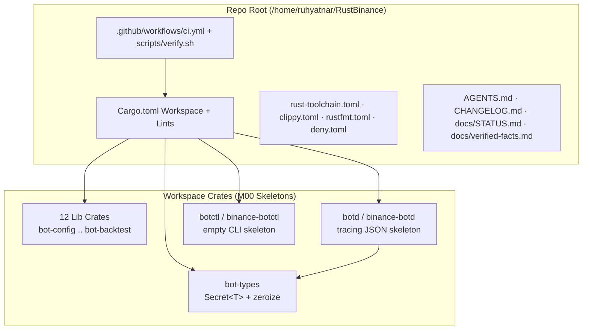

# M00 — Workspace Scaffold, CI, and `Secret<T>` Implementation Plan

> **For agentic workers:** REQUIRED SUB-SKILL: Use superpowers:subagent-driven-development (recommended) or superpowers:executing-plans to implement this plan task-by-task. Steps use checkbox (`- [ ]`) syntax for tracking.

**Goal:** Establish the compilable, verified 15-crate Cargo workspace foundation for the Binance Rust 24/7 trading bot (`M00`), complete with CI/lint/deny guardrails, `bot-types::Secret<T>`, and a JSON-tracing `binance-botd` skeleton.

**Architecture:** Promote the verified agent-kit docs and scripts to the repository root alongside `binance-docs/` (keeping `binance-bot-agent-kit/` intact as reference), define a strict Cargo workspace with 13 library crates and 2 binary crates (`binance-botd`, `binance-botctl`) enforcing `#![forbid(unsafe_code)]` and panic-free lints, implement `Secret<T>` with `zeroize` and redacted `Debug` in `bot-types`, and wire structured JSON logging via `tracing-subscriber` in `botd` with zero network or trading behavior.

**Architecture Diagram:**



**Tech Stack:** Rust stable (`rust-version = "1.86"`, host `1.100.0`), `cargo-deny` (`0.22.0`), `zeroize`, `tracing`, `tracing-subscriber` (`json`, `env-filter`), `anyhow`, GitHub Actions.

**Spec:** [M00-scaffold.md](file:///home/ruhyatnar/RustBinance/binance-bot-agent-kit/docs/milestones/M00-scaffold.md), [00-agent-rules.md](file:///home/ruhyatnar/RustBinance/binance-bot-agent-kit/docs/spec/00-agent-rules.md), [14-repo-roadmap.md](file:///home/ruhyatnar/RustBinance/binance-bot-agent-kit/docs/spec/14-repo-roadmap.md), [0001-venue-agnostic-from-day-one.md](file:///home/ruhyatnar/RustBinance/binance-bot-agent-kit/docs/decisions/0001-venue-agnostic-from-day-one.md), [verified-facts.md](file:///home/ruhyatnar/RustBinance/binance-bot-agent-kit/docs/verified-facts.md).

> [!IMPORTANT]
> **Scope Check:** Blueprint v3.1 spans 17 milestones (M00–M17) across independent subsystems. Per `AGENTS.md` ("tentukan **satu** milestone aktif"), this plan covers **M00 only**. M01 (`bot-types` & `bot-config`), M02 (`bot-exchange` Spot), etc. will each get their own plan after M00 is verified and approved.

## Global Constraints

- Priority order: Keselamatan dana > Kebenaran > Kesederhanaan > Performa.
- Minimum Rust version: `1.86` (verified requirement of `binance-sdk` in `docs/verified-facts.md`).
- `#![forbid(unsafe_code)]` in every Rust crate in M00.
- Workspace lints: `clippy::pedantic = "warn"`; `clippy::unwrap_used = "deny"`, `clippy::expect_used = "deny"`, `clippy::panic = "deny"`, `clippy::indexing_slicing = "deny"` in non-test code (`allow-*-in-tests = true` in `clippy.toml`).
- Default mode is always `paper`; zero network calls or trading logic in M00.
- Secrets MUST NEVER appear in `Debug`, logs, error messages, or git tracking; `Secret<T>` MUST redact `Debug`, omit `Display` and `Serialize`, and `zeroize` on `Drop`.
- Do NOT ignore `.agents/` in `.gitignore`.
- Do NOT hardcode outdated dependency versions from spec prose; resolve latest stable versions cleanly via `Cargo.lock`.
- Verification gate: `scripts/verify.sh` (`cargo fmt --all -- --check`, `cargo clippy --workspace --all-targets -- -D warnings`, `cargo test --workspace`, `cargo deny check`, secret scan) MUST exit 0.

## Review Focus

1. **Nested & pretty `Debug` redaction on `Secret<T>`:** Formatting `Secret<String>` with `{:?}`, `{:#?}`, or inside a `#[derive(Debug)]` wrapper struct must never leak plaintext → pinned by `secret_redacts_debug_pretty_and_nested` in Task 3.
2. **Empty and multi-byte UTF-8 secret drop safety:** Creating, exposing, and dropping `Secret<String>` with `""` and Unicode (`"rahasia-🔑-αβγ"`) must round-trip cleanly and invoke `Zeroize::zeroize` on `Drop` without panicking → pinned by `secret_exposes_edge_values_and_zeroizes_on_drop` in Task 3.
3. **Strict non-test lints vs test ergonomics:** `unwrap_used`/`expect_used`/`panic`/`indexing_slicing` must be denied in library/binary code while permitted in `#[cfg(test)]` modules so unit tests can assert cleanly → pinned by `clippy.toml` + `cargo clippy --workspace --all-targets -- -D warnings` in Task 2 & Task 3.
4. **Git secret hygiene without hiding `.agents/`:** `.gitignore` must ignore `*.pem`, `*.key`, `*.sqlite*`, `keys/`, `.env`, `target/`, `node_modules/`, `build/` while leaving `.agents/workflows/verify.md` unignored → pinned by `git check-ignore` checks in Task 1.
5. **`binance-botd` JSON log validity & `RUST_LOG` filtering:** Running `binance-botd` must emit parseable JSON log lines with `mode = "paper"`, respect `RUST_LOG=error` suppression, and exit with status 0 without network I/O → pinned by integration tests in `crates/botd/tests/cli_smoke.rs` in Task 4.

---

### Task 1: Promote Agent Kit Metadata, `.gitignore`, CI Workflow, and ADR-0002

**Files:**
- Create: `AGENTS.md`, `CHANGELOG.md`, `docs/` (copied from `binance-bot-agent-kit/` including updated `docs/verified-facts.md` and patched specs), `scripts/verify.sh`, `.agents/workflows/next-milestone.md`, `.agents/workflows/verify.md`
- Create: `.gitignore`
- Create: `.github/workflows/ci.yml`
- Create: `docs/decisions/0002-root-workspace-layout.md`

**Interfaces:**
- Consumes: verified files in `binance-bot-agent-kit/`
- Produces: root `AGENTS.md`, `docs/STATUS.md`, `docs/verified-facts.md`, `scripts/verify.sh` (executable), `.gitignore`, `.github/workflows/ci.yml`

- [ ] **Step 1: Copy kit metadata and scripts to repository root (non-destructive)**

Copy `AGENTS.md`, `CHANGELOG.md`, `docs/`, `scripts/verify.sh`, and `.agents/workflows/` from `binance-bot-agent-kit/` into the repository root without deleting `binance-bot-agent-kit/` or `binance-docs/`, and ensure `scripts/verify.sh` has mode `+x`.

Run:
```bash
mkdir -p docs scripts .agents/workflows
cp binance-bot-agent-kit/AGENTS.md binance-bot-agent-kit/CHANGELOG.md .
cp -r binance-bot-agent-kit/docs/* docs/
cp binance-bot-agent-kit/scripts/verify.sh scripts/verify.sh
chmod +x scripts/verify.sh
cp binance-bot-agent-kit/.agents/workflows/*.md .agents/workflows/
```
Expected: exit 0; `docs/STATUS.md`, `docs/verified-facts.md`, `scripts/verify.sh`, `.agents/workflows/next-milestone.md` exist at root.

- [ ] **Step 2: Create `.gitignore`**

Write `.gitignore` ignoring: `target/`, `node_modules/`, `*.pem`, `*.key`, `*.sqlite*`, `keys/`, `build/`, `.env`, `.env.*`, `desktop-ui/build/`, `web-ui/build/`, `.codegraph/`, `graphify-out/`. Do **not** include `.agents/`.

- [ ] **Step 3: Verify `.gitignore` rules with `git check-ignore`**

Run:
```bash
git check-ignore -q test.pem && git check-ignore -q secret.key && git check-ignore -q state.sqlite-wal && git check-ignore -q .env && git check-ignore -q keys/api_key_spot.txt && git check-ignore -q target/debug && ! git check-ignore -q .agents/workflows/verify.md
```
Expected: exit 0 (all secret/build patterns ignored; `.agents/workflows/verify.md` NOT ignored).

- [ ] **Step 4: Create `.github/workflows/ci.yml` and `docs/decisions/0002-root-workspace-layout.md`**

- `.github/workflows/ci.yml`: trigger on `push` and `pull_request`; `ubuntu-latest`; install stable Rust (`rustfmt`, `clippy`) + `cargo-deny` (via `EmbarkStudios/cargo-deny-action` or `taiki-e/install-action@cargo-deny`); run `./scripts/verify.sh`.
- `docs/decisions/0002-root-workspace-layout.md`: record ADR explaining that the Cargo workspace and active `docs/` live at repo root while `binance-docs/` (official OpenAPI/AsyncAPI YAML) and `binance-bot-agent-kit/` (original template snapshot) remain untouched alongside them for local verification.

- [ ] **Step 5: Commit Task 1**

```bash
git add AGENTS.md CHANGELOG.md docs/ scripts/verify.sh .agents/workflows/ .gitignore .github/workflows/ci.yml
git commit -m "chore(m00): promote agent-kit metadata, gitignore, CI workflow, and ADR-0002"
```

---

### Task 2: Cargo Workspace, Toolchain/Lint/Deny Config, and 15 Crate Skeletons

**Files:**
- Create: `Cargo.toml`, `rust-toolchain.toml`, `rustfmt.toml`, `clippy.toml`, `deny.toml`
- Create: `crates/bot-types/{Cargo.toml,src/lib.rs}`
- Create: `crates/bot-config/{Cargo.toml,src/lib.rs}`
- Create: `crates/bot-exchange/{Cargo.toml,src/lib.rs}`
- Create: `crates/bot-marketdata/{Cargo.toml,src/lib.rs}`
- Create: `crates/bot-indicators/{Cargo.toml,src/lib.rs}`
- Create: `crates/bot-strategy/{Cargo.toml,src/lib.rs}`
- Create: `crates/bot-risk/{Cargo.toml,src/lib.rs}`
- Create: `crates/bot-exec/{Cargo.toml,src/lib.rs}`
- Create: `crates/bot-store/{Cargo.toml,src/lib.rs}`
- Create: `crates/bot-ipc/{Cargo.toml,src/lib.rs}`
- Create: `crates/bot-venue/{Cargo.toml,src/lib.rs}`
- Create: `crates/bot-engine/{Cargo.toml,src/lib.rs}`
- Create: `crates/bot-backtest/{Cargo.toml,src/lib.rs}`
- Create: `crates/botd/{Cargo.toml,src/main.rs}` (binary name `binance-botd`)
- Create: `crates/botctl/{Cargo.toml,src/main.rs}` (binary name `binance-botctl`)

**Interfaces:**
- Consumes: `scripts/verify.sh` from Task 1
- Produces: Cargo workspace containing all 15 crates from §14.1 with shared `[workspace.package]` (`edition = "2024"`, `rust-version = "1.86"`, `license = "MIT OR Apache-2.0"`) and `[workspace.lints]`

- [ ] **Step 1: Create toolchain, formatting, clippy, and cargo-deny configuration files**

- `rust-toolchain.toml`: `[toolchain]` with `channel = "stable"` and `components = ["rustfmt", "clippy"]`.
- `rustfmt.toml`: `edition = "2024"`, `max_width = 100`.
- `clippy.toml`:
  ```toml
  allow-unwrap-in-tests = true
  allow-expect-in-tests = true
  allow-panic-in-tests = true
  allow-indexing-in-tests = true
  ```
- `deny.toml`: `cargo-deny` v2 format (`version = 2` compatible with `cargo-deny 0.22.0`; `[advisories]`, `[licenses]` allowing `MIT`, `Apache-2.0`, `Unicode-3.0`, `BSD-2-Clause`, `BSD-3-Clause`, `ISC`, `Zlib`, `CDLA-Permissive-2.0`, `[bans]`, `[sources]` allowing `https://github.com/rust-lang/crates.io-index`).

- [ ] **Step 2: Create root `Cargo.toml` with workspace members and strict lints**

Define `[workspace]` with `resolver = "2"` and all 15 `crates/*` members, `[workspace.package]` (`version = "0.1.0"`, `edition = "2024"`, `rust-version = "1.86"`, `license = "MIT OR Apache-2.0"`), `[workspace.lints.rust]` (`unsafe_code = "forbid"`), and `[workspace.lints.clippy]` (`pedantic = { level = "warn", priority = -1 }`, `unwrap_used = "deny"`, `expect_used = "deny"`, `panic = "deny"`, `indexing_slicing = "deny"`).

- [ ] **Step 3: Scaffold all 13 library crates and 2 binary crates**

Each crate `Cargo.toml` inherits `version/edition/rust-version/license.workspace = true` and `[lints] workspace = true`.
- `crates/botd/Cargo.toml` defines `[[bin]] name = "binance-botd" path = "src/main.rs"`.
- `crates/botctl/Cargo.toml` defines `[[bin]] name = "binance-botctl" path = "src/main.rs"`.
- Every `src/lib.rs` and `src/main.rs` begins with `#![forbid(unsafe_code)]` and minimal valid module doc / `fn main() {}`.

- [ ] **Step 4: Run verification suite on the empty workspace**

Run: `./scripts/verify.sh`
Expected: `OK: semua pemeriksaan lulus` (rustfmt, clippy `-D warnings`, test, `cargo deny check`, secret scan all pass).

- [ ] **Step 5: Commit Task 2**

```bash
git add Cargo.toml Cargo.lock rust-toolchain.toml rustfmt.toml clippy.toml deny.toml crates/
git commit -m "chore(m00): scaffold 15-crate Cargo workspace with strict lints and cargo-deny"
```

---

### Task 3: `bot-types::Secret<T>` with `Zeroize` and Redacted `Debug`

**Files:**
- Modify: `Cargo.toml` (add `zeroize` to `[workspace.dependencies]`)
- Modify: `crates/bot-types/Cargo.toml` (depend on `zeroize.workspace = true`)
- Create: `crates/bot-types/src/secret.rs`
- Modify: `crates/bot-types/src/lib.rs` (export `pub mod secret; pub use secret::Secret;`)

**Interfaces:**
- Consumes: `zeroize::Zeroize`
- Produces:
  - `pub struct Secret<T: Zeroize>(T);` in `bot_types`
  - `impl<T: Zeroize> Secret<T>`: `pub fn new(value: T) -> Self`, `pub fn expose(&self) -> &T`
  - `impl<T: Zeroize> std::fmt::Debug for Secret<T>` (formats as `"Secret(***)"`)
  - `impl<T: Zeroize> Drop for Secret<T>` (calls `self.0.zeroize()`)
  - Intentionally NO `Display`, NO `Serialize`, NO `Deref`, NO `Clone` (prevent accidental secret propagation)

- [ ] **Step 1: Add `zeroize` dependency to workspace and `bot-types`**

Add `zeroize` (latest stable via `cargo add zeroize` or `[workspace.dependencies]`) to `Cargo.toml` and `crates/bot-types/Cargo.toml`.

- [ ] **Step 2: Write failing unit tests in `crates/bot-types/src/secret.rs`**

Add `#[cfg(test)] mod tests` testing:
```rust
#[test]
fn secret_redacts_debug_pretty_and_nested() {
    #[derive(Debug)]
    struct Holder {
        #[allow(dead_code)]
        api_key: Secret<String>,
    }

    let s = Secret::new("rahasia-super-penting".to_owned());
    let dbg = format!("{s:?}");
    let pretty = format!("{s:#?}");
    assert_eq!(dbg, "Secret(***)");
    assert_eq!(pretty, "Secret(***)");
    assert!(!dbg.contains("rahasia"));

    let holder = Holder { api_key: s };
    let nested = format!("{holder:?}");
    assert!(nested.contains("Secret(***)"));
    assert!(!nested.contains("rahasia"));
}

#[test]
fn secret_exposes_edge_values_and_zeroizes_on_drop() {
    use std::sync::{Arc, atomic::{AtomicBool, Ordering}};

    struct ZeroizeProbe {
        cleared: Arc<AtomicBool>,
    }
    impl Zeroize for ZeroizeProbe {
        fn zeroize(&mut self) {
            self.cleared.store(true, Ordering::SeqCst);
        }
    }

    let empty = Secret::new(String::new());
    assert_eq!(empty.expose(), "");

    let unicode = Secret::new("rahasia-🔑-αβγ".to_owned());
    assert_eq!(unicode.expose(), "rahasia-🔑-αβγ");

    let cleared = Arc::new(AtomicBool::new(false));
    {
        let _probe = Secret::new(ZeroizeProbe { cleared: Arc::clone(&cleared) });
        assert!(!cleared.load(Ordering::SeqCst));
    }
    assert!(cleared.load(Ordering::SeqCst));
}
```

- [ ] **Step 3: Run test to verify it fails**

Run: `cargo test -p bot-types`
Expected: FAIL because `Secret` is not defined yet.

- [ ] **Step 4: Implement `Secret<T>` in `crates/bot-types/src/secret.rs` and re-export in `crates/bot-types/src/lib.rs`**

Implement `pub struct Secret<T: Zeroize>(T);`, `Secret::new`, `Secret::expose`, `fmt::Debug` returning `f.write_str("Secret(***)")`, and `Drop` calling `self.0.zeroize()`. Re-export `pub use secret::Secret;` from `crates/bot-types/src/lib.rs`.

- [ ] **Step 5: Run tests and clippy to verify pass**

Run: `cargo test -p bot-types && cargo clippy -p bot-types --all-targets -- -D warnings`
Expected: 2 tests pass; clippy clean.

- [ ] **Step 6: Commit Task 3**

```bash
git add Cargo.toml Cargo.lock crates/bot-types/
git commit -m "feat(bot-types): add Secret<T> with redacted Debug and zeroize on Drop"
```

---

### Task 4: `binance-botd` JSON Tracing Skeleton & M00 Verification Closure

**Files:**
- Modify: `Cargo.toml` (add `anyhow`, `tracing`, `tracing-subscriber` with features `["json", "env-filter"]`, `serde_json` to `[workspace.dependencies]`)
- Modify: `crates/botd/Cargo.toml` (depend on `anyhow`, `tracing`, `tracing-subscriber`, `bot-types`; dev-dep `serde_json`)
- Create: `crates/botd/src/logging.rs`
- Modify: `crates/botd/src/main.rs`
- Create: `crates/botd/tests/cli_smoke.rs`
- Modify: `docs/STATUS.md`, `CHANGELOG.md`

**Interfaces:**
- Consumes: `tracing`, `tracing-subscriber` (`fmt::layer().json()`, `EnvFilter`)
- Produces:
  - `pub fn init_tracing() -> anyhow::Result<()>` in `crates/botd/src/logging.rs`
  - `binance-botd` binary that initializes JSON tracing, emits one structured startup event (`mode = "paper"`, `version = env!("CARGO_PKG_VERSION")`), and exits cleanly with code 0

- [ ] **Step 1: Add tracing and anyhow dependencies to workspace and `botd`**

Add `anyhow`, `tracing`, `tracing-subscriber = { version = "...", features = ["json", "env-filter"] }`, and `serde_json` to `[workspace.dependencies]` (via `cargo add` / Cargo.lock resolution) and wire into `crates/botd/Cargo.toml`.

- [ ] **Step 2: Write failing integration test in `crates/botd/tests/cli_smoke.rs`**

```rust
use std::process::Command;

#[test]
fn botd_emits_valid_json_log_in_paper_mode_and_exits_cleanly() {
    let bin = env!("CARGO_BIN_EXE_binance-botd");
    let output = Command::new(bin)
        .env("RUST_LOG", "info")
        .output()
        .expect("failed to execute binance-botd");

    assert!(output.status.success(), "stderr: {}", String::from_utf8_lossy(&output.stderr));
    let combined = if output.stdout.is_empty() {
        String::from_utf8_lossy(&output.stderr).into_owned()
    } else {
        String::from_utf8_lossy(&output.stdout).into_owned()
    };
    let first_line = combined.lines().next().expect("expected at least one JSON log line");
    let parsed: serde_json::Value = serde_json::from_str(first_line)
        .expect("log line must be valid JSON");
    assert_eq!(parsed["level"], "INFO");
    assert_eq!(parsed["fields"]["mode"], "paper");
}

#[test]
fn botd_respects_rust_log_filter() {
    let bin = env!("CARGO_BIN_EXE_binance-botd");
    let output = Command::new(bin)
        .env("RUST_LOG", "error")
        .output()
        .expect("failed to execute binance-botd");

    assert!(output.status.success());
    assert!(output.stdout.trim().is_empty());
    assert!(output.stderr.trim().is_empty());
}
```

- [ ] **Step 3: Run test to verify it fails**

Run: `cargo test -p botd --test cli_smoke`
Expected: FAIL (no JSON log emitted yet).

- [ ] **Step 4: Implement `init_tracing()` in `crates/botd/src/logging.rs` and wire `crates/botd/src/main.rs`**

- `crates/botd/src/logging.rs`: `pub fn init_tracing() -> anyhow::Result<()>` using `tracing_subscriber::EnvFilter::try_from_default_env().unwrap_or_else(|_| EnvFilter::new("info"))` and `tracing_subscriber::fmt().json().with_env_filter(filter).try_init()`.
- `crates/botd/src/main.rs`: call `logging::init_tracing()?`, emit `tracing::info!(mode = "paper", version = env!("CARGO_PKG_VERSION"), "binance-botd skeleton initialized");`, return `Ok(())`.

- [ ] **Step 5: Run `botd` smoke test and full `./scripts/verify.sh`**

Run: `cargo test -p botd --test cli_smoke && ./scripts/verify.sh`
Expected: all tests pass; `cargo deny check` clean; `OK: semua pemeriksaan lulus`.

- [ ] **Step 6: Update `docs/STATUS.md` and `CHANGELOG.md` for M00 completion**

- In `docs/STATUS.md`: check off `- [x] **M00**`, set `Terakhir diperbarui: 2026-11-22`, keep `Milestone aktif` pending owner approval before moving to M01, record session summary (completed items, passed tests, remaining untested areas).
- In `CHANGELOG.md`: add entry under `[Unreleased]` for M00 workspace scaffold, `Secret<T>`, JSON tracing skeleton, and `docs/verified-facts.md` updates.

- [ ] **Step 7: Commit Task 4**

```bash
git add Cargo.toml Cargo.lock crates/botd/ docs/STATUS.md CHANGELOG.md
git commit -m "feat(botd): initialize JSON tracing skeleton and close M00"
```
