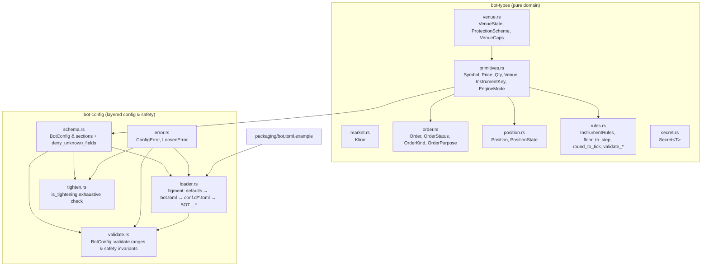

# M01 — `bot-types` & `bot-config` Implementation Plan

> **For agentic workers:** REQUIRED SUB-SKILL: Use superpowers:subagent-driven-development (recommended) or superpowers:executing-plans to implement this plan task-by-task. Steps use checkbox (`- [ ]`) syntax for tracking.

**Goal:** Implement venue-agnostic domain types (`bot-types`) with exact `Decimal` filter rounding/validation, plus layered TOML/env configuration (`bot-config`) with strict range validation, runtime tighten-only checks, and a validated `packaging/bot.toml.example`.

**Architecture:** `bot-types` owns all pure domain types, `InstrumentKey = (Venue, Symbol)`, venue capability descriptors (§3.5 without manager logic), and side-effect-free `InstrumentRules` rounding/validation using `rust_decimal::Decimal`. `bot-config` depends on `bot-types` and layers code defaults → `bot.toml` → lexicographically sorted `conf.d/*.toml` → `BOT__SECTION__KEY` env overrides via `figment`, enforcing `#[serde(deny_unknown_fields)]`, strict range/safety validation (zero silent clamping), and exhaustive `is_tightening(old, new)` runtime checks.

**Architecture Diagram:**



**Tech Stack:** Rust (edition 2024, MSRV 1.86), `rust_decimal`, `serde`, `serde_json`, `time`, `uuid`, `thiserror`, `figment` (`toml`, `env`), `proptest`, `zeroize`.

**Spec:**
- [M01-types-config.md](file:///home/ruhyatnar/RustBinance/docs/milestones/M01-types-config.md)
- [03-architecture.md](file:///home/ruhyatnar/RustBinance/docs/spec/03-architecture.md#L52-L201) (§3.4–§3.5)
- [07-risk.md](file:///home/ruhyatnar/RustBinance/docs/spec/07-risk.md#L26-L42) (§7.2, §7.8)
- [09-config.md](file:///home/ruhyatnar/RustBinance/docs/spec/09-config.md) (full)
- [C-definition-of-done.md](file:///home/ruhyatnar/RustBinance/docs/spec/C-definition-of-done.md)

## Global Constraints

- Rust edition `2024`, MSRV `1.86`; `#![forbid(unsafe_code)]`; `clippy::pedantic = "warn"`, `-D warnings`; `unwrap_used`, `expect_used`, `panic`, `indexing_slicing` denied in all non-test code.
- Prices, quantities, balances, PnL, and risk/config numeric parameters MUST use `rust_decimal::Decimal`; `f64` is allowed ONLY in `Kline` OHLCV/volume fields (for indicator calculators).
- All state keys use `InstrumentKey { venue: Venue, symbol: Symbol }`; `Order`, `Position`, and `InstrumentRules` MUST carry `venue: Venue`.
- Default mode MUST be `TradingMode::Paper`; no config with `mode = "live"` passes validation if the enabled venue's `live_confirmation_file` is empty.
- Secrets (`*.pem`, `api_key*`, `.env`) MUST never appear in config files, tests, logs, or commits; config holds file paths only.
- All `Serialize`/`Deserialize` types MUST round-trip cleanly with `Decimal` serialized as JSON strings (never JSON numbers).
- Pin dependencies via `Cargo.lock` using latest stable versions via `cargo add` (never copy version numbers from spec prose); keep `deny.toml` allowlist strictly limited to encountered OSI-approved licenses so `cargo deny check` passes with zero warnings.
- Every behavior change requires tests and a `CHANGELOG.md` entry; `./scripts/verify.sh` MUST exit 0 and `graphify update .` MUST run before completion.
- Out of scope for M01: exchange I/O, live/testnet connections, SQLite, `VenueManager` runtime switching logic, `botd` CLI changes.

## Review Focus

1. **Flexible `Decimal` config deserialization + string JSON serialization:** TOML floats (`0.5`, `-2.0`), TOML integers (`20`, `50_000_000`), and `BOT__*` env strings (`"0.25"`) MUST all deserialize into `Decimal` accurately without float precision artifacts, while JSON serialization MUST always emit string values (`"0.5"`). → Pinned in Task 3 (`config_validation.rs`).
2. **Negative-sign direction on loss/drawdown limits:** Positive numbers for `daily_loss_halt_pct`, `weekly_loss_halt_pct`, or `drawdown_kill_pct` MUST fail validation; in `is_tightening`, moving closer to zero (`-2.0 -> -1.5`) is tightening (allowed) and moving more negative (`-2.0 -> -3.0`) is loosening (rejected). → Pinned in Task 4 (`config_validation.rs`) & Task 5 (`tighten_only.rs`).
3. **`capital_allocation_usd = 0` sentinel semantics in `is_tightening`:** `0` means "use full venue quote balance" (unbounded), NOT zero capital. Therefore `0 -> 500` is tightening (allowed), `500 -> 250` is tightening (allowed), `500 -> 0` is loosening (rejected), and `250 -> 500` is loosening (rejected). → Pinned in Task 5 (`tighten_only.rs`).
4. **Degenerate & overflow arithmetic in `floor_to_step` / `round_to_tick`:** `step_size <= 0`, `tick_size <= 0`, negative `qty`/`price`, or `Decimal::MAX` with tiny `step_size = 0.00000001` MUST return typed `Err(RulesError::...)` — never panic, divide by zero, or overflow. → Pinned in Task 2 (`rules_proptest.rs`).
5. **Deterministic `conf.d/*.toml` layering & missing vs malformed file handling:** `conf.d/` MUST load only `*.toml` files sorted lexicographically by filename (ignoring non-`.toml` files like `.bak`), tolerate a missing optional `bot.toml` or `conf.d/` directory when falling back to defaults, and immediately fail with a parse error on malformed TOML (never silently skip). → Pinned in Task 3 (`config_validation.rs`).

---

### Task 1: Verify `exchangeInfo.filters` + Core `bot-types` Domain Types

**Files:**
- Modify: [docs/verified-facts.md](file:///home/ruhyatnar/RustBinance/docs/verified-facts.md)
- Modify: [Cargo.toml](file:///home/ruhyatnar/RustBinance/Cargo.toml)
- Modify: [deny.toml](file:///home/ruhyatnar/RustBinance/deny.toml)
- Modify: [crates/bot-types/Cargo.toml](file:///home/ruhyatnar/RustBinance/crates/bot-types/Cargo.toml)
- Modify: [crates/bot-types/src/lib.rs](file:///home/ruhyatnar/RustBinance/crates/bot-types/src/lib.rs)
- Create: `crates/bot-types/src/primitives.rs`
- Create: `crates/bot-types/src/venue.rs`
- Create: `crates/bot-types/src/market.rs`
- Create: `crates/bot-types/src/order.rs`
- Create: `crates/bot-types/src/position.rs`
- Test: `crates/bot-types/tests/serde_roundtrip.rs`

**Interfaces:**
- Consumes: existing `bot_types::Secret` from [crates/bot-types/src/secret.rs](file:///home/ruhyatnar/RustBinance/crates/bot-types/src/secret.rs).
- Produces (re-exported at `bot_types::*`):
  - `Symbol(pub String)` (`as_str(&self) -> &str`, `Display`)
  - `Price(pub Decimal)` (`as_decimal(&self) -> Decimal`, `Display`)
  - `Qty(pub Decimal)` (`as_decimal(&self) -> Decimal`, `Display`)
  - `Venue { Spot, UsdsFutures }` (`serde`: `"spot"`, `"futures"` with alias `"usds_futures"`)
  - `Side { Buy, Sell }`, `Direction { Long, Short }`
  - `TradingMode { Paper, Testnet, Live }` (`Default = Paper`, `serde(rename_all = "snake_case")`)
  - `EngineMode { Starting, Syncing, Ready, Paused, ReduceOnly, Halted, Killed }`
  - `StrategyId { TrendPullback, Breakout, GainersMomentum, VwapReversion }`
  - `InstrumentKey { pub venue: Venue, pub symbol: Symbol }` (`Debug, Clone, PartialEq, Eq, Hash, PartialOrd, Ord, Serialize, Deserialize`)
  - `VenueState { Disabled, Activating, Active, Draining }`
  - `ProtectionScheme { DualOco, AlgoReduceOnly }`
  - `VenueCaps { pub can_short: bool, pub max_leverage: u32, pub has_funding: bool, pub protection: ProtectionScheme }` (`VenueCaps::spot()`, `VenueCaps::usds_futures(max_leverage: u32)`)
  - `Kline` (exact §3.4 fields)
  - `OrderStatus`, `OrderKind`, `OrderPurpose`, `Order` (exact §3.4 fields; `OffsetDateTime` via `time::serde::rfc3339`)
  - `PositionState`, `Position` (exact §3.4 fields; `OffsetDateTime` via `time::serde::rfc3339`)

- [ ] **Step 1: Record M01 `[VERIFY]` entry in `docs/verified-facts.md`**

Append a verified entry (`milestone: M01`) documenting the exact `exchangeInfo.symbols[].filters` schemas observed in `binance-docs/SPOT_REST.yaml` (`PRICE_FILTER`: `minPrice`/`maxPrice`/`tickSize`; `LOT_SIZE`: `minQty`/`maxQty`/`stepSize`; `NOTIONAL`: `minNotional`/`applyMinToMarket`/`maxNotional`/`applyMaxToMarket`/`avgPriceMins`; `MIN_NOTIONAL`: `minNotional`/`applyToMarket`/`avgPriceMins`; `PERCENT_PRICE_BY_SIDE`: `bidMultiplierUp`/`bidMultiplierDown`/`askMultiplierUp`/`askMultiplierDown`/`avgPriceMins`) and `binance-docs/FUTURES_REST.yaml` (`MIN_NOTIONAL` uses field `notional` instead of `minNotional`, plus `tickSize`/`stepSize`/`minQty`/`maxQty`). Impact: `InstrumentRules` stores normalized `min_notional: Decimal` across both venues.

- [ ] **Step 2: Add pinned dependencies for `bot-types` and update `deny.toml` if needed**

Add latest stable versions via `cargo add` (moved into `[workspace.dependencies]` in [Cargo.toml](file:///home/ruhyatnar/RustBinance/Cargo.toml)):
- `rust_decimal` with features `["serde", "serde-with-str"]`
- `serde` with features `["derive"]`
- `thiserror`
- `time` with features `["serde", "formatting", "parsing"]`
- `uuid` with features `["v4", "serde"]`
- Dev-dependencies on `bot-types`: `serde_json`, `proptest`

Run `cargo deny check` and add any newly encountered OSI-approved licenses (e.g., `BSD-3-Clause`, `ISC`) to [deny.toml](file:///home/ruhyatnar/RustBinance/deny.toml) only if required.

- [ ] **Step 3: Write the failing test in `crates/bot-types/tests/serde_roundtrip.rs`**

```rust
use bot_types::{
    Direction, EngineMode, InstrumentKey, Kline, Order, OrderKind, OrderPurpose, OrderStatus,
    Position, PositionState, Price, ProtectionScheme, Qty, Side, StrategyId, Symbol, TradingMode,
    Venue, VenueCaps, VenueState,
};
use rust_decimal::Decimal;
use std::collections::HashSet;
use std::str::FromStr;
use time::OffsetDateTime;
use uuid::Uuid;

fn dec(s: &str) -> Decimal {
    Decimal::from_str(s).expect("valid decimal literal")
}

#[test]
fn all_domain_types_roundtrip_and_serialize_decimals_as_strings() {
    let now = OffsetDateTime::from_unix_timestamp(1_763_800_000).expect("valid timestamp");
    let order = Order {
        venue: Venue::Spot,
        client_id: "S_tp_01".to_owned(),
        exchange_id: Some(42),
        symbol: Symbol("BTCUSDT".to_owned()),
        side: Side::Buy,
        kind: OrderKind::LimitMaker,
        price: Some(Price(dec("65432.10"))),
        qty: Qty(dec("0.015")),
        filled_qty: Qty(dec("0.005")),
        avg_fill_price: Some(Price(dec("65432.00"))),
        status: OrderStatus::PartiallyFilled,
        position_id: Some(Uuid::nil()),
        purpose: OrderPurpose::Entry,
        created_at: now,
        updated_at: now,
    };
    let order_val = serde_json::to_value(&order).expect("serialize order");
    assert!(order_val["price"].is_string(), "Price must serialize as JSON string");
    assert_eq!(order_val["price"], "65432.10");
    assert!(order_val["qty"].is_string(), "Qty must serialize as JSON string");
    assert_eq!(order_val["venue"], "spot");
    let order_rt: Order = serde_json::from_value(order_val).expect("deserialize order");
    assert_eq!(order_rt, order);

    let position = Position {
        id: Uuid::nil(),
        symbol: Symbol("ETHUSDT".to_owned()),
        venue: Venue::UsdsFutures,
        direction: Direction::Short,
        strategy: StrategyId::TrendPullback,
        entry_price: Price(dec("3200.50")),
        qty_initial: Qty(dec("1.500")),
        qty_open: Qty(dec("0.750")),
        r_distance: dec("45.25"),
        leverage: Some(3),
        liq_price: Some(Price(dec("4200.00"))),
        stop_price: Price(dec("3245.75")),
        tp1_price: Price(dec("3132.62")),
        tp2_price: Some(Price(dec("3064.75"))),
        best_price: Price(dec("3150.00")),
        tp1_done: true,
        breakeven_done: true,
        fees_paid_quote: dec("1.92"),
        realized_pnl_quote: dec("50.91"),
        state: PositionState::OpenProtected,
        opened_at: now,
    };
    let pos_val = serde_json::to_value(&position).expect("serialize position");
    assert!(pos_val["entry_price"].is_string());
    assert!(pos_val["r_distance"].is_string());
    assert!(pos_val["fees_paid_quote"].is_string());
    assert!(pos_val["realized_pnl_quote"].is_string());
    assert_eq!(pos_val["venue"], "futures");
    let pos_rt: Position = serde_json::from_value(pos_val).expect("deserialize position");
    assert_eq!(pos_rt, position);

    let kline = Kline {
        open_time_ms: 1_763_800_000_000,
        close_time_ms: 1_763_803_599_999,
        open: 65000.0,
        high: 65500.5,
        low: 64900.25,
        close: 65432.1,
        volume: 1234.5,
        quote_volume: 80_000_000.0,
        trades: 12_345,
        taker_buy_base: 600.25,
        is_closed: true,
    };
    let kline_rt: Kline =
        serde_json::from_str(&serde_json::to_string(&kline).expect("ser kline")).expect("de kline");
    assert_eq!(kline_rt, kline);

    let caps = VenueCaps::usds_futures(3);
    assert!(caps.can_short && caps.has_funding && caps.max_leverage == 3);
    assert_eq!(caps.protection, ProtectionScheme::AlgoReduceOnly);
    let caps_rt: VenueCaps =
        serde_json::from_str(&serde_json::to_string(&caps).expect("ser caps")).expect("de caps");
    assert_eq!(caps_rt, caps);

    assert_eq!(TradingMode::default(), TradingMode::Paper);
    assert_eq!(
        serde_json::from_str::<VenueState>("\"Draining\"").expect("de venue state"),
        VenueState::Draining
    );
    assert_eq!(
        serde_json::from_str::<EngineMode>("\"ReduceOnly\"").expect("de engine mode"),
        EngineMode::ReduceOnly
    );
}

#[test]
fn instrument_key_distinguishes_same_symbol_across_venues() {
    let spot = InstrumentKey {
        venue: Venue::Spot,
        symbol: Symbol("BTCUSDT".to_owned()),
    };
    let fut = InstrumentKey {
        venue: Venue::UsdsFutures,
        symbol: Symbol("BTCUSDT".to_owned()),
    };
    assert_ne!(spot, fut);
    let mut set = HashSet::new();
    set.insert(spot.clone());
    set.insert(fut.clone());
    assert_eq!(set.len(), 2);

    let spot_rt: InstrumentKey =
        serde_json::from_str(&serde_json::to_string(&spot).expect("ser key")).expect("de key");
    assert_eq!(spot_rt, spot);
}
```

- [ ] **Step 4: Run test to verify it fails**

Run: `cargo test -p bot-types --test serde_roundtrip`
Expected: FAIL with unresolved imports for `bot_types::{Direction, EngineMode, ...}`

- [ ] **Step 5: Implement `primitives.rs`, `venue.rs`, `market.rs`, `order.rs`, `position.rs` and re-export in `crates/bot-types/src/lib.rs`**

Implement each focused module following the Interfaces block above:
- `crates/bot-types/src/primitives.rs`: `Symbol`, `Price`, `Qty`, `Venue` (`#[serde(rename = "spot")] Spot`, `#[serde(rename = "futures", alias = "usds_futures")] UsdsFutures`), `Side`, `Direction`, `TradingMode` (`#[default] Paper`, `#[serde(rename_all = "snake_case")]`), `EngineMode`, `StrategyId`, `InstrumentKey`. Derive `PartialEq, Eq` on all non-float types. Serialize `Price` and `Qty` inner `Decimal` with `#[serde(with = "rust_decimal::serde::str")]` so `Decimal` ALWAYS serializes as a JSON string regardless of feature unification.
- `crates/bot-types/src/venue.rs`: `VenueState`, `ProtectionScheme`, `VenueCaps` (`VenueCaps::spot()` → `can_short: false, max_leverage: 1, has_funding: false, protection: ProtectionScheme::DualOco`; `VenueCaps::usds_futures(max_leverage)` → `can_short: true, max_leverage, has_funding: true, protection: ProtectionScheme::AlgoReduceOnly`).
- `crates/bot-types/src/market.rs`: `Kline` with exact §3.4 fields (`Debug, Clone, PartialEq, Serialize, Deserialize`).
- `crates/bot-types/src/order.rs`: `OrderStatus`, `OrderKind`, `OrderPurpose`, `Order` (`Debug, Clone, PartialEq, Eq, Serialize, Deserialize`; `created_at` and `updated_at` annotated with `#[serde(with = "time::serde::rfc3339")]`).
- `crates/bot-types/src/position.rs`: `PositionState`, `Position` (`Debug, Clone, PartialEq, Eq, Serialize, Deserialize`; `r_distance`, `fees_paid_quote`, `realized_pnl_quote` annotated with `#[serde(with = "rust_decimal::serde::str")]`; `opened_at` annotated with `#[serde(with = "time::serde::rfc3339")]`).
- `crates/bot-types/src/lib.rs`: declare and re-export all modules and public types with docstrings.

- [ ] **Step 6: Run tests, clippy, and deny check**

Run: `cargo test -p bot-types && cargo clippy -p bot-types --all-targets -- -D warnings && cargo deny check`
Expected: PASS (all tests green, 0 clippy warnings, `cargo deny check` ok)

- [ ] **Step 7: Commit**

```bash
git add docs/verified-facts.md Cargo.toml Cargo.lock deny.toml crates/bot-types/
git commit -m "feat(bot-types): add venue-agnostic core domain types and verified filter facts"
```

---

### Task 2: `InstrumentRules` Precision Rounding & Validation (`bot-types`)

**Files:**
- Create: `crates/bot-types/src/rules.rs`
- Modify: [crates/bot-types/src/lib.rs](file:///home/ruhyatnar/RustBinance/crates/bot-types/src/lib.rs)
- Test: `crates/bot-types/tests/rules_proptest.rs`

**Interfaces:**
- Consumes: `Symbol`, `Price`, `Qty`, `Venue`, `InstrumentKey` from Task 1 (`crates/bot-types/src/primitives.rs`).
- Produces (re-exported at `bot_types::*`):
  - `RulesError` (`thiserror::Error`, `Debug, Clone, PartialEq, Eq`):
    - `InvalidTickSize(Decimal)`, `InvalidStepSize(Decimal)`, `InvalidMinQty(Decimal)`, `InvalidMaxQty { min_qty: Decimal, max_qty: Decimal }`, `NegativeMinNotional(Decimal)`
    - `NegativeValue(Decimal)`, `NonPositivePrice(Decimal)`, `ArithmeticOverflow`
    - `NotTrading { venue: Venue, symbol: Symbol }`
    - `QtyBelowMin { qty: Decimal, min_qty: Decimal }`, `QtyAboveMax { qty: Decimal, max_qty: Decimal }`, `QtyNotStepMultiple { qty: Decimal, step_size: Decimal }`
    - `PriceNotTickMultiple { price: Decimal, tick_size: Decimal }`
    - `NotionalBelowMin { notional: Decimal, min_notional: Decimal }`
  - `InstrumentRules` (`Debug, Clone, PartialEq, Eq, Serialize, Deserialize`):
    - Fields: `venue: Venue`, `symbol: Symbol`, `tick_size: Decimal`, `step_size: Decimal`, `min_qty: Decimal`, `max_qty: Decimal`, `min_notional: Decimal`, `status_trading: bool`, `base_precision: u32`, `quote_precision: u32` (all `Decimal` fields serialized with `rust_decimal::serde::str`).
    - Methods: `key(&self) -> InstrumentKey`, `validate_rules(&self) -> Result<(), RulesError>`, `floor_qty(&self, qty: Qty) -> Result<Qty, RulesError>`, `round_price(&self, price: Price) -> Result<Price, RulesError>`, `floor_price(&self, price: Price) -> Result<Price, RulesError>`, `ceil_price(&self, price: Price) -> Result<Price, RulesError>`, `validate_qty(&self, qty: Qty) -> Result<(), RulesError>`, `validate_price(&self, price: Price) -> Result<(), RulesError>`, `validate_notional(&self, price: Price, qty: Qty) -> Result<(), RulesError>`, `validate_order(&self, price: Price, qty: Qty) -> Result<(), RulesError>`.
  - Pure free functions:
    - `floor_to_step(qty: Qty, step_size: Decimal) -> Result<Qty, RulesError>`
    - `round_to_tick(price: Price, tick_size: Decimal) -> Result<Price, RulesError>`
    - `floor_to_tick(price: Price, tick_size: Decimal) -> Result<Price, RulesError>`
    - `ceil_to_tick(price: Price, tick_size: Decimal) -> Result<Price, RulesError>`

- [ ] **Step 1: Write the failing unit + property tests in `crates/bot-types/tests/rules_proptest.rs`**

```rust
use bot_types::{
    InstrumentRules, Price, Qty, RulesError, Symbol, Venue, ceil_to_tick, floor_to_step,
    floor_to_tick, round_to_tick,
};
use proptest::prelude::*;
use rust_decimal::Decimal;
use std::str::FromStr;

fn dec(s: &str) -> Decimal {
    Decimal::from_str(s).expect("valid decimal")
}

fn btc_rules() -> InstrumentRules {
    InstrumentRules {
        venue: Venue::Spot,
        symbol: Symbol("BTCUSDT".to_owned()),
        tick_size: dec("0.01"),
        step_size: dec("0.0001"),
        min_qty: dec("0.001"),
        max_qty: dec("1000"),
        min_notional: dec("10"),
        status_trading: true,
        base_precision: 8,
        quote_precision: 8,
    }
}

#[test]
fn degenerate_and_overflow_inputs_return_errors_without_panicking() {
    assert_eq!(
        floor_to_step(Qty(dec("1.5")), Decimal::ZERO),
        Err(RulesError::InvalidStepSize(Decimal::ZERO))
    );
    assert_eq!(
        floor_to_step(Qty(dec("1.5")), dec("-0.01")),
        Err(RulesError::InvalidStepSize(dec("-0.01")))
    );
    assert_eq!(
        floor_to_step(Qty(dec("-1.0")), dec("0.01")),
        Err(RulesError::NegativeValue(dec("-1.0")))
    );
    assert_eq!(
        round_to_tick(Price(dec("100")), Decimal::ZERO),
        Err(RulesError::InvalidTickSize(Decimal::ZERO))
    );
    assert_eq!(
        round_to_tick(Price(dec("-1")), dec("0.01")),
        Err(RulesError::NegativeValue(dec("-1")))
    );
    // Overflow guard on extreme Decimal::MAX with tiny step/tick
    let res = floor_to_step(Qty(Decimal::MAX), dec("0.00000001"));
    assert!(matches!(res, Ok(_) | Err(RulesError::ArithmeticOverflow)));
    let ceil_res = ceil_to_tick(Price(Decimal::MAX), dec("0.01"));
    assert!(matches!(ceil_res, Ok(_) | Err(RulesError::ArithmeticOverflow)));
}

#[test]
fn validate_order_enforces_trading_status_step_tick_qty_and_min_notional() {
    let rules = btc_rules();
    assert!(rules.validate_rules().is_ok());
    assert!(rules.validate_order(Price(dec("50000.01")), Qty(dec("0.001"))).is_ok());

    // Below min_notional (5000 * 0.001 = 5 < 10) must be rejected, never upsized
    assert!(matches!(
        rules.validate_order(Price(dec("5000.00")), Qty(dec("0.001"))),
        Err(RulesError::NotionalBelowMin { .. })
    ));
    // Below min_qty
    assert!(matches!(
        rules.validate_order(Price(dec("50000.00")), Qty(dec("0.0005"))),
        Err(RulesError::QtyBelowMin { .. })
    ));
    // Above max_qty
    assert!(matches!(
        rules.validate_order(Price(dec("50000.00")), Qty(dec("1000.0001"))),
        Err(RulesError::QtyAboveMax { .. })
    ));
    // Off step
    assert!(matches!(
        rules.validate_order(Price(dec("50000.00")), Qty(dec("0.00105"))),
        Err(RulesError::QtyNotStepMultiple { .. })
    ));
    // Off tick
    assert!(matches!(
        rules.validate_order(Price(dec("50000.005")), Qty(dec("0.001"))),
        Err(RulesError::PriceNotTickMultiple { .. })
    ));
    // Not trading
    let mut halted = rules.clone();
    halted.status_trading = false;
    assert!(matches!(
        halted.validate_order(Price(dec("50000.00")), Qty(dec("0.001"))),
        Err(RulesError::NotTrading { .. })
    ));

    // JSON round-trip with Decimal as string
    let val = serde_json::to_value(&rules).expect("ser rules");
    assert!(val["tick_size"].is_string());
    assert!(val["min_notional"].is_string());
    let rt: InstrumentRules = serde_json::from_value(val).expect("de rules");
    assert_eq!(rt, rules);
}

#[test]
fn round_to_tick_midpoint_rounds_half_up() {
    assert_eq!(round_to_tick(Price(dec("10.005")), dec("0.01")), Ok(Price(dec("10.01"))));
    assert_eq!(round_to_tick(Price(dec("10.004")), dec("0.01")), Ok(Price(dec("10.00"))));
    assert_eq!(floor_to_tick(Price(dec("10.009")), dec("0.01")), Ok(Price(dec("10.00"))));
    assert_eq!(ceil_to_tick(Price(dec("10.001")), dec("0.01")), Ok(Price(dec("10.01"))));
    assert_eq!(ceil_to_tick(Price(dec("10.00")), dec("0.01")), Ok(Price(dec("10.00"))));
}

proptest! {
    #[test]
    fn prop_floor_to_step_is_multiple_and_le_input(
        raw_units in 0_i64..1_000_000_000_i64,
        raw_scale in 0_u32..8_u32,
        step_mantissa in prop_oneof![Just(1_i64), Just(2_i64), Just(5_i64), Just(25_i64), Just(10_i64)],
        step_scale in 0_u32..6_u32,
    ) {
        let qty = Decimal::new(raw_units, raw_scale);
        let step = Decimal::new(step_mantissa, step_scale);
        let floored = floor_to_step(Qty(qty), step).expect("valid floor");
        prop_assert!(floored.0 <= qty);
        prop_assert!((floored.0 % step).is_zero());
        prop_assert!(qty - floored.0 < step);
    }

    #[test]
    fn prop_round_floor_ceil_to_tick_invariants(
        raw_units in 0_i64..1_000_000_000_i64,
        raw_scale in 0_u32..6_u32,
        tick_mantissa in prop_oneof![Just(1_i64), Just(5_i64), Just(10_i64), Just(25_i64)],
        tick_scale in 0_u32..5_u32,
    ) {
        let price = Decimal::new(raw_units, raw_scale);
        let tick = Decimal::new(tick_mantissa, tick_scale);

        let floored = floor_to_tick(Price(price), tick).expect("valid floor_to_tick");
        prop_assert!(floored.0 <= price);
        prop_assert!((floored.0 % tick).is_zero());
        prop_assert!(price - floored.0 < tick);

        let rounded = round_to_tick(Price(price), tick).expect("valid round_to_tick");
        prop_assert!((rounded.0 % tick).is_zero());
        let diff = (rounded.0 - price).abs();
        prop_assert!(diff * Decimal::from(2) <= tick);

        let ceiled = ceil_to_tick(Price(price), tick).expect("valid ceil_to_tick");
        prop_assert!(ceiled.0 >= price);
        prop_assert!((ceiled.0 % tick).is_zero());
        prop_assert!(ceiled.0 - price < tick);
    }
}
```

- [ ] **Step 2: Run test to verify it fails**

Run: `cargo test -p bot-types --test rules_proptest`
Expected: FAIL with unresolved imports for `InstrumentRules`, `RulesError`, `floor_to_step`, `round_to_tick`

- [ ] **Step 3: Implement `crates/bot-types/src/rules.rs` and re-export in `crates/bot-types/src/lib.rs`**

Implementation approach for exact, division-free rounding:
- `floor_decimal(value: Decimal, step: Decimal, invalid_step: impl FnOnce(Decimal) -> RulesError) -> Result<Decimal, RulesError>`:
  1. Reject `step <= Decimal::ZERO` with `invalid_step(step)` and `value < Decimal::ZERO` with `RulesError::NegativeValue(value)`.
  2. Compute `rem = value.checked_rem(step).ok_or(RulesError::ArithmeticOverflow)?`.
  3. Return `value.checked_sub(rem).ok_or(RulesError::ArithmeticOverflow)`.
- `round_to_tick`: compute `rem = price.0.checked_rem(tick_size)`, `floored = price.0 - rem`; compare `rem.checked_mul(Decimal::TWO)` (or `rem >= tick_size - rem`, which never overflows!) against `tick_size - rem`: if `rem >= tick_size - rem`, return `floored.checked_add(tick_size)`; else `floored`.
- `ceil_to_tick`: if `rem.is_zero()`, return `price`; else `floored.checked_add(tick_size)`.
- All arithmetic uses `checked_*` methods — zero panics, zero division-precision drift.

- [ ] **Step 4: Run tests and clippy**

Run: `cargo test -p bot-types && cargo clippy -p bot-types --all-targets -- -D warnings`
Expected: PASS (all unit + proptest cases green, 0 warnings)

- [ ] **Step 5: Commit**

```bash
git add crates/bot-types/
git commit -m "feat(bot-types): add InstrumentRules exact Decimal rounding and validation"
```

---

### Task 3: `bot-config` Schema, Layered Loader (`figment`), and `packaging/bot.toml.example`

**Files:**
- Modify: [Cargo.toml](file:///home/ruhyatnar/RustBinance/Cargo.toml)
- Modify: [deny.toml](file:///home/ruhyatnar/RustBinance/deny.toml)
- Modify: [crates/bot-config/Cargo.toml](file:///home/ruhyatnar/RustBinance/crates/bot-config/Cargo.toml)
- Modify: [crates/bot-config/src/lib.rs](file:///home/ruhyatnar/RustBinance/crates/bot-config/src/lib.rs)
- Create: `crates/bot-config/src/error.rs`
- Create: `crates/bot-config/src/decimal_serde.rs`
- Create: `crates/bot-config/src/schema.rs`
- Create: `crates/bot-config/src/loader.rs`
- Create: `packaging/bot.toml.example`
- Test: `crates/bot-config/tests/config_loader.rs`

**Interfaces:**
- Consumes: `TradingMode`, `Venue` from `bot-types`.
- Produces (re-exported at `bot_config::*`):
  - `ConfigError` (`thiserror::Error`): `Load(String)`, `Io { path: PathBuf, source: String }`, `Validation(Vec<RangeViolation>)`
  - `RangeViolation { pub field: &'static str, pub value: String, pub reason: String }`
  - `LoosenViolation { pub field: &'static str, pub old: String, pub new: String, pub reason: &'static str }`
  - `LoosenError` (`thiserror::Error`): `InvalidTarget(ConfigError)`, `Loosened(Vec<LoosenViolation>)`
  - `BotConfig` and all nested structs matching §9 (`GeneralConfig`, `SafetyConfig`, `BinanceConfig`, `UniverseConfig`, `StrategyConfig`, `TrendPullbackConfig`, `BreakoutConfig`, `GainersMomentumConfig`, `VwapReversionConfig`, `ExitConfig`, `RiskConfig`, `FuturesRiskConfig`, `VenuesConfig`, `SpotVenueConfig`, `FuturesVenueConfig`, `IpcConfig`, `StorageConfig`) + enums (`SizingMode`, `ProfitLockMode`, `OrphanPolicy`, `OnOpenPositionsPolicy`, `CrossVenueSameSymbolPolicy`, `PositionMode`, `MarginMode`). Every struct has `#[serde(deny_unknown_fields)]` and `Default` matching §9 values verbatim, plus `#[serde(default)]` on optional fields (`universe.exclude_symbols = []`, `risk.max_same_direction_correlated = 3`, `risk.futures.max_notional_per_position_pct = 20`).
  - `ConfigSourcePaths { pub base_file: Option<PathBuf>, pub conf_d_dir: Option<PathBuf>, pub env_prefix: Option<String> }` (`ConfigSourcePaths::system_default()` → `/etc/binance-bot/bot.toml`, `/etc/binance-bot/conf.d`, `"BOT__"`)
  - `load_from_paths(paths: &ConfigSourcePaths) -> Result<BotConfig, ConfigError>`
  - `load_from_paths_with_env_pairs(paths: &ConfigSourcePaths, env_pairs: &[(&str, &str)]) -> Result<BotConfig, ConfigError>`
  - `load_from_toml_str(toml_str: &str) -> Result<BotConfig, ConfigError>`
  - `load_config() -> Result<BotConfig, ConfigError>`

- [ ] **Step 1: Add pinned `figment` dependency and update `deny.toml`**

Add latest stable `figment` (`features = ["toml", "env"]`) to workspace [Cargo.toml](file:///home/ruhyatnar/RustBinance/Cargo.toml) via `cargo add`; add `bot-types`, `figment`, `rust_decimal`, `serde`, `thiserror` to [crates/bot-config/Cargo.toml](file:///home/ruhyatnar/RustBinance/crates/bot-config/Cargo.toml) and `serde_json`, `tempfile` as dev-dependencies. Run `cargo deny check` and update [deny.toml](file:///home/ruhyatnar/RustBinance/deny.toml) only for newly encountered OSI-approved licenses.

- [ ] **Step 2: Create `packaging/bot.toml.example`**

Copy the full §9 `bot.toml` template verbatim into `packaging/bot.toml.example` (including `exclude_symbols = []` under `[universe]`, `max_same_direction_correlated = 3` under `[risk]`, and `max_notional_per_position_pct = 20` under `[risk.futures]` with comments matching §7.2/§7.8/§9).

- [ ] **Step 3: Write the failing tests in `crates/bot-config/tests/config_loader.rs`**

```rust
use bot_config::{BotConfig, ConfigError, ConfigSourcePaths, load_from_paths, load_from_toml_str};
use bot_types::{TradingMode, Venue};
use rust_decimal::Decimal;
use std::fs;
use std::str::FromStr;

fn dec(s: &str) -> Decimal {
    Decimal::from_str(s).expect("valid decimal")
}

#[test]
fn example_bot_toml_loads_matches_defaults_and_roundtrips_json_decimals_as_strings() {
    let example = include_str!("../../../packaging/bot.toml.example");
    let cfg = load_from_toml_str(example).expect("example bot.toml must load");
    assert_eq!(cfg.general.mode, TradingMode::Paper);
    assert_eq!(cfg.venues.default_active, Venue::Spot);
    assert_eq!(cfg.risk.risk_per_trade_pct, dec("0.5"));
    assert_eq!(cfg.risk.daily_loss_halt_pct, dec("-2.0"));
    assert_eq!(cfg.risk.futures.risk_per_trade_pct, dec("0.35"));
    assert_eq!(cfg.universe.min_quote_volume_24h_usd, dec("50000000"));
    assert_eq!(cfg, BotConfig::default());

    let val = serde_json::to_value(&cfg).expect("serialize BotConfig");
    assert!(val["risk"]["risk_per_trade_pct"].is_string());
    assert!(val["risk"]["daily_loss_halt_pct"].is_string());
    assert!(val["risk"]["futures"]["liq_buffer_mult"].is_string());
    assert!(val["universe"]["min_quote_volume_24h_usd"].is_string());
    let rt: BotConfig = serde_json::from_value(val).expect("deserialize BotConfig");
    assert_eq!(rt, cfg);
}

#[test]
fn unknown_field_in_any_section_is_rejected() {
    let cases = [
        "[general]\nunknown_key = 1\n",
        "[risk]\ntypo_risk = 0.5\n",
        "[risk.futures]\nunknown_fut = 1\n",
        "[venues.spot]\nsecret_key = \"nope\"\n",
        "[strategy.trend_pullback]\nextra = true\n",
        "[top_level_bogus]\nx = 1\n",
    ];
    for case in cases {
        let err = load_from_toml_str(case).expect_err("unknown field must fail");
        assert!(matches!(err, ConfigError::Load(_)), "case={case} err={err:?}");
    }
}

#[test]
fn layered_loading_respects_defaults_base_sorted_conf_d_and_env_precedence() {
    let dir = tempfile::tempdir().expect("tempdir");
    let base = dir.path().join("bot.toml");
    let conf_d = dir.path().join("conf.d");
    fs::create_dir(&conf_d).expect("mkdir conf.d");

    fs::write(&base, "[risk]\nrisk_per_trade_pct = 0.4\nmax_open_positions = 3\n").expect("write base");
    fs::write(conf_d.join("10-first.toml"), "[risk]\nrisk_per_trade_pct = 0.3\n").expect("write 10");
    fs::write(conf_d.join("20-second.toml"), "[risk]\nrisk_per_trade_pct = 0.25\n").expect("write 20");
    fs::write(conf_d.join("99-ignored.bak"), "[risk]\nrisk_per_trade_pct = 0.99\n").expect("write bak");

    let paths = ConfigSourcePaths {
        base_file: Some(base),
        conf_d_dir: Some(conf_d),
        env_prefix: None,
    };
    let cfg_no_env = load_from_paths(&paths).expect("layered load without env");
    assert_eq!(cfg_no_env.risk.risk_per_trade_pct, dec("0.25"));
    assert_eq!(cfg_no_env.risk.max_open_positions, 3);
    assert_eq!(cfg_no_env.risk.portfolio_heat_max_pct, dec("2.0"));

    // Env layer overrides conf.d/*.toml
    let cfg_with_env = bot_config::load_from_paths_with_env_pairs(
        &paths,
        &[("RISK__RISK_PER_TRADE_PCT", "0.2")],
    )
    .expect("layered load with env override");
    assert_eq!(cfg_with_env.risk.risk_per_trade_pct, dec("0.2"));
    assert_eq!(cfg_with_env.risk.max_open_positions, 3);
    assert_eq!(cfg_with_env.risk.portfolio_heat_max_pct, dec("2.0"));
}

#[test]
fn env_override_parses_decimal_and_nested_futures_keys() {
    let cfg = bot_config::load_from_paths_with_env_pairs(
        &ConfigSourcePaths {
            base_file: None,
            conf_d_dir: None,
            env_prefix: None,
        },
        &[
            ("RISK__RISK_PER_TRADE_PCT", "0.2"),
            ("RISK__FUTURES__RISK_PER_TRADE_PCT", "0.25"),
            ("VENUES__SPOT__CAPITAL_ALLOCATION_USD", "1500.50"),
        ],
    )
    .expect("env override load");
    assert_eq!(cfg.risk.risk_per_trade_pct, dec("0.2"));
    assert_eq!(cfg.risk.futures.risk_per_trade_pct, dec("0.25"));
    assert_eq!(cfg.venues.spot.capital_allocation_usd, dec("1500.50"));
}

#[test]
fn missing_optional_paths_use_defaults_while_malformed_toml_fails() {
    let dir = tempfile::tempdir().expect("tempdir");
    let cfg = load_from_paths(&ConfigSourcePaths {
        base_file: Some(dir.path().join("nonexistent.toml")),
        conf_d_dir: Some(dir.path().join("no_conf_d")),
        env_prefix: None,
    })
    .expect("missing optional paths fall back to defaults");
    assert_eq!(cfg, BotConfig::default());

    let bad = dir.path().join("bad.toml");
    fs::write(&bad, "[risk\nbroken = ").expect("write bad toml");
    let err = load_from_paths(&ConfigSourcePaths {
        base_file: Some(bad),
        conf_d_dir: None,
        env_prefix: None,
    })
    .expect_err("malformed toml must fail");
    assert!(matches!(err, ConfigError::Load(_)));
}
```

- [ ] **Step 4: Run test to verify it fails**

Run: `cargo test -p bot-config --test config_loader`
Expected: FAIL with unresolved imports for `bot_config::{BotConfig, ...}`

- [ ] **Step 5: Implement `error.rs`, `decimal_serde.rs`, `schema.rs`, `loader.rs`, and `lib.rs` in `crates/bot-config/`**

Key implementation decisions:
- `decimal_serde.rs`: custom `serialize` (always emits string via `value.to_string()`) and `deserialize` visitor handling `visit_str`, `visit_i64`, `visit_u64`, and `visit_f64` (formatting `f64` cleanly via `Decimal::from_str(&v.to_string())` rather than `from_f64_retain` to avoid binary float artifacts like `0.35000000000000003`, rejecting non-finite `NaN`/`inf`!).
- `schema.rs`: every struct derives `Debug, Clone, PartialEq, Eq, Serialize, Deserialize` + `#[serde(deny_unknown_fields)]` + `Default` matching §9 values verbatim. Note `#[serde(default)]` on sub-sections and fields so partial override TOML files merge cleanly onto defaults via `figment::providers::Serialized::defaults(BotConfig::default())`.
- `loader.rs`:
  1. Start with `Figment::from(Serialized::defaults(BotConfig::default()))`.
  2. If `base_file` is `Some(path)` and `path.exists()`, `.merge(Toml::file(path))`.
  3. If `conf_d_dir` is `Some(dir)` and `dir.exists()`, read directory entries, filter to regular files with `.extension() == Some("toml")`, sort paths lexicographically by filename, and `.merge(Toml::file(p))` in order.
  4. If `env_prefix` is `Some(prefix)`, `.merge(Env::prefixed(prefix).split("__"))`.
  5. Provide `load_from_paths_with_env_pairs(paths, pairs: &[(&str, &str)])` (merging an in-memory key/value provider split on `"__"`) so unit tests can test env overrides without `unsafe { std::env::set_var }` (critical because `#![forbid(unsafe_code)]` is enabled on Rust 2024 where `set_var` is `unsafe`!).
  6. Note: `validate()` will be called inside the loader functions starting in Task 4 (in Task 3, `load_*` returns extracted `BotConfig`).

- [ ] **Step 6: Run tests, clippy, and deny check**

Run: `cargo test -p bot-config && cargo clippy -p bot-config --all-targets -- -D warnings && cargo deny check`
Expected: PASS

- [ ] **Step 7: Commit**

```bash
git add Cargo.toml Cargo.lock deny.toml crates/bot-config/ packaging/bot.toml.example
git commit -m "feat(bot-config): add full TOML config schema, layered figment loader, and bot.toml.example"
```

---

### Task 4: Strict Range & Safety Validation (`bot-config`)

**Files:**
- Create: `crates/bot-config/src/validate.rs`
- Modify: `crates/bot-config/src/loader.rs` (call `cfg.validate()?` before returning)
- Modify: `crates/bot-config/src/lib.rs`
- Test: `crates/bot-config/tests/config_validation.rs`

**Interfaces:**
- Consumes: `BotConfig`, `ConfigError`, `RangeViolation`, `MarginMode`, `PositionMode` from Task 3.
- Produces:
  - `impl BotConfig { pub fn validate(&self) -> Result<(), ConfigError> }`
  - `load_from_paths`, `load_from_toml_str`, `load_config` now automatically execute `validate()` and return `Err(ConfigError::Validation(violations))` on any out-of-range or unsafe configuration (no silent clamping).

**Exact validation rules pinned from §7.2, §7.8, §9, and Hard Rule #2:**
- `[general]`: `quote_assets` non-empty, each non-empty uppercase ASCII; `timezone_reporting` non-empty.
- `[binance]`: `recv_window_ms` in `100..=60_000`; `max_clock_drift_ms` in `100..=5_000`; `stale_market_ms` in `200..=30_000`.
- `[universe]`: `min_quote_volume_24h_usd > 0`, `scanner_min_quote_volume_24h_usd > 0`, `scanner_min_quote_volume_24h_usd <= min_quote_volume_24h_usd`, `max_spread_bps` in `0.1..=200`, `scanner_max_spread_bps` in `0.1..=500`, `refresh_minutes` in `1..=1440`.
- `[strategy.*]`: `rsi_min < rsi_max` within `0..=100`, `adx_min` in `0..=100`, `tp1_r > 0`, `tp2_r > tp1_r`, `tp1_close_ratio` in `(0, 1]`, `cost_multiple >= 1`, `donchian >= 2`, `min_volume_mult > 0`, `min_gain_24h_pct > 0`, `max_gain_24h_pct > min_gain_24h_pct`, `size_multiplier` in `(0, 1]`, `max_concurrent >= 1`, `time_stop_hours >= 1`.
- `[exit]`: `be_trigger_r > 0`, `be_fee_buffer_bps >= 0`, `trail_activate_r > 0`, `trail_atr_mult > 0`, `trail_min_step_atr > 0`, `exhaustion_rsi` in `50..=100`, `exhaustion_trail_factor` in `(0, 1]`, `max_bars_in_trade >= 1`, `hard_stop_grace_ms` in `100..=30_000`.
- `[risk]` (§7.2):
  - `risk_per_trade_pct`: `0.1..=1.0`
  - `max_open_positions`: `1..=8`
  - `portfolio_heat_max_pct`: `0.5..=4.0`
  - `max_notional_per_position_pct`: `5..=35`
  - `max_total_exposure_pct`: `20..=80` (and `>= max_notional_per_position_pct`)
  - `max_same_direction_correlated`: `1..=5`
  - `daily_loss_halt_pct`: `-4.0..=-0.5`
  - `weekly_loss_halt_pct`: `-15.0..=-1.0` and `<= daily_loss_halt_pct`
  - `drawdown_kill_pct`: `-20.0..=-5.0` and `<= weekly_loss_halt_pct`
  - `max_entry_slippage_bps`: `2..=25`
  - `max_orders_per_day`: `1..=1000`
  - `btc_crash_15m_pct`: `0.5..=10.0`
  - `btc_crash_60m_pct`: `1.0..=20.0` and `>= btc_crash_15m_pct`
- `[risk.futures]` (§7.8):
  - `risk_per_trade_pct`: `0.1..=0.75`
  - `short_size_multiplier`: `0.25..=1.0`
  - `max_effective_leverage`: `0.5..=3.0` and `<= Decimal::from(venues.futures.max_leverage)`
  - `liq_buffer_mult`: `2.0..=6.0`
  - `liq_emergency_mult`: `1.0..=2.0` and `< liq_buffer_mult`
  - `funding_adverse_block_pct`: `0.01..=0.1`
  - `max_funding_cost_r`: `0.01..=0.5`
  - `mark_last_divergence_pct`: `0.2..=1.0`
  - `max_notional_per_position_pct`: `5..=35`
  - `max_open_positions`: `1..=6`
  - `btc_spike_15m_pct`: `0.5..=10.0`
  - `btc_spike_60m_pct`: `1.0..=20.0` and `>= btc_spike_15m_pct`
- `[venues]`:
  - `switch_cooldown_s >= 1`, `max_switches_per_day <= 24`
  - `venues.spot.capital_allocation_usd >= 0`, `venues.futures.capital_allocation_usd >= 0`
  - `venues.futures.margin_mode == MarginMode::Isolated` (`Cross` MUST fail!)
  - `venues.futures.position_mode == PositionMode::OneWay` (`Hedge` MUST fail!)
  - `venues.futures.max_leverage`: `1..=5`
  - `venues.futures.min_quote_volume_24h_usd > 0`
  - `default_active` venue MUST be `enabled == true`
  - Live safety gate (Hard Rule #2): if `general.mode == TradingMode::Live`, any enabled venue MUST have non-empty `live_confirmation_file`.
- `[ipc]` & `[storage]`: `uds_path` non-empty, `web_bind` parses as valid `std::net::SocketAddr`, `telemetry_hz` in `1..=60`, `db_path` non-empty, `backup_dir` non-empty.

- [ ] **Step 1: Write the failing tests in `crates/bot-config/tests/config_validation.rs`**

```rust
use bot_config::{BotConfig, ConfigError, MarginMode, PositionMode, load_from_toml_str};
use bot_types::{TradingMode, Venue};
use rust_decimal::Decimal;
use std::str::FromStr;

fn dec(s: &str) -> Decimal {
    Decimal::from_str(s).expect("valid decimal")
}

fn assert_invalid_field(cfg: &BotConfig, expected_field: &str) {
    let err = cfg.validate().expect_err("expected validation failure");
    match err {
        ConfigError::Validation(vs) => {
            assert!(
                vs.iter().any(|v| v.field == expected_field),
                "expected violation on `{expected_field}`, got {vs:?}"
            );
        }
        other => panic!("expected ConfigError::Validation, got {other:?}"),
    }
}

#[test]
fn default_and_example_config_pass_validation() {
    assert!(BotConfig::default().validate().is_ok());
    let example = include_str!("../../../packaging/bot.toml.example");
    assert!(load_from_toml_str(example).is_ok());
}

#[test]
fn spot_risk_out_of_range_parameters_are_rejected_without_clamping() {
    let checks: Vec<(&str, Box<dyn Fn(&mut BotConfig)>)> = vec![
        ("risk.risk_per_trade_pct", Box::new(|c| c.risk.risk_per_trade_pct = dec("0.09"))),
        ("risk.risk_per_trade_pct", Box::new(|c| c.risk.risk_per_trade_pct = dec("1.01"))),
        ("risk.max_open_positions", Box::new(|c| c.risk.max_open_positions = 0)),
        ("risk.max_open_positions", Box::new(|c| c.risk.max_open_positions = 9)),
        ("risk.portfolio_heat_max_pct", Box::new(|c| c.risk.portfolio_heat_max_pct = dec("0.4"))),
        ("risk.portfolio_heat_max_pct", Box::new(|c| c.risk.portfolio_heat_max_pct = dec("4.1"))),
        ("risk.max_notional_per_position_pct", Box::new(|c| c.risk.max_notional_per_position_pct = dec("4"))),
        ("risk.max_notional_per_position_pct", Box::new(|c| c.risk.max_notional_per_position_pct = dec("36"))),
        ("risk.max_total_exposure_pct", Box::new(|c| c.risk.max_total_exposure_pct = dec("19"))),
        ("risk.max_total_exposure_pct", Box::new(|c| c.risk.max_total_exposure_pct = dec("81"))),
        ("risk.max_same_direction_correlated", Box::new(|c| c.risk.max_same_direction_correlated = 0)),
        ("risk.max_same_direction_correlated", Box::new(|c| c.risk.max_same_direction_correlated = 6)),
        ("risk.daily_loss_halt_pct", Box::new(|c| c.risk.daily_loss_halt_pct = dec("2.0"))),
        ("risk.daily_loss_halt_pct", Box::new(|c| c.risk.daily_loss_halt_pct = dec("-0.4"))),
        ("risk.daily_loss_halt_pct", Box::new(|c| c.risk.daily_loss_halt_pct = dec("-4.1"))),
        ("risk.weekly_loss_halt_pct", Box::new(|c| c.risk.weekly_loss_halt_pct = dec("-1.5"))),
        ("risk.drawdown_kill_pct", Box::new(|c| c.risk.drawdown_kill_pct = dec("-4.9"))),
        ("risk.drawdown_kill_pct", Box::new(|c| c.risk.drawdown_kill_pct = dec("-20.1"))),
        ("risk.max_entry_slippage_bps", Box::new(|c| c.risk.max_entry_slippage_bps = dec("1"))),
        ("risk.max_entry_slippage_bps", Box::new(|c| c.risk.max_entry_slippage_bps = dec("26"))),
        ("risk.max_orders_per_day", Box::new(|c| c.risk.max_orders_per_day = 0)),
    ];
    for (field, mutate) in checks {
        let mut cfg = BotConfig::default();
        mutate(&mut cfg);
        assert_invalid_field(&cfg, field);
    }
}

#[test]
fn futures_risk_and_venue_safety_rules_are_enforced() {
    let checks: Vec<(&str, Box<dyn Fn(&mut BotConfig)>)> = vec![
        ("risk.futures.risk_per_trade_pct", Box::new(|c| c.risk.futures.risk_per_trade_pct = dec("0.09"))),
        ("risk.futures.risk_per_trade_pct", Box::new(|c| c.risk.futures.risk_per_trade_pct = dec("0.76"))),
        ("risk.futures.short_size_multiplier", Box::new(|c| c.risk.futures.short_size_multiplier = dec("0.24"))),
        ("risk.futures.short_size_multiplier", Box::new(|c| c.risk.futures.short_size_multiplier = dec("1.01"))),
        ("risk.futures.max_effective_leverage", Box::new(|c| c.risk.futures.max_effective_leverage = dec("0.4"))),
        ("risk.futures.max_effective_leverage", Box::new(|c| c.risk.futures.max_effective_leverage = dec("3.1"))),
        ("risk.futures.liq_buffer_mult", Box::new(|c| c.risk.futures.liq_buffer_mult = dec("1.9"))),
        ("risk.futures.liq_buffer_mult", Box::new(|c| c.risk.futures.liq_buffer_mult = dec("6.1"))),
        ("risk.futures.liq_emergency_mult", Box::new(|c| c.risk.futures.liq_emergency_mult = dec("0.9"))),
        ("risk.futures.liq_emergency_mult", Box::new(|c| c.risk.futures.liq_emergency_mult = dec("2.1"))),
        ("risk.futures.funding_adverse_block_pct", Box::new(|c| c.risk.futures.funding_adverse_block_pct = dec("0.005"))),
        ("risk.futures.funding_adverse_block_pct", Box::new(|c| c.risk.futures.funding_adverse_block_pct = dec("0.11"))),
        ("risk.futures.mark_last_divergence_pct", Box::new(|c| c.risk.futures.mark_last_divergence_pct = dec("0.19"))),
        ("risk.futures.mark_last_divergence_pct", Box::new(|c| c.risk.futures.mark_last_divergence_pct = dec("1.01"))),
        ("risk.futures.max_open_positions", Box::new(|c| c.risk.futures.max_open_positions = 0)),
        ("risk.futures.max_open_positions", Box::new(|c| c.risk.futures.max_open_positions = 7)),
        ("venues.futures.max_leverage", Box::new(|c| c.venues.futures.max_leverage = 0)),
        ("venues.futures.max_leverage", Box::new(|c| c.venues.futures.max_leverage = 6)),
        ("venues.futures.margin_mode", Box::new(|c| c.venues.futures.margin_mode = MarginMode::Cross)),
        ("venues.futures.position_mode", Box::new(|c| c.venues.futures.position_mode = PositionMode::Hedge)),
        ("venues.default_active", Box::new(|c| c.venues.default_active = Venue::UsdsFutures)),
        ("venues.spot.live_confirmation_file", Box::new(|c| c.general.mode = TradingMode::Live)),
        (
            "risk.futures.max_effective_leverage",
            Box::new(|c| {
                c.venues.futures.max_leverage = 1;
                c.risk.futures.max_effective_leverage = dec("2.0");
            }),
        ),
        (
            "risk.futures.liq_emergency_mult",
            Box::new(|c| {
                c.risk.futures.liq_buffer_mult = dec("2.0");
                c.risk.futures.liq_emergency_mult = dec("2.0");
            }),
        ),
    ];
    for (field, mutate) in checks {
        let mut cfg = BotConfig::default();
        mutate(&mut cfg);
        assert_invalid_field(&cfg, field);
    }
}

#[test]
fn loader_rejects_invalid_toml_values() {
    let err = load_from_toml_str("[risk]\nrisk_per_trade_pct = 5.0\n")
        .expect_err("out-of-range TOML must fail at load");
    assert!(matches!(err, ConfigError::Validation(_)));
}
```

- [ ] **Step 2: Run test to verify it fails**

Run: `cargo test -p bot-config --test config_validation`
Expected: FAIL with missing `validate` method on `BotConfig`

- [ ] **Step 3: Implement `crates/bot-config/src/validate.rs` and wire into `loader.rs`**

Collect ALL violations into a `Vec<RangeViolation>` so operators see every misconfigured key in a single `botctl config validate` run, then return `Ok(())` if empty or `Err(ConfigError::Validation(violations))`. Wire `cfg.validate()?;` at the end of `load_from_paths`, `load_from_paths_with_env_pairs`, and `load_from_toml_str`.

- [ ] **Step 4: Run tests and clippy**

Run: `cargo test -p bot-config && cargo clippy -p bot-config --all-targets -- -D warnings`
Expected: PASS

- [ ] **Step 5: Commit**

```bash
git add crates/bot-config/
git commit -m "feat(bot-config): enforce strict range and cross-field safety validation"
```

---

### Task 5: Runtime Tighten-Only Rules (`is_tightening`) & Milestone Closeout

**Files:**
- Create: `crates/bot-config/src/tighten.rs`
- Modify: `crates/bot-config/src/lib.rs`
- Test: `crates/bot-config/tests/tighten_only.rs`
- Modify: [docs/STATUS.md](file:///home/ruhyatnar/RustBinance/docs/STATUS.md)
- Modify: [CHANGELOG.md](file:///home/ruhyatnar/RustBinance/CHANGELOG.md)

**Interfaces:**
- Consumes: `BotConfig`, `BotConfig::validate`, `LoosenError`, `LoosenViolation`, all config structs/enums from Tasks 3–4.
- Produces (re-exported at `bot_config::*`):
  - `pub fn is_tightening(old: &BotConfig, new: &BotConfig) -> Result<(), LoosenError>`

**Exact tighten-only policy (exhaustive destructuring on every struct so future fields cannot bypass checks):**
- First run `new.validate().map_err(LoosenError::InvalidTarget)?`.
- **Tighten-only (lower is tighter, `new <= old`):** `risk.risk_per_trade_pct`, `risk.max_open_positions`, `risk.portfolio_heat_max_pct`, `risk.max_notional_per_position_pct`, `risk.max_total_exposure_pct`, `risk.max_same_direction_correlated`, `risk.max_entry_slippage_bps`, `risk.max_orders_per_day`, `risk.btc_crash_15m_pct`, `risk.btc_crash_60m_pct`, `risk.futures.risk_per_trade_pct`, `risk.futures.short_size_multiplier`, `risk.futures.max_effective_leverage`, `risk.futures.funding_adverse_block_pct`, `risk.futures.max_funding_cost_r`, `risk.futures.mark_last_divergence_pct`, `risk.futures.max_notional_per_position_pct`, `risk.futures.max_open_positions`, `risk.futures.btc_spike_15m_pct`, `risk.futures.btc_spike_60m_pct`, `venues.max_switches_per_day`, `venues.futures.max_leverage`, `strategy.gainers_momentum.size_multiplier`, `strategy.gainers_momentum.max_concurrent`, `universe.max_spread_bps`, `universe.scanner_max_spread_bps`.
- **Tighten-only (higher is tighter, `new >= old`):** `risk.daily_loss_halt_pct`, `risk.weekly_loss_halt_pct`, `risk.drawdown_kill_pct` (negative numbers: closer to 0 is tighter!), `risk.futures.liq_buffer_mult`, `risk.futures.liq_emergency_mult`, `venues.switch_cooldown_s`, `venues.futures.min_quote_volume_24h_usd`, `venues.futures.min_listing_age_days`, `universe.min_quote_volume_24h_usd`, `universe.scanner_min_quote_volume_24h_usd`, `universe.min_listing_age_days`, `universe.scanner_min_listing_age_days`.
- **Tighten-only (boolean / enum / set / sentinel rules):**
  - Disable-only booleans (`true -> false` OK, `false -> true` REJECT): `strategy.*.enabled`, `venues.allow_switch`, `venues.spot.enabled`, `venues.futures.enabled`, `venues.futures.allow_short`.
  - Enable-only safety booleans (`false -> true` OK, `true -> false` REJECT): `safety.kill_flatten`, `strategy.gainers_momentum.shadow_only`, `strategy.vwap_reversion.shadow_only`.
  - `risk.profit_lock_mode`: strictness `Off < Reduce < Stop` (`new >= old`).
  - `venues.cross_venue_same_symbol`: `Allow -> BlockOpposite` OK; `BlockOpposite -> Allow` REJECT.
  - `venues.*.capital_allocation_usd`: `0` = unbounded (`0 -> >0` OK; `>0 -> 0` REJECT; `>0 -> smaller >0` OK; `>0 -> larger >0` REJECT).
  - `universe.exclude_symbols`: every symbol in `old` MUST remain in `new` (can only add exclusions).
- **Immutable at runtime (`old != new` → REJECT):** `[general].*`, `[binance].*`, `[ipc].*`, `[storage].*`, `[exit].*`, `risk.sizing_mode`, `risk.orphan_policy`, `venues.default_active`, `venues.on_open_positions_default`, `venues.*.api_key_file`, `venues.*.private_key_path`, `venues.*.live_confirmation_file`, `venues.futures.position_mode`, `venues.futures.margin_mode`, `universe.refresh_minutes`, and all non-listed `[strategy.*]` signal parameters.

- [ ] **Step 1: Write the failing tests in `crates/bot-config/tests/tighten_only.rs`**

```rust
use bot_config::{
    BotConfig, CrossVenueSameSymbolPolicy, LoosenError, ProfitLockMode, is_tightening,
};
use rust_decimal::Decimal;
use std::str::FromStr;

fn dec(s: &str) -> Decimal {
    Decimal::from_str(s).expect("valid decimal")
}

fn assert_loosened(old: &BotConfig, new: &BotConfig, expected_field: &str) {
    let err = is_tightening(old, new).expect_err("expected loosening rejection");
    match err {
        LoosenError::Loosened(vs) => {
            assert!(
                vs.iter().any(|v| v.field == expected_field),
                "expected loosened field `{expected_field}`, got {vs:?}"
            );
        }
        other => panic!("expected LoosenError::Loosened, got {other:?}"),
    }
}

#[test]
fn identical_and_strictly_tighter_configs_are_allowed() {
    let old = BotConfig::default();
    assert!(is_tightening(&old, &old).is_ok());

    let mut tighter = old.clone();
    tighter.risk.risk_per_trade_pct = dec("0.25");
    tighter.risk.max_open_positions = 2;
    tighter.risk.daily_loss_halt_pct = dec("-1.5");
    tighter.risk.drawdown_kill_pct = dec("-8.0");
    tighter.risk.profit_lock_mode = ProfitLockMode::Stop;
    tighter.risk.futures.risk_per_trade_pct = dec("0.2");
    tighter.risk.futures.liq_buffer_mult = dec("4.0");
    tighter.risk.futures.liq_emergency_mult = dec("1.8");
    tighter.venues.spot.capital_allocation_usd = dec("1000"); // 0 (unbounded) -> 1000 (capped)
    tighter.venues.futures.max_leverage = 2;
    tighter.strategy.breakout.enabled = false;
    tighter.universe.exclude_symbols.push("MEMEUSDT".to_owned());
    assert!(is_tightening(&old, &tighter).is_ok());

    // Further reducing positive capital cap is also tightening
    let mut tighter2 = tighter.clone();
    tighter2.venues.spot.capital_allocation_usd = dec("500");
    assert!(is_tightening(&tighter, &tighter2).is_ok());
}

#[test]
fn loosening_any_risk_or_futures_parameter_is_rejected() {
    let old = BotConfig::default();

    let cases: Vec<(&str, Box<dyn Fn(&mut BotConfig)>)> = vec![
        ("risk.risk_per_trade_pct", Box::new(|c| c.risk.risk_per_trade_pct = dec("0.75"))),
        ("risk.max_open_positions", Box::new(|c| c.risk.max_open_positions = 5)),
        ("risk.portfolio_heat_max_pct", Box::new(|c| c.risk.portfolio_heat_max_pct = dec("2.5"))),
        ("risk.daily_loss_halt_pct", Box::new(|c| c.risk.daily_loss_halt_pct = dec("-3.0"))),
        ("risk.weekly_loss_halt_pct", Box::new(|c| c.risk.weekly_loss_halt_pct = dec("-6.0"))),
        ("risk.drawdown_kill_pct", Box::new(|c| c.risk.drawdown_kill_pct = dec("-12.0"))),
        ("risk.profit_lock_mode", Box::new(|c| c.risk.profit_lock_mode = ProfitLockMode::Off)),
        ("risk.futures.risk_per_trade_pct", Box::new(|c| c.risk.futures.risk_per_trade_pct = dec("0.5"))),
        ("risk.futures.liq_buffer_mult", Box::new(|c| c.risk.futures.liq_buffer_mult = dec("2.5"))),
        ("risk.futures.liq_emergency_mult", Box::new(|c| c.risk.futures.liq_emergency_mult = dec("1.2"))),
        ("risk.futures.funding_adverse_block_pct", Box::new(|c| c.risk.futures.funding_adverse_block_pct = dec("0.05"))),
        ("venues.futures.max_leverage", Box::new(|c| c.venues.futures.max_leverage = 4)),
        (
            "venues.cross_venue_same_symbol",
            Box::new(|c| c.venues.cross_venue_same_symbol = CrossVenueSameSymbolPolicy::Allow),
        ),
        ("strategy.gainers_momentum.shadow_only", Box::new(|c| c.strategy.gainers_momentum.shadow_only = false)),
        ("safety.kill_flatten", Box::new(|c| c.safety.kill_flatten = false)),
        ("ipc.web_bind", Box::new(|c| c.ipc.web_bind = "127.0.0.1:4000".to_owned())),
    ];
    for (field, mutate) in cases {
        let mut new_cfg = old.clone();
        mutate(&mut new_cfg);
        assert_loosened(&old, &new_cfg, field);
    }
}

#[test]
fn capital_allocation_zero_sentinel_and_exclude_symbols_removal_are_rejected() {
    let mut capped = BotConfig::default();
    capped.venues.spot.capital_allocation_usd = dec("500");
    capped.universe.exclude_symbols = vec!["BADUSDT".to_owned()];

    // Removing cap (500 -> 0) is loosening!
    let mut unbounded = capped.clone();
    unbounded.venues.spot.capital_allocation_usd = Decimal::ZERO;
    assert_loosened(&capped, &unbounded, "venues.spot.capital_allocation_usd");

    // Increasing cap (500 -> 800) is loosening!
    let mut larger = capped.clone();
    larger.venues.spot.capital_allocation_usd = dec("800");
    assert_loosened(&capped, &larger, "venues.spot.capital_allocation_usd");

    // Removing excluded symbol is loosening!
    let mut unexcluded = capped.clone();
    unexcluded.universe.exclude_symbols.clear();
    assert_loosened(&capped, &unexcluded, "universe.exclude_symbols");
}

#[test]
fn tighter_but_out_of_range_target_returns_invalid_target() {
    let old = BotConfig::default();
    let mut invalid = old.clone();
    invalid.risk.risk_per_trade_pct = dec("0.01"); // tighter than 0.5, but below 0.1 minimum!
    assert!(matches!(
        is_tightening(&old, &invalid),
        Err(LoosenError::InvalidTarget(_))
    ));
}
```

- [ ] **Step 2: Run test to verify it fails**

Run: `cargo test -p bot-config --test tighten_only`
Expected: FAIL with unresolved import `is_tightening`

- [ ] **Step 3: Implement `crates/bot-config/src/tighten.rs` and re-export in `lib.rs`**

Destructure every config struct explicitly (`let BotConfig { general, safety, binance, universe, strategy, exit, risk, venues, ipc, storage } = old;`) and compare against `new` using small typed helpers (`check_le`, `check_ge`, `check_disable_only`, `check_enable_only`, `check_immutable`, `check_capital_cap`). Return `Err(LoosenError::Loosened(violations))` if non-empty.

- [ ] **Step 4: Run tests**

Run: `cargo test -p bot-config`
Expected: PASS

- [ ] **Step 5: Update `docs/STATUS.md` and `CHANGELOG.md`, run full verification & `graphify update .`**

- Update [docs/STATUS.md](file:///home/ruhyatnar/RustBinance/docs/STATUS.md): mark M01 `[x]`, set active milestone status to M01 complete (awaiting owner instruction for M02), update session notes (what passed, what is not yet tested).
- Update [CHANGELOG.md](file:///home/ruhyatnar/RustBinance/CHANGELOG.md): document M01 additions (`bot-types` domain types & `InstrumentRules` precision math, `bot-config` layered TOML/env schema, strict range validation, `is_tightening`, `packaging/bot.toml.example`).
- Run `./scripts/verify.sh` — expected exit code `0` (`cargo fmt --check`, `cargo clippy --workspace --all-targets -- -D warnings`, `cargo test --workspace`, `cargo deny check`, secret scan).
- Run `graphify update .` to refresh `graphify-out/`.

- [ ] **Step 6: Commit**

```bash
git add crates/bot-config/ docs/STATUS.md CHANGELOG.md
git commit -m "feat(bot-config): add runtime tighten-only checks and complete M01"
```
